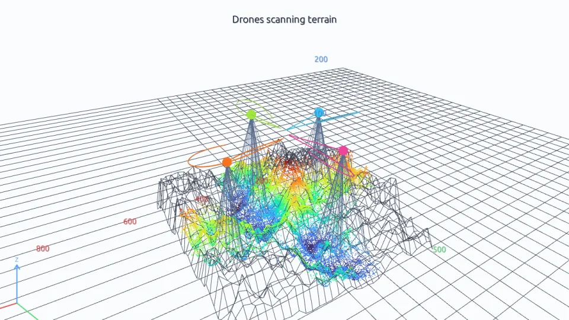

# Multi-drone SLAM: LIDAR mapping and pose-graph loop closure

[](https://runmat.com/sandbox?example=defense-multi-drone-slam)

Four drones fly over procedural mountain terrain that none of them has a map of. Each one scans
the ground with a spinning LIDAR, 4,608 rays per step marched against a 257 × 257 heightfield, and
adds the hits to a shared point-cloud map placed through its own drifting odometry. When a drone
returns within 15 m of mapped track it detects a loop closure, and one sparse least-squares solve
over every drone's pose history corrects all four trajectories. In the 180-step run, the solve at
step 156 cuts the mean position error from 12.3 m to 1.42 m and the map snaps back into alignment.

<picture>
  <source media="(prefers-color-scheme: dark)" srcset=".artifacts/thumbnail.webp">
  
</picture>

## The problem

A drone without GPS estimates its motion from inertial and visual odometry, and those estimates
drift. Points it maps are placed through that drifting pose, so the map smears. Simultaneous
localization and mapping (SLAM) corrects the drift by recognizing places seen before: a loop
closure says that two poses saw the same place, so their relative position is known. A pose graph
holds one node per pose and one edge per measurement (odometry between consecutive poses, closures
between distant ones), and a least-squares solve finds the poses that best agree with all of them.
With several drones, closures between different drones' tracks tie their graphs together, so a
correction found by one drone also straightens the others.

The project simulates the whole loop: terrain, true flight paths, drifting odometry, LIDAR ray
marching, place recognition, the pose-graph solve and a real-time 3D playback.

## How the example works

1. **Terrain.** `terrain/make_terrain.m` builds a 512 m square world on a 2 m grid from two
   diamond-square fractals, one smooth and one folded into ridges, blended and shaped into heights
   from 0 to 110 m:

   $$R = \bigl(1 - |2S - 1|\bigr)^{2.2}, \qquad H = 0.6\,B + 0.4\,R, \qquad h = 110\,H^{1.35}\ \text{m}$$

2. **Flight and drift.** `flight/fly_routes.m` flies each drone in 140-step petals from its launch
   pad, each petal turned 25° from the last so it covers new ground. `flight/make_odometry.m` adds
   a constant world-frame velocity bias of 0.07 to 0.08 m per step, a 0.5 % scale error, a yaw-rate
   bias and white noise, as uncorrected wind would:

   ```matlab
   ddx = diff(truth(:, :, 1), 1, 2) + biasWorld(:, 1);
   odo(:, 2:T, 1) = scaleErr .* fwd + 0.03 .* randn(D, T - 1);
   ```

   Integrated by `flight/dead_reckon.m`, a 0.08 m bias puts a drone about 12 m off after 150 steps.

3. **LIDAR ray marching.** Each drone carries 16 beams from -60° to -87° elevation at 72 azimuths.
   `sensors/cast_lidar.m` samples all 4,608 rays of a step at 2 m intervals out to 220 m, finds the
   first sample below the bilinear terrain with one `max` over a logical matrix, and refines the
   crossing linearly:

   ```matlab
   [anyHit, first] = max(gap < 0, [], 2);
   ```

   It keeps 55 hits per drone per step as map points, stored in the drone's body frame so they can
   be redrawn through any later pose estimate, and marks 2 m coverage cells as mapped.

4. **Loop closures.** `slam/detect_closures.m` compares each drone's position with every mapped
   pose: another drone's track at any age, or its own track at least 60 steps old. A match within
   15 m is a closure. It uses the true positions as a stand-in for a place-recognition front end,
   and each closure measures the true relative pose plus 0.25 m and 0.003 rad of noise. The first
   closure more than 60 steps after the previous solve opens an event, which is solved 22 steps
   later.

5. **The pose-graph solve.** `slam/solve_pose_graph.m` builds one sparse incidence matrix A over
   every pose of every drone, with a row per odometry edge, closure and launch anchor. It solves
   for headings first, then, with headings fixed, rotates each body-frame measurement into the
   world and solves for x and y with the same normal matrix:

   ```matlab
   yawOpt = (A' * (A .* wTh)) \ (A' * (wTh .* [oth; lth; TYaw(1, :)']));
   N = A' * (A .* wP);
   pxOpt = N \ (A' * (wP .* [bx; TX(1, :)']));
   ```

   Odometry edges carry σ = 0.05 m and 0.0008 rad; closures 0.30 m and 0.003 rad. The solve
   trusts odometry over short spans and closures over long ones, where odometry error has piled up.

6. **Playback.** `slam/slam_estimate.m` blends each new solve in over 12 steps, and
   `playback/slam_play.m` draws the map and each drone's position error at 15 steps per second,
   skipping frames when drawing falls behind so 180 steps always take 12 seconds.

## Results

```
terrain 257x257, 4 drones, 180 steps
rays cast 829440 (4608 per step, 110 march samples each), hits 812526
map points 39600
loop closures 40 in 1 events
event 1: opened step 134, solved step 156, 624 nodes, 651 edges (31 closures), mean error 12.3 m -> 1.42 m
coverage 53.9 % at the end
simulation time 49.7 s
```

Over 180 steps the drones cast 829,440 rays, 98 % of which hit the terrain, and keep 39,600 map
points. Before the solve, each drone's estimated path pulls away from its true path and the map
smears against the terrain wireframe. The event opened at step 134 solves at step 156 over
624 nodes and 651 edges, 31 of them closures, and the mean position error falls from 12.3 m to
1.42 m. The position-error panel shows all four curves dropping at the dotted "sync" line. By the
end of the run the drones have mapped 53.9 % of the world.

The Run button plays a saved copy of this run from `results/slam_run.mat`. The `main` entry point
checks a key computed from the step count and the text of every simulation file, and simulates
again only when the key no longer matches. The `simulate` entry point always simulates. Changes to
`graphics/` or `playback/` never need a new simulation.

## What to try

1. Set `steps` in `main/slam_settings.m` to 480. Each extra 140 steps adds one more correction
   event; the home-page video uses 480 steps.
2. Halve `closeRange` in `main/slam_config.m`. Fewer closures are detected, later; look at how much
   error builds up before the first solve.
3. Double `biasWorld` in `flight/make_odometry.m`. The error that builds up between corrections
   roughly doubles.
4. Change the closure noise in `slam/solve_pose_graph.m` and the edge sigmas to see how the balance
   between closures and odometry moves the corrected tracks.

## Files

- `runmat.toml`: the project file: package, the seven source folders and the `main` and `simulate` entry points.
- `runmat.lock`: the lock file.
- `main/multi_drone_slam.m`: entry point `main`: plays the saved run, simulating first when it no longer matches the code.
- `main/simulate_slam.m`: entry point `simulate`: simulates, saves and plays.
- `main/slam_settings.m`: step count, playback rate, frame rate, theme and text size.
- `main/slam_config.m`: all model parameters: world, drones, routes, place recognition, event timing, LIDAR fan and coverage grid.
- `main/slam_simulate.m`: runs the stages in order from `rng(20261103)`, prints progress and the run report.
- `terrain/make_terrain.m`: the diamond-square heightfield.
- `flight/fly_routes.m`, `flight/make_odometry.m`, `flight/dead_reckon.m`: true petal routes, drifting odometry, and its integration into poses.
- `sensors/cast_lidar.m`: ray marching, map points, drawn rays and coverage.
- `slam/detect_closures.m`, `slam/solve_pose_graph.m`, `slam/slam_estimate.m`: closures and events, the two-stage sparse solve, and the blended estimate shown at each step.
- `playback/slam_results.m`, `playback/slam_run_key.m`, `playback/slam_play.m`: load or simulate, the saved-run key, and real-time playback.
- `graphics/`: the playback figure (`slam_scene.m`, `slam_scene_step.m`, `slam_scene_finish.m`, `slam_map_title.m`), the from-scratch drawing used for the home-page video (`slam_draw.m`, `draw_sync_marks.m`), map points, ground grid, terrain wireframe and palettes.
- `results/slam_run.mat`: the saved run that `main` plays.

## Related

- [RunMat home page](https://runmat.com/), whose video is drawn by this project
- [Defense engineering in RunMat](https://runmat.com/industries/defense)
- [Tracking a turning target](../track-filter) and [range-Doppler map](../range-doppler)
- Function reference: [`sparse`](https://runmat.com/docs/reference/builtins/sparse), [`mldivide`](https://runmat.com/docs/reference/builtins/mldivide), [`scatter3`](https://runmat.com/docs/reference/builtins/scatter3), [`plot3`](https://runmat.com/docs/reference/builtins/plot3)
- [Download RunMat](https://runmat.com/download)
