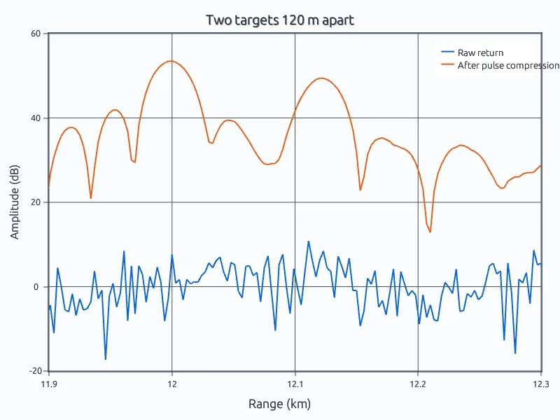

# Radar pulse compression with a matched filter: resolving two targets with an LFM chirp

[](https://runmat.com/sandbox?example=defense-pulse-compression)

This example transmits a 10 µs linear FM chirp with 5 MHz of bandwidth, receives echoes from two
targets 120 m apart near 12 km, and compresses the noisy return with a matched filter. In the raw
return the two 1.5 km-long echoes overlap and sit at the noise level. After compression the peaks
land at 12.000 and 12.123 km, and the compression gain is 26.8 dB against the 27.0 dB expected for
the 500 samples in the pulse.

<picture>
  <source media="(prefers-color-scheme: dark)" srcset=".artifacts/thumbnail.webp">
  
</picture>

## The problem

A radar wants long pulses for energy on target and short pulses for range resolution. Pulse
compression gets both: a long pulse whose frequency sweeps across bandwidth B is correlated with
a copy of itself on receive. The output collapses to a peak whose width corresponds to a range
resolution of

$$\Delta R = \frac{c}{2B}$$

which is 30 m for 5 MHz, while an uncompressed 10 µs pulse spans cτ/2 = 1.5 km. The matched filter
also gives the largest possible SNR gain, equal to the number of samples in the pulse when the
noise is white.

## How the example works

1. **Make the chirp**, sampled at 50 MHz:

   ```matlab
   pulse = exp(1i*pi*(B/T)*(t - T/2).^2);
   ```

2. **Place two echoes** at 12,000 m and 12,120 m with amplitudes 1 and 0.7 in a 16,384-sample
   record, and add complex noise of unit power.

3. **Apply the matched filter** as a product in the frequency domain:

   ```matlab
   y = ifft(fft(rx) .* conj(fft(pulse, n)));
   ```

4. **Measure** the two peak positions in the 11.9–12.3 km window, and compare the SNR after
   compression, using the noise passed through the same filter, with the input SNR.

## Results

```
peaks at 12.000 and 12.123 km, 123 m apart (resolution c/2B = 30 m)
compression gain 26.8 dB, against 27.0 dB expected for the 500 samples in the pulse
```

The raw return stays near 0 dB across the window; the targets cannot be seen in it. After
compression the two peaks stand more than 50 dB high and are cleanly separated, since 120 m is four
resolution cells. The peaks land 123 m apart because each range sample is c/(2 f_s) = 3 m and
the echo delays are rounded to whole samples. The chirp's range sidelobes are visible around each
peak; a taper on the reference pulse would lower them.

## What to try

1. Move the second target to `12040`, 40 m away, close to the 30 m resolution, and look at how the
   peaks merge.
2. Double the bandwidth to `B = 10e6`. The resolution becomes 15 m; the expected gain stays at
   27.0 dB, because the pulse still has 500 samples.
3. Multiply the reference by `hamming(numel(pulse))` in the matched filter and compare the
   sidelobes and the peak width.

## Files

- `pulse-compression.m`: the script: the chirp, the two echoes, the matched filter and the measurements.
- `runmat.toml`: the project file.

## Related

- [Defense engineering in RunMat](https://runmat.com/industries/defense)
- [Range-Doppler map](../range-doppler) and [CFAR detection](../cfar-detection)
- Function reference: [`fft`](https://runmat.com/docs/reference/builtins/fft), [`ifft`](https://runmat.com/docs/reference/builtins/ifft), [`conj`](https://runmat.com/docs/reference/builtins/conj)
- [Download RunMat](https://runmat.com/download)
