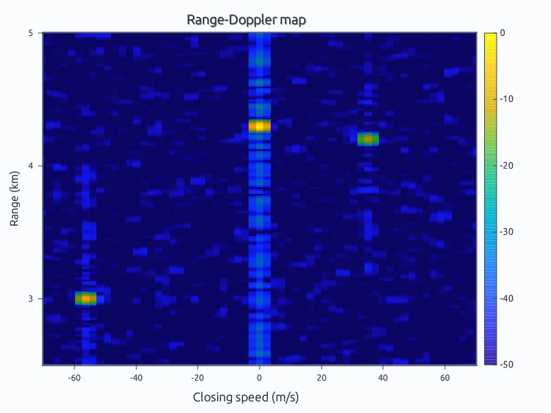

# Range-Doppler map of a pulse-Doppler radar: matched filter and Doppler FFT

[](https://runmat.com/sandbox?example=defense-range-doppler)

This example forms the range-Doppler map of an X-band pulse-Doppler radar from 64 pulses of a
10 µs, 5 MHz chirp at a 10 kHz pulse repetition frequency. The scene has ground clutter at zero
speed, a stationary target and two moving targets. Matched filtering in range and an FFT across
pulses separate them: the stationary target at 4.30 km, one target at 3.00 km opening at 56 m/s
and one at 4.20 km closing at 35 m/s.

<picture>
  <source media="(prefers-color-scheme: dark)" srcset=".artifacts/thumbnail.webp">
  
</picture>

## The problem

A ground-based or airborne radar sees strong returns from the ground at every range. A target
that moves can be pulled out of that clutter by its Doppler shift. Over a coherent burst of pulses,
a target with range rate v shifts its echo phase from pulse to pulse by 4πv/(λ·PRF). An FFT across
the pulses at each range cell turns that phase progression into a Doppler frequency
f_d = 2v/λ, which maps to speed. The result is a two-dimensional map in range and speed, the
input to moving-target detection.

For this radar, λ = 3 cm and the speed resolution is

$$\Delta v = \frac{\lambda}{2} \cdot \frac{\text{PRF}}{M} = 2.34 \text{ m/s}$$

with unambiguous speeds up to ±75 m/s and a range resolution of c/2B = 30 m.

## How the example works

1. **Build the data cube**: 1024 range samples by 64 pulses, with noise and the same clutter
   return on every pulse. Each target's echo moves in range and phase from pulse to pulse:

   ```matlab
   R = R0(q) + v(q) * (m - 1) / prf;
   X(idx, m) = X(idx, m) + amp(q) * pulse * exp(-1i*4*pi*R/lambda);
   ```

2. **Compress in range** with a Hamming-weighted matched filter applied to every pulse:

   ```matlab
   H = conj(fft(pulse .* hamming(numel(pulse)), nfast));
   Y = ifft(fft(X) .* repmat(H, 1, M));
   ```

3. **Transform across pulses** with a Hann window and center zero speed:

   ```matlab
   RD = fftshift(fft(Y .* repmat(hann(M)', nfast, 1), [], 2), 2);
   ```

4. **Display and measure.** Plot 2.5–5 km in dB, find the strongest cell, then the two strongest
   cells away from zero speed.

## Results

```
stationary target at 4.30 km, 0 m/s
moving targets: 3.00 km opening at 56 m/s, 4.20 km closing at 35 m/s
```

The map shows the clutter as a vertical stripe at zero speed through every range, with the
stationary target at 4.30 km as the brightest cell inside it. Without Doppler processing it would
be indistinguishable from a strong clutter patch. The two moving targets stand alone away from the
stripe, at -56 m/s and +35 m/s on the closing-speed axis. The closing target at 4.20 km is only
100 m from the stationary one in range, and their different speeds separate them clearly.

## What to try

1. Set the second target's speed to `-80` m/s, closing at 80 m/s. That exceeds the ±75 m/s
   unambiguous range, so it folds to -70 m/s on the closing-speed axis and looks like a target
   opening at 70 m/s.
2. Double the burst to `M = 128` pulses. The speed resolution halves to 1.17 m/s.
3. Replace `hann(M)` with `ones(M, 1)` and compare the Doppler sidelobes around the clutter stripe.

## Files

- `range-doppler.m`: the script: the data cube, range compression, the Doppler FFT, the map and the measurements.
- `runmat.toml`: the project file.

## Related

- [Defense engineering in RunMat](https://runmat.com/industries/defense)
- [Pulse compression](../pulse-compression) and [CFAR detection](../cfar-detection)
- Function reference: [`fft`](https://runmat.com/docs/reference/builtins/fft), [`fftshift`](https://runmat.com/docs/reference/builtins/fftshift), [`hann`](https://runmat.com/docs/reference/builtins/hann), [`imagesc`](https://runmat.com/docs/reference/builtins/imagesc)
- [Download RunMat](https://runmat.com/download)
