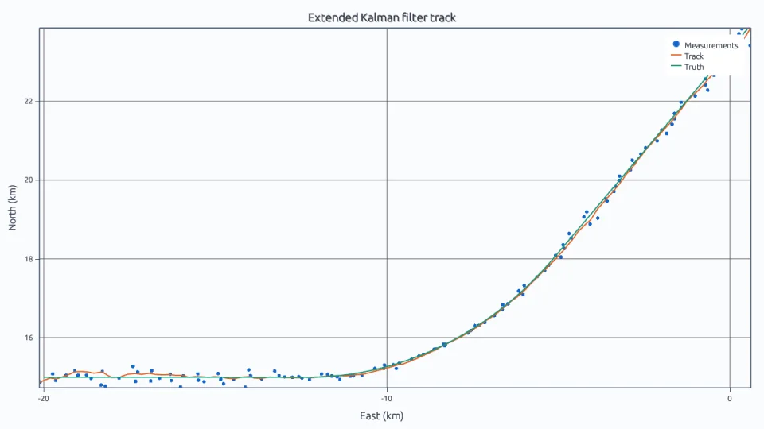

# Tracking a maneuvering target from radar range and bearing with an extended Kalman filter

[](https://runmat.com/sandbox?example=defense-track-filter)

This example tracks a target flying at 200 m/s through a straight leg, a 40-second turn at
0.02 rad/s and a second straight leg. A radar measures its range to 15 m and bearing to 0.5° once
a second, and an extended Kalman filter with a constant-velocity model estimates position and
velocity. After the first 10 seconds, the track's position error is 80 m RMS, against 172 m for
single measurements, and its velocity error is 11.4 m/s RMS.

<picture>
  <source media="(prefers-color-scheme: dark)" srcset=".artifacts/thumbnail.webp">
  
</picture>

## The problem

A surveillance radar reports each target as a range and a bearing. At 25 km, a 0.5° bearing error
alone is about 220 m across the line of sight, so single reports scatter widely. A tracking filter
combines successive reports with a motion model to estimate position and velocity more precisely
than any single report. The measurements are nonlinear in the Cartesian state x = [x, v_x, y, v_y]:

$$h(x) = \begin{bmatrix} \sqrt{x^2 + y^2} \\ \operatorname{atan2}(y, x) \end{bmatrix}$$

so the extended Kalman filter linearizes them at each step with their Jacobian. A
constant-velocity model treats any turn as random acceleration, with a process noise level q_a
that sets how quickly the filter follows a maneuver.

## How the example works

1. **Fly the truth.** The target starts at (-20 km, 15 km) heading east at 200 m/s and turns at
   0.02 rad/s from 40 to 80 seconds.

2. **Measure range and bearing** with Gaussian errors of 15 m and 0.5°:

   ```matlab
   rho_m = sqrt(truth(:,1).^2 + truth(:,3).^2) + sr*randn(n, 1);
   bearing_m = atan2(truth(:,3), truth(:,1)) + sb*randn(n, 1);
   ```

3. **Predict** with the constant-velocity model and q_a = 3 m/s² of process noise.

4. **Update** with the linearized measurement, wrapping the bearing innovation to ±π:

   ```matlab
   Hk = [x(1)/rho 0 x(3)/rho 0; -x(3)/rho^2 0 x(1)/rho^2 0];
   innov(2) = atan2(sin(innov(2)), cos(innov(2)));
   K = P * Hk' / S;
   x = x + K * innov;
   ```

5. **Score** position and velocity RMS errors from second 11 on, after the filter settles.

## Results

```
position error 172 m from single measurements, 80 m from the track
velocity error 11.4 m/s, through a 0.02 rad/s turn
```

The track follows the true path through the turn and cuts the position error by more than half
compared with converting each report to a position. The turn produces 200 × 0.02 = 4 m/s² of
lateral acceleration, more than the 3 m/s² process noise allows for, so the track lags slightly
through the turn; that lag contributes to the velocity error.

## What to try

1. Lower the process noise to `qa = 1`. The straight legs get smoother; look at how far the track
   falls behind in the turn.
2. Tighten the turn to `0.05` rad/s, 10 m/s² of lateral acceleration, and compare the errors.
3. Improve the bearing accuracy to `0.1` degrees and see how much of the position error was
   cross-range.

## Files

- `track-filter.m`: the script: truth trajectory, radar measurements, the extended Kalman filter and the scoring.
- `runmat.toml`: the project file.

## Related

- [Defense engineering in RunMat](https://runmat.com/industries/defense)
- [Range-Doppler map](../range-doppler) and [multi-drone SLAM](../multi-drone-slam)
- [Pitch from IMU data](../../aerospace/flight-attitude): a linear Kalman filter for attitude
- Function reference: [`atan2`](https://runmat.com/docs/reference/builtins/atan2), [`randn`](https://runmat.com/docs/reference/builtins/randn), [`eye`](https://runmat.com/docs/reference/builtins/eye)
- [Download RunMat](https://runmat.com/download)
