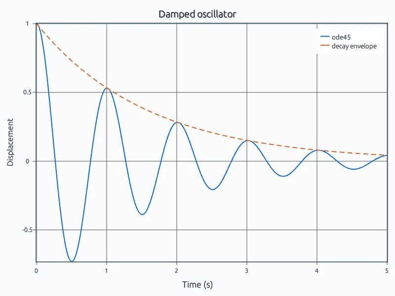

# Damped mass-spring oscillator solved with ode45 and checked against the closed form

[](https://runmat.com/sandbox?example=damped-oscillator)

This example solves the free vibration of an underdamped mass-spring system, with a 1 Hz natural
frequency and 10 % damping, using `ode45`, and compares the result with the exact solution. The
system rings at a damped frequency of 0.995 Hz, and the numerical solution differs from the closed
form by at most 4.0 × 10⁻⁹ over 5 s.

<picture>
  <source media="(prefers-color-scheme: dark)" srcset=".artifacts/thumbnail.webp">
  
</picture>

## The problem

The single-degree-of-freedom oscillator is the base model for structural vibration, suspension
response, instrument dynamics and RLC circuits. Written with natural frequency ωn and damping ratio
ζ, its free motion obeys

$$\ddot x + 2\zeta\omega_n \dot x + \omega_n^2 x = 0$$

For ζ < 1 the mass oscillates at the damped frequency ωd = ωn√(1 − ζ²) inside an envelope that
decays as e^(−ζωn t). Released from x = 1 at rest, the exact solution is

$$x(t) = e^{-\zeta\omega_n t}\left(\cos\omega_d t + \frac{\zeta\omega_n}{\omega_d}\sin\omega_d t\right)$$

Having a closed form makes this a good first check of a solver and its tolerance settings before
using it on a model that has none.

## How the example works

1. **Write the equation as a first-order system** in displacement and velocity:

   ```matlab
   wn = 2*pi;  zeta = 0.1;
   f = @(t, x) [x(2); -2*zeta*wn*x(2) - wn^2*x(1)];
   ```

2. **Solve over 5 s** from x = 1, v = 0 with tight tolerances:

   ```matlab
   opts = struct('RelTol', 1e-8, 'AbsTol', 1e-10);
   [t, x] = ode45(f, [0 5], [1; 0], opts);
   ```

3. **Evaluate the closed form** at the solver's time points and take the largest difference.

4. **Plot** the displacement with the decay envelope e^(−ζωn t).

## Results

```
Damping ratio 0.10, damped frequency 0.995 Hz
Largest difference from the closed form: 4.0e-09
```

10 % damping lowers the frequency by only 0.5 %, from 1 Hz to 0.995 Hz. Each peak is 0.532 times
the one before, and after 5 s the envelope has fallen to 0.043 of the initial displacement. In the
figure the positive peaks touch the dashed envelope once per cycle. The 4.0 × 10⁻⁹ error is set by
the tolerances: the solver meets them across all five cycles.

## What to try

1. Set `zeta = 1` for critical damping. The mass returns to zero without crossing it; the closed
   form in the script holds only for ζ < 1.
2. Loosen the tolerances to the defaults by dropping `opts`, and compare the largest difference.
3. Add a forcing term, `+ sin(wn*t)`, to the second row of `f` and watch the response build up at
   resonance.

## Files

- `damped-oscillator.m`: the script: equation, ode45 solve, closed-form check and the plot.
- `runmat.toml`: the project file.

## Related

- [Differential equations in RunMat](https://runmat.com/math/differential-equations)
- [Van der Pol, a stiff oscillator](../van-der-pol-stiff) and [spring-mass modes](../../linear-algebra/spring-mass-modes)
- Function reference: [`ode45`](https://runmat.com/docs/reference/builtins/ode45)
- [Download RunMat](https://runmat.com/download)
