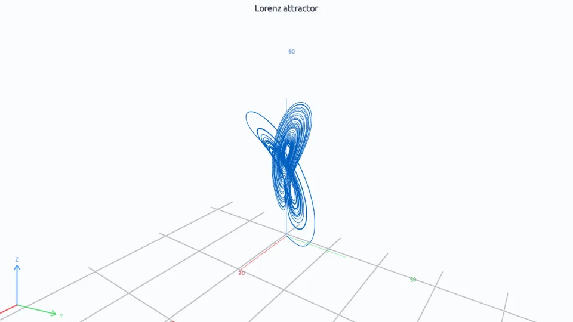

# Lorenz attractor: solve and draw a chaotic system in 3-D

[](https://runmat.com/sandbox?example=differential-equations-lorenz-attractor)

This example integrates the Lorenz system with its classic parameters, σ = 10, ρ = 28 and β = 8/3,
from the point (1, 1, 1). One script draws the trajectory live, one fourth-order Runge-Kutta step
at a time, for 2000 steps of 0.02. A second script solves the same system with `ode45` to t = 40 and
plots the result. The trajectory settles onto the two-lobed butterfly of the Lorenz attractor.

<picture>
  <source media="(prefers-color-scheme: dark)" srcset=".artifacts/thumbnail.webp">
  
</picture>

## The problem

Edward Lorenz derived these three equations in 1963 as a reduced model of convection in a fluid
layer heated from below:

$$\dot x = \sigma(y - x), \qquad \dot y = x(\rho - z) - y, \qquad \dot z = xy - \beta z$$

At ρ = 28 the system has no stable equilibrium and no periodic orbit. The trajectory loops around
one of two unstable fixed points, at (±√(β(ρ − 1)), ±√(β(ρ − 1)), ρ − 1) = (±8.49, ±8.49, 27),
then jumps to the other at irregular intervals. Two trajectories that start very close separate
exponentially, which is why long-range weather prediction has a horizon. The attractor is a
standard test for ODE solvers and for 3-D plotting.

## How the example works

1. **Define the right-hand side** as a function of the state vector:

   ```matlab
   sigma = 10;  rho = 28;  b = 8/3;
   f = @(u) [sigma*(u(2) - u(1)); u(1)*(rho - u(3)) - u(2); u(1)*u(2) - b*u(3)];
   ```

2. **Draw it live** (`lorenz-attractor-animate.m`): take one classic Runge-Kutta step, add the
   point to an animated line, and redraw every fifth step:

   ```matlab
   k1 = f(u);  k2 = f(u + dt/2*k1);  k3 = f(u + dt/2*k2);  k4 = f(u + dt*k3);
   u = u + dt/6*(k1 + 2*k2 + 2*k3 + k4);
   addpoints(h, u(1), u(2), u(3));
   ```

3. **Solve it in one call** (`lorenz-attractor-ode.m`) with `ode45`, reporting the solution every
   5 ms to t = 40, and draw it with `plot3`:

   ```matlab
   [t, u] = ode45(f, 0:0.005:40, [1; 1; 1]);
   plot3(u(:, 1), u(:, 2), u(:, 3), 'LineWidth', 1);
   ```

## Results

Both scripts trace the same shape: two lobes, centered on the fixed points at z = 27, joined where
the trajectory switches sides. The live version shows the switching as it happens; the trajectory
circles one lobe a varying number of times before crossing. Because the system is chaotic, the
fixed-step Runge-Kutta path and the adaptive `ode45` path agree only for the first part of the run.
After that they follow different routes over the same attractor.

## What to try

1. Start from `[1; 1; 1.0001]` in the `ode45` script and plot `u(:, 1)` against `t` for both runs
   to see where they separate.
2. Set `rho = 14`. Both fixed points become stable, and the trajectory spirals into one of them.
3. Halve `dt` in the animation and compare how long the path matches the larger step.

## Files

- `lorenz-attractor-animate.m`: the entry script: Runge-Kutta steps drawn live with an animated line.
- `lorenz-attractor-ode.m`: the same system solved with ode45 and plotted at the end.
- `runmat.toml`: the project file.

## Related

- [Differential equations in RunMat](https://runmat.com/math/differential-equations)
- [Predator and prey](../predator-prey) and [animated line plots](../../plotting/animated-line)
- Function reference: [`ode45`](https://runmat.com/docs/reference/builtins/ode45), [`plot3`](https://runmat.com/docs/reference/builtins/plot3), [`animatedline`](https://runmat.com/docs/reference/builtins/animatedline), [`addpoints`](https://runmat.com/docs/reference/builtins/addpoints)
- [Download RunMat](https://runmat.com/download)
