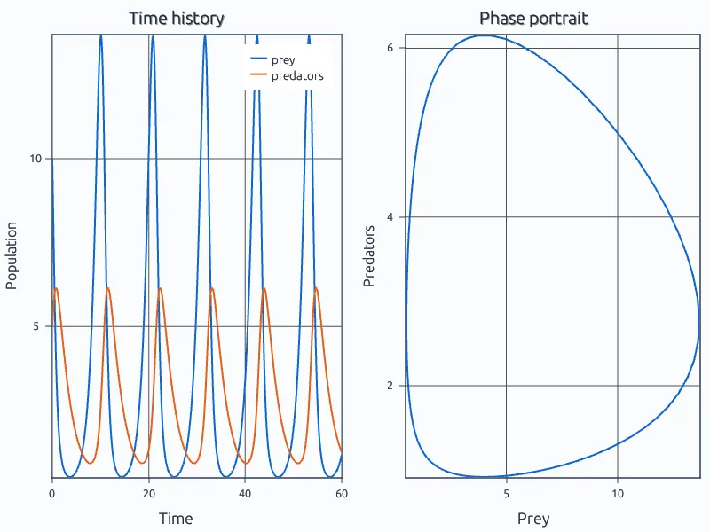

# Lotka-Volterra predator-prey model: populations and phase-plane orbit

[](https://runmat.com/sandbox?example=differential-equations-predator-prey)

This example solves the Lotka-Volterra equations for a prey population starting at 10 and a
predator population starting at 5, over 60 time units. The populations cycle: prey between 0.51
and 13.68, predators between 0.92 and 6.16. In the phase plane the solution traces one closed orbit
over and over, which `ode45` holds to a relative tolerance of 10⁻⁸ in 1840 steps.

<picture>
  <source media="(prefers-color-scheme: dark)" srcset=".artifacts/thumbnail.webp">
  
</picture>

## The problem

The Lotka-Volterra model is the classic pair of coupled nonlinear ODEs. Prey x grow at rate α and
are eaten at a rate proportional to encounters with predators; predators y grow from those
encounters and die at rate γ:

$$\dot x = \alpha x - \beta x y, \qquad \dot y = \delta x y - \gamma y$$

The system has an equilibrium at x* = γ/δ, y* = α/β, here 4 prey and 2.75 predators. Away from it,
the quantity V = δx − γ ln x + βy − α ln y stays constant along every solution, so each solution is
a closed orbit around the equilibrium. That makes the model a good test of a solver: any drift off
the orbit is numerical error. The same structure, two coupled rates with a conserved quantity,
appears in chemical kinetics and in some control and economics models.

## How the example works

1. **Define the rates**:

   ```matlab
   alpha = 1.1;  beta = 0.4;
   delta = 0.1;  gamma = 0.4;
   f = @(t, s) [alpha*s(1) - beta*s(1)*s(2); delta*s(1)*s(2) - gamma*s(2)];
   ```

2. **Solve to t = 60** with tight tolerances, starting from 10 prey and 5 predators:

   ```matlab
   opts = struct('RelTol', 1e-8, 'AbsTol', 1e-10);
   [t, s] = ode45(f, [0 60], [10; 5], opts);
   ```

3. **Report** the step count and each population's range.

4. **Plot** both populations against time, and predators against prey.

## Results

```
ode45: 1840 steps at RelTol 1e-8
Prey 0.51 to 13.68, predators 0.92 to 6.16
```

The time history shows about five and a half cycles in 60 time units. Each prey peak comes first
and each predator peak follows it, as the predators grow on the abundant prey and then eat it down.
The prey swing is much larger than the predator swing, and the prey spend long stretches near 0.51
between sharp peaks. In the phase portrait the trajectory retraces a single closed loop with no
visible spiral in or out. The orbit's period is longer than 2π/√(αγ) = 9.47, the small-oscillation
period around the equilibrium, because this orbit swings far from it.

## What to try

1. Start at the equilibrium, `[4; 2.75]`, and check that both populations stay constant.
2. Compute `V = delta*s(:,1) - gamma*log(s(:,1)) + beta*s(:,2) - alpha*log(s(:,2))` and plot its
   drift with the default tolerances and with `opts`.
3. Add a carrying capacity to the prey, `alpha*s(1)*(1 - s(1)/50)`, and watch the orbit spiral
   inward.

## Files

- `predator-prey.m`: the script: rates, ode45 solve, population ranges and the two plots.
- `runmat.toml`: the project file.

## Related

- [Differential equations in RunMat](https://runmat.com/math/differential-equations)
- [SIR epidemic model](../sir-epidemic) and [Lorenz attractor](../lorenz-attractor)
- Function reference: [`ode45`](https://runmat.com/docs/reference/builtins/ode45), [`subplot`](https://runmat.com/docs/reference/builtins/subplot)
- [Download RunMat](https://runmat.com/download)
