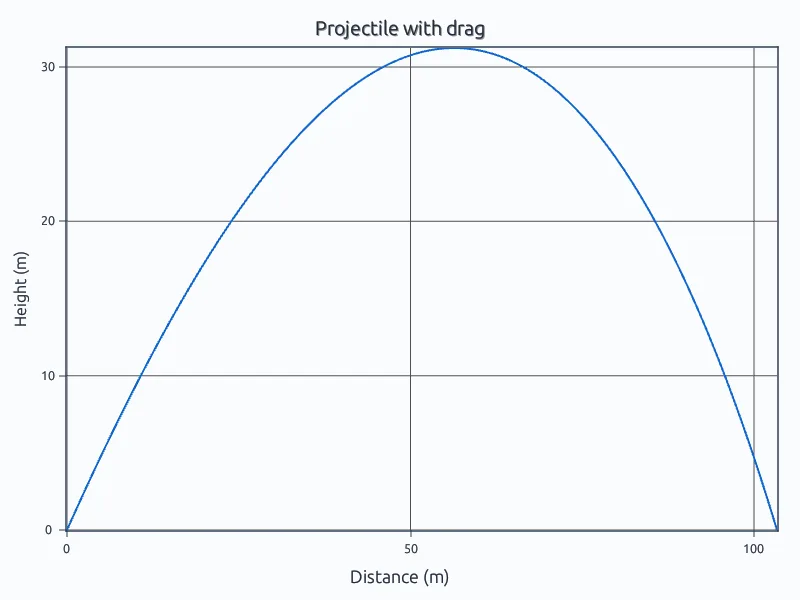

# Projectile range with quadratic air drag

[](https://runmat.com/sandbox?example=differential-equations-projectile-drag)

This example computes the flight of a projectile launched at 40 m/s and 45° with quadratic air
drag. It integrates the equations of motion with `ode45` and finds the landing point by
interpolating where the height crosses zero. Drag cuts the range to 103.3 m from the 163.1 m of
the drag-free parabola, and the flight lasts 5.03 s.

<picture>
  <source media="(prefers-color-scheme: dark)" srcset=".artifacts/thumbnail.webp">
  
</picture>

## The problem

Without drag, a projectile follows a parabola and its range has the closed form v₀² sin 2θ / g.
At practical speeds, air drag grows with the square of speed and the closed form no longer applies.
Ballistics, sports-ball flight, drop testing and debris analysis all need the drag model.

With drag per unit mass k (in 1/m), the equations of motion are

$$\ddot x = -k\,|v|\,\dot x, \qquad \ddot y = -g - k\,|v|\,\dot y$$

which couple the horizontal and vertical motion through the speed |v|. Here k = 0.005 m⁻¹, which
gives a terminal velocity √(g/k) = 44.3 m/s, close to the launch speed. A second numerical task is
the landing: the solver reports the state at fixed times, and the ground crossing falls between two
of them.

## How the example works

1. **Write the state** as position and velocity, [x; y; vx; vy]:

   ```matlab
   f = @(t, s) [s(3); s(4); -k*sqrt(s(3)^2 + s(4)^2)*s(3); -g - k*sqrt(s(3)^2 + s(4)^2)*s(4)];
   ```

2. **Solve on a 10 ms grid** for 10 s, longer than the flight:

   ```matlab
   [t, s] = ode45(f, 0:0.01:10, [0; 0; v0*cos(angle); v0*sin(angle)]);
   ```

3. **Find the landing** between the last point above ground and the first below, by linear
   interpolation in height:

   ```matlab
   i = find(s(:, 2) < 0, 1);
   range = interp1(s([i i-1], 2), s([i i-1], 1), 0);
   ```

4. **Plot** the path up to the landing point.

## Results

```
Range with drag: 103.3 m (no drag: 163.1 m)
Flight time: 5.03 s
```

Drag removes 37 % of the range. The drag-free flight would last 5.77 s and peak at 40.8 m; with
drag, the path peaks near 31 m. In the figure the path is no longer symmetric: the descent is
steeper than the climb and the apex sits past the halfway point, because the projectile has lost
horizontal speed by the time it comes down.

## What to try

1. Find the launch angle for the longest range by looping over angles from 30° to 50°. With drag,
   the best angle is below 45°.
2. Set `k = 0` and check that the script reproduces the 163.1 m drag-free range.
3. Double the launch speed to 80 m/s and compare how much range drag removes at the higher speed.

## Files

- `projectile-drag.m`: the script: equations of motion, ode45 solve, ground crossing and the plot.
- `runmat.toml`: the project file.

## Related

- [Differential equations in RunMat](https://runmat.com/math/differential-equations)
- [Damped oscillator](../damped-oscillator) and [trapz against integral](../trapz-vs-integral)
- Function reference: [`ode45`](https://runmat.com/docs/reference/builtins/ode45), [`interp1`](https://runmat.com/docs/reference/builtins/interp1), [`find`](https://runmat.com/docs/reference/builtins/find)
- [Download RunMat](https://runmat.com/download)
