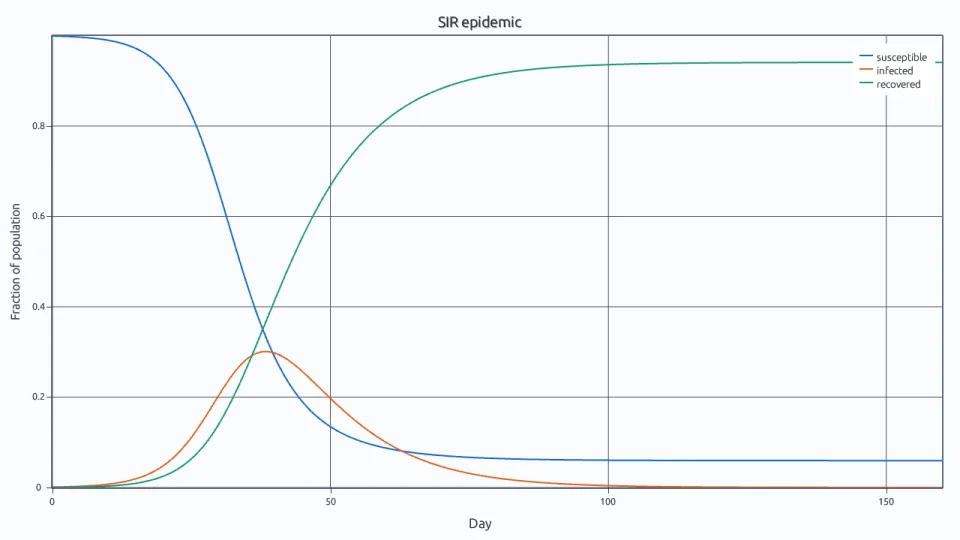

# SIR epidemic model: peak infection and final size

[](https://runmat.com/sandbox?example=differential-equations-sir-epidemic)

This example solves the SIR epidemic model for a contact rate of 0.3 per day and a recovery rate of
0.1 per day, starting with 0.1 % of the population infected. Infections peak at 30.1 % of the
population on day 38. When the epidemic has run its course, 5.9 % of the population has never been
infected.

<picture>
  <source media="(prefers-color-scheme: dark)" srcset=".artifacts/thumbnail.webp">
  
</picture>

## The problem

The SIR model splits a population into susceptible S, infected I and recovered R fractions.
Susceptible people are infected at a rate proportional to contacts with infected people, and
infected people recover at a fixed rate:

$$\dot S = -\beta S I, \qquad \dot I = \beta S I - \gamma I, \qquad \dot R = \gamma I$$

The basic reproduction number R₀ = β/γ, here 3, is the number of people one case infects in a fully
susceptible population. Infections grow while S > 1/R₀ and fall once S drops below it, so the peak
comes when one third of the population is still susceptible. The same equations, with other names,
describe the spread of faults through a network, rumors, and some chemical chain reactions.

## How the example works

1. **Define the three rates** with β = 0.3 and γ = 0.1 per day:

   ```matlab
   f = @(t, y) [-beta*y(1)*y(2); beta*y(1)*y(2) - gamma*y(2); gamma*y(2)];
   ```

2. **Solve for 160 days**, reporting the solution twice a day:

   ```matlab
   [t, y] = ode45(f, 0:0.5:160, [0.999; 0.001; 0]);
   ```

3. **Find the peak** of the infected fraction and read the susceptible fraction at day 160:

   ```matlab
   [peak, k] = max(y(:, 2));
   ```

4. **Plot** all three fractions against time.

## Results

```
Peak: 30.1% infected on day 38
Never infected: 5.9% of the population
```

Both numbers agree with the model's closed-form results. The peak fraction is
I_max = 1 − (1 + ln R₀)/R₀ = 30.0 % for a population that starts fully susceptible, and the final
susceptible fraction solves s∞ = s₀ e^(−R₀(1 − s∞)), giving 5.9 %. In the figure, the susceptible and
recovered curves cross near the infection peak. By day 100 the infected fraction is near zero and
the other two have leveled off.

## What to try

1. Lower the contact rate to `beta = 0.2`, so R₀ = 2. The peak formula gives 15.3 % infected.
2. Set `beta = 0.09`, below `gamma`. R₀ is under 1, and the infection dies out from the start.
3. Start with 30 % already recovered, `[0.699; 0.001; 0.3]`, and compare the peak.

## Files

- `sir-epidemic.m`: the script: rates, ode45 solve, peak and final size, and the plot.
- `runmat.toml`: the project file.

## Related

- [Differential equations in RunMat](https://runmat.com/math/differential-equations)
- [Predator and prey](../predator-prey) and [Van der Pol, a stiff problem](../van-der-pol-stiff)
- Function reference: [`ode45`](https://runmat.com/docs/reference/builtins/ode45), [`max`](https://runmat.com/docs/reference/builtins/max)
- [Download RunMat](https://runmat.com/download)
