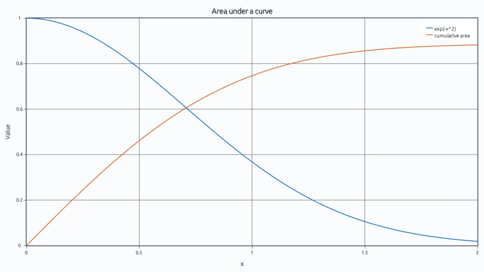

# Area under a curve: adaptive quadrature against the trapezoid rule

[](https://runmat.com/sandbox?example=differential-equations-trapz-vs-integral)

This example computes the area under e^(−x²) from 0 to 2 two ways and compares each with the exact
value, (√π/2) erf(2) = 0.882081. Adaptive quadrature with `integral` matches it to within rounding,
an error of 0.0e+00 at the printed precision. The trapezoid rule on 101 evenly spaced points is off
by 2.4 × 10⁻⁶. The figure shows the function and its running area from `cumtrapz`.

<picture>
  <source media="(prefers-color-scheme: dark)" srcset=".artifacts/thumbnail.webp">
  
</picture>

## The problem

Engineering integrals come in two forms. Some have a formula for the integrand: energy from a power
curve, a moment of a load distribution, a probability from a density. Others have only samples: a
logged force to integrate into impulse, an acceleration record to integrate into velocity.

The tool differs. `integral` takes a function, evaluates it wherever it needs to, and refines
adaptively until an error estimate meets its tolerance. `trapz` takes samples and joins them with
straight lines. Its error for spacing h is about

$$E \approx \frac{h^2}{12}\big[f'(a) - f'(b)\big]$$

so it falls as h²: halving the spacing cuts the error by four. `cumtrapz` returns the running
integral at every sample instead of just the total.

## How the example works

1. **Define the function and the exact area**:

   ```matlab
   f = @(x) exp(-x.^2);
   exact = sqrt(pi)/2 * erf(2);
   ```

2. **Integrate adaptively**:

   ```matlab
   q = integral(f, 0, 2);
   ```

3. **Integrate samples** on a 0.02 spacing, 101 points:

   ```matlab
   x = 0:0.02:2;
   area = trapz(x, f(x));
   ```

4. **Plot** the function and its cumulative area:

   ```matlab
   plot(x, cumtrapz(x, f(x)));
   ```

## Results

```
integral: error 0.0e+00
trapz, 101 points: error 2.4e-06
```

The trapezoid error matches the formula: with h = 0.02, f′(0) = 0 and f′(2) = −4e⁻⁴, the estimate
is 2.44 × 10⁻⁶. In the figure the cumulative area rises steeply where e^(−x²) is large, near
x = 0, and levels off toward 0.882 as the function decays.

## What to try

1. Halve the spacing to `0:0.01:2`. The formula gives an error of 6.1 × 10⁻⁷.
2. Integrate to infinity with `integral(f, 0, Inf)` and compare with √π/2.
3. Integrate an acceleration record twice with `cumtrapz` to get displacement, and look at how
   the error grows.

## Files

- `trapz-vs-integral.m`: the script: exact value, integral, trapz and the cumulative-area plot.
- `runmat.toml`: the project file.

## Related

- [Differential equations in RunMat](https://runmat.com/math/differential-equations)
- [Projectile with drag](../projectile-drag) and [damped oscillator](../damped-oscillator)
- Function reference: [`integral`](https://runmat.com/docs/reference/builtins/integral), [`trapz`](https://runmat.com/docs/reference/builtins/trapz), [`cumtrapz`](https://runmat.com/docs/reference/builtins/cumtrapz)
- [Download RunMat](https://runmat.com/download)
