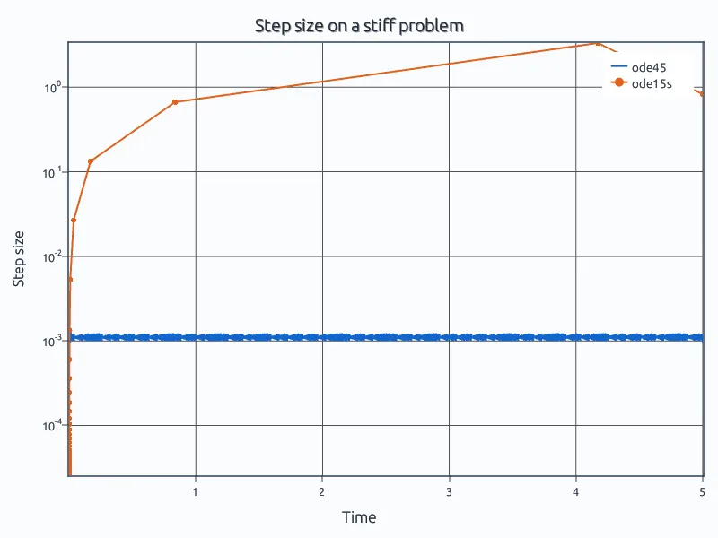

# Stiff ODEs: ode45 against ode15s on the Van der Pol oscillator

[](https://runmat.com/sandbox?example=differential-equations-van-der-pol-stiff)

This example solves the Van der Pol equation with μ = 1000 from t = 0 to 5, once with the explicit
solver `ode45` and once with the stiff solver `ode15s`, and plots the step size each one takes.
`ode45` needs 18104 steps; `ode15s` needs 31.

<picture>
  <source media="(prefers-color-scheme: dark)" srcset=".artifacts/thumbnail.webp">
  
</picture>

## The problem

A system is stiff when it contains dynamics on very different time scales, and the fast ones have
already died out. Chemical kinetics, circuit simulation with small parasitic capacitances, and
thermal networks with thin layers are common examples. An explicit solver must keep its step small
enough to stay stable on the fastest time scale, even when the solution itself changes slowly. An
implicit solver for stiff problems stays stable at large steps, so its step follows the accuracy
the solution needs.

The Van der Pol oscillator is the standard test:

$$\ddot y - \mu (1 - y^2)\,\dot y + y = 0$$

For large μ the solution creeps slowly for long stretches and then jumps quickly. At μ = 1000 the
slow phase lasts longer than this 5-second run, so the solution stays on the slow branch
throughout.

## How the example works

1. **Write the equation as a first-order system**:

   ```matlab
   mu = 1000;
   f = @(t, y) [y(2); mu*(1 - y(1)^2)*y(2) - y(1)];
   ```

2. **Solve with both solvers** from y = 2, ẏ = 0, at default tolerances:

   ```matlab
   [t1, y1] = ode45(f, [0 5], [2; 0]);
   [t2, y2] = ode15s(f, [0 5], [2; 0]);
   ```

3. **Count the steps** and plot each step size, `diff(t)`, on a log axis.

## Results

```
ode45 (explicit): 18104 steps
ode15s (stiff): 31 steps
```

`ode45` takes 584 times as many steps. In the figure its step size sits flat at about
2.8 × 10⁻⁴ for the whole run, 5/18104 on average: that ceiling is its stability limit, not an
accuracy requirement. `ode15s` starts with tiny steps through the initial transient, then grows
its step by more than three orders of magnitude, to around 1 by the end, because the solution is
smooth and slow.

## What to try

1. Set `mu = 1`. The problem is no longer stiff, and the two solvers take comparable step counts.
2. Extend the run to `[0 3000]` with `ode15s` and plot `y2(:, 1)` to see the slow creep and the
   fast jumps of the relaxation oscillation.
3. Time both solvers with `tic` and `toc` at μ = 1000.

## Files

- `van-der-pol-stiff.m`: the script: Van der Pol equation, both solvers, step counts and the step-size plot.
- `runmat.toml`: the project file.

## Related

- [Differential equations in RunMat](https://runmat.com/math/differential-equations)
- [Damped oscillator](../damped-oscillator) and [Lorenz attractor](../lorenz-attractor)
- Function reference: [`ode15s`](https://runmat.com/docs/reference/builtins/ode15s), [`ode45`](https://runmat.com/docs/reference/builtins/ode45), [`semilogy`](https://runmat.com/docs/reference/builtins/semilogy)
- [Download RunMat](https://runmat.com/download)
