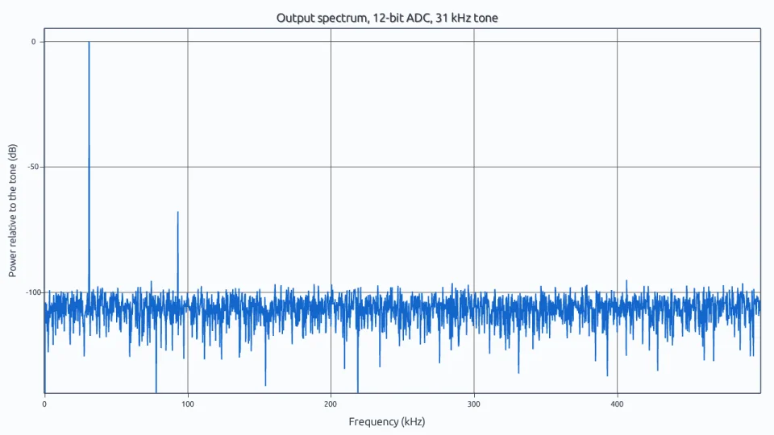

# ADC characterization from a sine test: SINAD, ENOB and SFDR from one FFT

[](https://runmat.com/sandbox?example=electronics-semiconductors-adc-enob)

This example characterizes a 12-bit analog-to-digital converter sampling at 1 MS/s from a
coherently sampled 31 kHz sine, in the style of IEEE 1241. One FFT of 4096 output codes gives the
signal-to-noise-and-distortion ratio (SINAD) of 66.2 dB, an effective number of bits (ENOB) of
10.70, and a spurious-free dynamic range (SFDR) of 67.8 dB set by the third harmonic.

<picture>
  <source media="(prefers-color-scheme: dark)" srcset=".artifacts/thumbnail.webp">
  
</picture>

## The problem

A converter's datasheet resolution is the number of output bits; its useful resolution is lower,
because noise and distortion add to the quantization error. The standard sine-wave test drives the
converter with a pure tone near full scale and analyzes the output spectrum:

- **SINAD** is the tone power over the power of everything else, noise and harmonics together.
- **ENOB** converts SINAD into the resolution of an ideal converter with the same SINAD:

  $$\text{ENOB} = \frac{\text{SINAD} - 1.76}{6.02}$$

- **SFDR** is the tone power over the largest single spur.

Coherent sampling puts a whole number of sine cycles in the record (here 127 cycles in 4096
samples, with 127 prime), so the tone falls exactly on one FFT bin and no window is needed.

## How the example works

1. **Capture the codes.** `adc_capture`, a local function at the end of the file, feeds a sine at
   0.97 of full scale with a small third harmonic and input noise into a 12-bit quantizer:

   ```matlab
   v = 0.97*sin(2*pi*f0*t) + 0.0004*sin(2*pi*3*f0*t) + 0.00012*randn(N, 1);
   codes = round((v + 1) / 2 * 4095);
   ```

2. **Take the one-sided power spectrum** of the codes with the mean removed:

   ```matlab
   X = abs(fft(codes - mean(codes))) / (N/2);
   P = X(1:N/2).^2;
   ```

3. **Split signal from the rest.** The tone sits in bin 128; everything except that bin and DC is
   noise plus distortion:

   ```matlab
   signal = P(k);
   rest = sum(P) - signal - P(1);
   sinad = 10*log10(signal / rest);
   ```

4. **Find the largest spur** for SFDR, and plot the spectrum relative to the tone.

## Results

```
SINAD 66.2 dB, ENOB 10.70 bits
SFDR 67.8 dB
```

An ideal 12-bit converter reaches 6.02 × 12 + 1.76 = 74.0 dB SINAD, so this one gives up about
1.3 bits to noise and distortion. The spectrum shows the tone at 31.0 kHz, its third harmonic
at 93.0 kHz about 68 dB down, and a flat noise floor near -100 dB per bin. The floor sits that far
below the SINAD because the noise power is spread across 2048 bins, a processing gain of 33 dB.

## What to try

1. Remove the third harmonic by setting `0.0004` to `0`. The largest spur is then a noise bin;
   compare the new SFDR and how much SINAD recovers.
2. Set `cycles = 128`. 4096 / 128 = 32, so the record samples the same 32 phases of the sine over
   and over; look at how the noise floor and the spurs change.
3. Raise the input noise from `0.00012` to `0.0005` and read the ENOB.

## Files

- `adc-enob.m`: the script: the FFT analysis, the plot, and the `adc_capture` data function.
- `runmat.toml`: the project file.

## Related

- [Electronics and semiconductors in RunMat](https://runmat.com/industries/electronics-semiconductors)
- [RC low-pass filter](../rc-filter) and [wafer map yield](../wafer-map)
- Function reference: [`fft`](https://runmat.com/docs/reference/builtins/fft), [`round`](https://runmat.com/docs/reference/builtins/round), [`plot`](https://runmat.com/docs/reference/builtins/plot)
- [Download RunMat](https://runmat.com/download)
