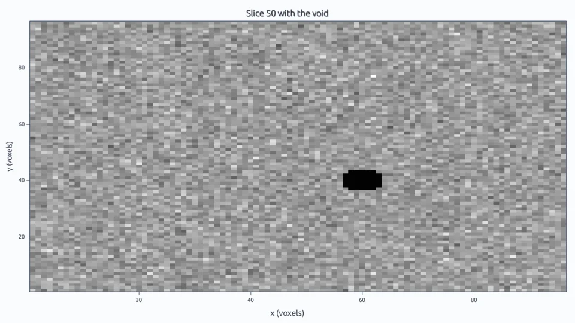

# Finding voids in a CT scan of a potted electronics module

[](https://runmat.com/sandbox?example=electronics-semiconductors-ct-void)

This example searches a computed tomography (CT) volume of a potted module, 96 slices of 96 × 96
voxels, for voids: voxels much less dense than the potting compound. A density threshold finds 278
void voxels across 10 slices. The largest void is centered at voxel (60, 40, 50) and holds 251 of
them.

<picture>
  <source media="(prefers-color-scheme: dark)" srcset=".artifacts/thumbnail.webp">
  
</picture>

## The problem

Potting compound protects electronics from vibration, moisture and arcing, but trapped air leaves
voids. A void next to a high-voltage conductor can start partial discharge; one under a power
device leaves a hot spot. Industrial CT measures density in three dimensions without cutting the
part open, so voids show up as low-density regions. The inspection task is to find them, measure
their size and locate them, so they can be compared against an acceptance limit and traced back
to the potting process.

## How the example works

1. **Build the volume.** Potting density 0.8 with 0.05 of noise, plus two spherical voids at
   density 0.1: one of radius 4 voxels and one of radius 2:

   ```matlab
   V = 0.8 + 0.05*randn(N, N, N);
   V(((X - 60).^2 + (Y - 40).^2 + (Z - 50).^2) < 4^2) = 0.1;
   ```

2. **Threshold.** Any voxel below 0.4, halfway between void and potting, is a void voxel:
   `mask = V < 0.4;`

3. **Locate the voxels.** `find` and `ind2sub` turn the mask into row, column and slice indices:

   ```matlab
   [r, c, p] = ind2sub(size(mask), find(mask));
   ```

4. **Measure the large void.** Select the voxels near it, count them, and average their
   coordinates for its center. `unique(p)` counts the slices that contain any void.

5. **Show slice 50**, through the center of the large void, in grayscale.

## Results

```
278 void voxels found in 10 slices
largest void centered at (60, 40, 50), 251 voxels
```

The threshold sits eight noise standard deviations below the potting density, so no potting voxel
is flagged. The large void spans 7 slices and the small one 3, for 10 slices in all; the small
void holds the remaining 27 voxels. The slice image shows the large void as a black disc in
uniform gray potting.

## What to try

1. Raise the noise from `0.05` to `0.15`. The threshold is then under three standard deviations
   from the potting, so look for isolated false void voxels.
2. Look at slice 20 with `imagesc(V(:, :, 20), [0 1])` to see the small void.
3. Multiply the voxel count by your scanner's voxel volume to report void volume in mm³.

## Files

- `ct-void.m`: the script: the synthetic CT volume, the threshold, the void measurements and the slice image.
- `runmat.toml`: the project file.

## Related

- [Electronics and semiconductors in RunMat](https://runmat.com/industries/electronics-semiconductors)
- [Wafer map yield](../wafer-map) and [wafer bow](../wafer-bow)
- Function reference: [`ind2sub`](https://runmat.com/docs/reference/builtins/ind2sub), [`meshgrid`](https://runmat.com/docs/reference/builtins/meshgrid), [`imagesc`](https://runmat.com/docs/reference/builtins/imagesc)
- [Download RunMat](https://runmat.com/download)
