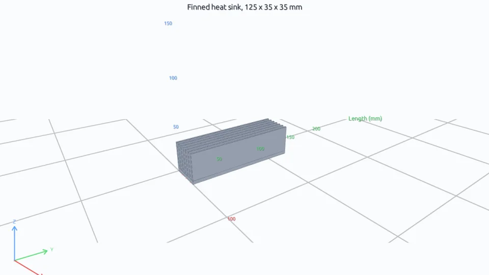

# Sizing a finned heat sink by hand: fin efficiency and thermal resistance

[](https://runmat.com/sandbox?example=electronics-semiconductors-heatsink-hand)

This example sizes a 125 × 35 × 35 mm aluminum heat sink with seven 2 mm fins by hand. The fin
equation gives a fin efficiency of 94 %, and the convection area gives a thermal resistance of
0.51 K/W from the base to air at a convection coefficient of 35 W/m²K. A 10 W device raises the
base 5.1 K above ambient. The script also draws the heat sink to scale.

<picture>
  <source media="(prefers-color-scheme: dark)" srcset=".artifacts/thumbnail.webp">
  
</picture>

## The problem

Before running a thermal simulation, an engineer sizes the heat sink by hand to know what answer
to expect. Fins add area, but heat has to conduct along each fin, so the fin tip runs cooler than
its root and the added area is less effective than the base. The fin efficiency η measures that,
for a straight fin of thickness t, height L_f and conductivity k:

$$m = \sqrt{\frac{2h}{k\,t}}, \qquad \eta = \frac{\tanh(m L_f)}{m L_f}$$

The heat sink's resistance to air combines the exposed base area and the fin area weighted by η:

$$R = \frac{1}{h\,(A_{base} + \eta A_{fin})}, \qquad \Delta T = Q R$$

## How the example works

1. **Set the geometry and materials.** Seven fins 2 mm thick on a 4 mm base, aluminum at
   k = 160 W/m·K, natural-to-light forced convection at h = 35 W/m²K, and 10 W of heat:

   ```matlab
   nfin = 7;  t = 0.002;  base = 0.004;
   k = 160;  h = 35;  Q = 10;
   ```

2. **Compute the fin efficiency** for the 31 mm fin height:

   ```matlab
   m = sqrt(2*h / (k*t));
   eta = tanh(m*Lf) / (m*Lf);
   ```

3. **Add up the areas.** Both faces and the tip of every fin, and the base area between the fins
   plus the base edges:

   ```matlab
   Afin = nfin * (2*Lf*L + t*L);
   R = 1 / (h*(Abase + eta*Afin));
   ```

4. **Draw the heat sink** as eight boxes, the base and seven fins, with `patch`.

## Results

```
fin efficiency 94%, thermal resistance 0.51 K/W to air
10 W raises the base 5.1 K above ambient
```

At 94 % efficiency the fins are short and thick enough that nearly all their area works at base
temperature; the fins provide 0.056 m² of the 0.060 m² total area. The 0.51 K/W result is the base
of a thermal budget: add the device's junction-to-case resistance and the interface to get the
junction temperature, as in the [junction temperature](../junction-temperature) example.

## What to try

1. Add a fan by raising `h` to `70`. Fin efficiency falls to 88 %, and the resistance drops to
   0.27 K/W, 2.7 K of rise at 10 W.
2. Make the fins thinner with `t = 0.001`. The fin efficiency drops; check whether the extra space
   is worth more fins.
3. Change the fin count `nfin` and look at the resistance. This hand calculation leaves out the
   reduced airflow between closely spaced fins.

## Files

- `heatsink-hand.m`: the script: fin efficiency, thermal resistance, the temperature rise and the 3D drawing.
- `runmat.toml`: the project file.

## Related

- [Electronics and semiconductors in RunMat](https://runmat.com/industries/electronics-semiconductors)
- [Junction temperature](../junction-temperature) and [pin-fin heat sink convection](../../fea/pin-fin-convection)
- Function reference: [`tanh`](https://runmat.com/docs/reference/builtins/tanh), [`patch`](https://runmat.com/docs/reference/builtins/patch), [`view`](https://runmat.com/docs/reference/builtins/view)
- [Download RunMat](https://runmat.com/download)
