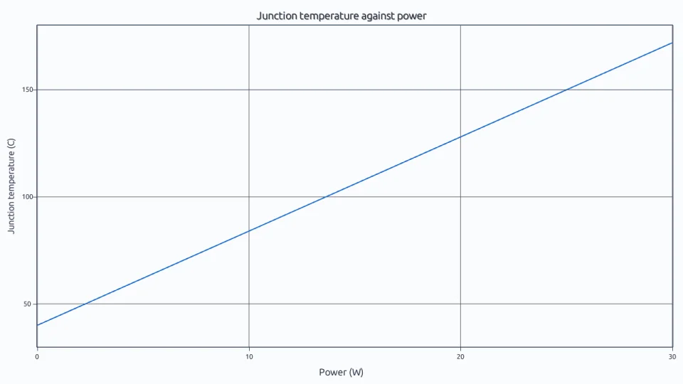

# Junction temperature of a power device through its thermal resistance chain

[](https://runmat.com/sandbox?example=electronics-semiconductors-junction-temperature)

This example computes the junction temperature of a power semiconductor from 0 to 30 W of
dissipation, through three thermal resistances in series: junction to case, the thermal interface
and the heat sink. At 40 °C ambient and 4.4 K/W in total, the junction runs at 84 °C at 10 W and
reaches its 150 °C limit at 25.0 W.

<picture>
  <source media="(prefers-color-scheme: dark)" srcset=".artifacts/thumbnail.webp">
  
</picture>

## The problem

A MOSFET, IGBT or regulator has a maximum junction temperature, often 150 °C or 175 °C, and its
life shortens quickly as it approaches that limit. In steady state, heat flows from the junction
to ambient through a chain of thermal resistances, and each one adds a temperature rise
proportional to the power:

$$T_j = T_a + P \, (R_{jc} + R_{cs} + R_{sa})$$

The datasheet gives R_jc, the interface material gives R_cs, and the heat sink gives R_sa. The
chain answers two design questions: how hot the junction runs at the operating power, and how much
power the device can dissipate before it reaches the limit:

$$P_{max} = \frac{T_{max} - T_a}{\sum R}$$

## How the example works

1. **Set the chain**: 1.5 K/W junction to case, 0.5 K/W through the interface, 2.4 K/W for the heat
   sink, at 40 °C ambient against a 150 °C limit:

   ```matlab
   R = [1.5 0.5 2.4];
   Ta = 40;  Tmax = 150;
   ```

2. **Sweep the power** from 0 to 30 W and compute the junction temperature and the power limit:

   ```matlab
   Tj = Ta + P * sum(R);
   Pmax = (Tmax - Ta) / sum(R);
   ```

3. **Plot** the junction temperature with the 150 °C limit as a horizontal line from `yline`.

## Results

```
junction temperature 84 C at 10 W, 4.4 K/W in total
the device reaches 150 C at 25.0 W
```

The junction temperature rises in a straight line at 4.4 K per watt and crosses 150 °C at 25.0 W.
The heat sink is the largest resistance in the chain, so it is the first place to look for margin.

## What to try

1. Use a heat sink of 1.2 K/W. The total falls to 3.2 K/W, the junction runs at 72 °C at 10 W, and
   the power limit rises to 34.4 W.
2. Raise the ambient to `Ta = 55`, as inside an enclosure. The power limit falls to 21.6 W.
3. Take the heat sink resistance from the [hand-sized heat sink](../heatsink-hand), 0.51 K/W, in
   place of `2.4`.

## Files

- `junction-temperature.m`: the script: the resistance chain, the power limit and the plot.
- `runmat.toml`: the project file.

## Related

- [Electronics and semiconductors in RunMat](https://runmat.com/industries/electronics-semiconductors)
- [Heat sink sized by hand](../heatsink-hand) and [chip cold plate power step](../../fea/chip-cold-plate-power-step)
- Function reference: [`linspace`](https://runmat.com/docs/reference/builtins/linspace), [`yline`](https://runmat.com/docs/reference/builtins/yline), [`plot`](https://runmat.com/docs/reference/builtins/plot)
- [Download RunMat](https://runmat.com/download)
