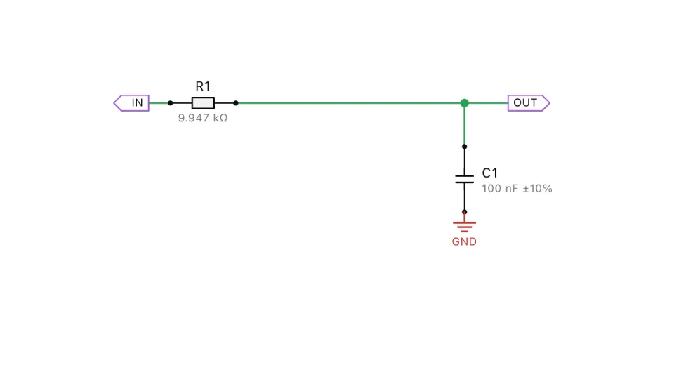

# RC low-pass filter with its resistor sized by a .m function

[](https://runmat.com/sandbox?example=electronics-rc-filter)

`lowpass.circuit` is a first-order RC low-pass filter whose resistor value is computed, not typed.
The component line calls `rcResistor.m` with the corner frequency and the capacitor, and the
function returns R = 1 / (2π · fc · C): 9.947 kΩ for a 160 Hz corner with 100 nF. The
schematic, the bill of materials and the AC simulation all read that value, and the simulation
checks the measured corner against a 150–170 Hz spec.

<picture>
  <source media="(prefers-color-scheme: dark)" srcset=".artifacts/thumbnail.webp">
  
</picture>

## The problem

An RC low-pass filter passes signals below its corner frequency and attenuates those above it at
20 dB per decade. The corner, where the output is 3 dB below the input, is

$$f_c = \frac{1}{2 \pi R C}$$

In practice you pick a standard capacitor and solve for R. When the resistor is a number typed into
a schematic, the design intent (the corner) lives only in someone's notes, and a change to C or
fc means recomputing R by hand. Here the circuit states the corner, and the resistor follows from it.

## How the example works

1. **The sizing function.** `rcResistor.m` is an ordinary function. Arguments arrive in SI units
   (Hz, F) and the result is in ohms:

   ```matlab
   function r = rcResistor(fc, c)
   r = 1 / (2 * pi * fc * c);
   end
   ```

2. **The component calls it.** R1's value is the function call, with units on each argument and
   the result read as ohms:

   ```circuit
   component R1 = { part = "R0402-10K", value = rcResistor(fc = 160 Hz, c = 100 nF) as ohm }
   ```

3. **The schematic.** Input port IN, R1 in series, C1 to ground, output port OUT.

4. **The simulation.** The `corner` simulation drives IN with a 1 V AC source, sweeps 1 Hz to
   100 kHz, and measures the -3 dB bandwidth at OUT against its spec:

   ```circuit
   measure f3db = { of = response, bandwidth = net.OUT, spec = { min = 150 Hz, max = 170 Hz } }
   ```

## Results

R1 evaluates to 9.947 kΩ, as the schematic shows under R1. The `f3db` measure reads a corner of about 160 Hz and passes its
150–170 Hz spec.

## What to try

1. Open `lowpass.circuit` and select R1. Properties shows the computed value, the function and
   the file it came from.
2. Run the `corner` simulation and read the `f3db` measure.
3. Change `fc = 160 Hz` to `fc = 1 kHz`. R1 recomputes to about 1.59 kΩ. Re-run `corner`: the
   corner moves to 1 kHz, and the measure fails its 150–170 Hz spec until you widen it.
4. Change `c = 100 nF` to `c = 1 uF`. R1 drops to about 995 Ω, and the corner stays at 160 Hz.

## Files

- `lowpass.circuit`: the schematic (IN, R1, C1, OUT) and the `corner` simulation.
- `rcResistor.m`: the sizing function.
- `runmat.toml`: the project file.

## Related

- [Electronics and semiconductors in RunMat](https://runmat.com/industries/electronics-semiconductors)
- [RunMat ECAD](https://runmat.com/pcb-design)
- [Junction temperature](../junction-temperature) and [ADC characterization](../adc-enob)
- [Download RunMat](https://runmat.com/download)
