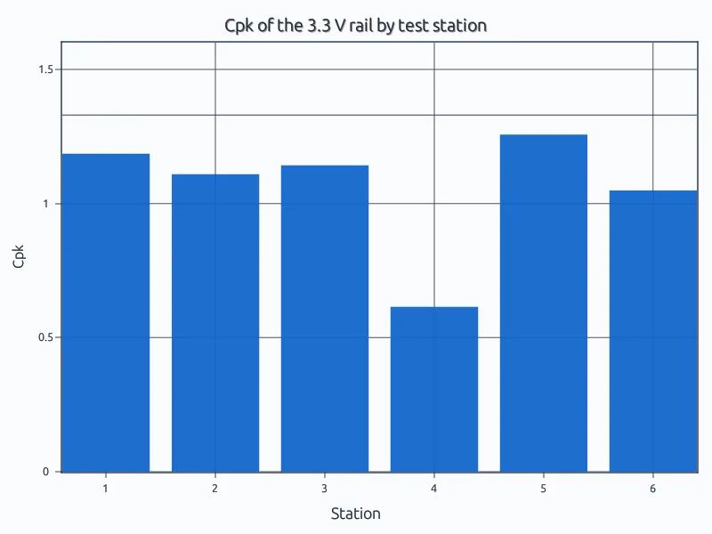

# Process capability (Cpk) by test station: finding the station that reads high

[](https://runmat.com/sandbox?example=electronics-semiconductors-station-cpk)

This example computes the process capability index Cpk of one production test, a 3.30 V supply
rail with limits of 3.15 to 3.45 V, separately for each of six test stations, from 400
measurements per station. Station 4 has a Cpk of 0.57 while the other stations range from 0.94 to
1.24, and it reads 71 mV higher than the mean of the rest.

<picture>
  <source media="(prefers-color-scheme: dark)" srcset=".artifacts/thumbnail.webp">
  
</picture>

## The problem

Cpk measures how well a process fits inside its specification limits, accounting for both spread
and centering:

$$C_{pk} = \min\left(\frac{USL - \mu}{3\sigma}, \frac{\mu - LSL}{3\sigma}\right)$$

A common target is 1.33, which leaves four standard deviations between the mean and the nearer
limit. In electronics manufacturing the same test often runs on several stations in parallel.
A station with a calibration offset shifts every reading it takes, which lowers its Cpk and can
fail good boards or pass bad ones. Computing Cpk per station, instead of across the pooled data,
separates a station problem from a product problem.

## How the example works

1. **Make the measurements.** 2400 readings with 40 mV of spread; each station has its own
   offset, and station 4's is 80 mV:

   ```matlab
   offset = [0 0.02 -0.01 0.08 0 0.03]';
   volts = 3.30 + offset(station) + 0.04*randn(numel(station), 1);
   T = table(station, volts, 'VariableNames', {'station', 'volts'});
   ```

2. **Group by station** with `accumarray` for each station's mean and standard deviation:

   ```matlab
   mu = accumarray(T.station, T.volts, [], @mean);
   sd = accumarray(T.station, T.volts, [], @std);
   ```

3. **Compute Cpk** against both limits and take the smaller side:

   ```matlab
   cpk = min((USL - mu) ./ (3*sd), (mu - LSL) ./ (3*sd));
   ```

4. **Plot** the six values as bars with the 1.33 target as a line.

## Results

```
station 4 has Cpk 0.57; the other stations range 0.94 to 1.24
station 4 reads 71 mV high against the mean of the rest
```

The bar chart shows station 4 at less than half the Cpk of the best stations. Its readings sit
71 mV above the others, close to the 80 mV offset it was given, which leaves only about 70 mV to
the upper limit. No station reaches 1.33: even a perfectly centered station with 40 mV of spread
has a Cpk of 0.15 / 0.12 = 1.25. Recalibrating station 4 fixes the outlier; reaching 1.33 needs
the spread itself below 0.15 / (3 × 1.33) = 37.6 mV.

## What to try

1. Set station 4's offset to `0` and check that its Cpk joins the others.
2. Reduce the spread from `0.04` to `0.03`. A centered station then reaches 0.15 / 0.09 = 1.67.
3. Replace the synthetic readings with a CSV from your test system: read it with `readtable` and
   keep the `station` and `volts` columns.

## Files

- `station-cpk.m`: the script: the readings, Cpk per station and the bar chart.
- `runmat.toml`: the project file.

## Related

- [Electronics and semiconductors in RunMat](https://runmat.com/industries/electronics-semiconductors)
- [Wafer map yield](../wafer-map) and [X-bar control chart](../../industrial-machinery/xbar-chart)
- Function reference: [`accumarray`](https://runmat.com/docs/reference/builtins/accumarray), [`table`](https://runmat.com/docs/reference/builtins/table), [`bar`](https://runmat.com/docs/reference/builtins/bar)
- [Download RunMat](https://runmat.com/download)
