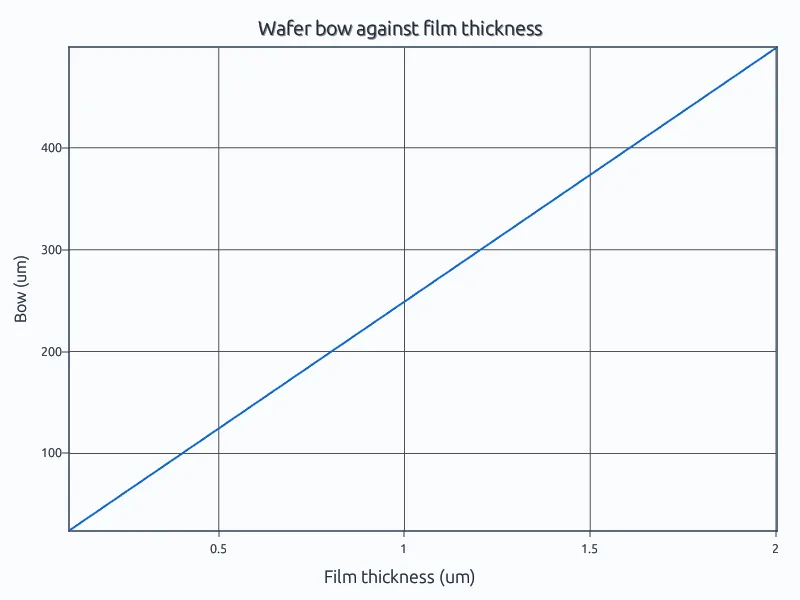

# Wafer bow from thin-film stress with Stoney's equation

[](https://runmat.com/sandbox?example=electronics-semiconductors-wafer-bow)

This example computes the bow of a 300 mm, 775 µm silicon wafer carrying a tensile film at
400 MPa, for film thicknesses from 0.1 to 2 µm, with Stoney's equation. A 1 µm film bends the wafer
to a 45 m radius of curvature, which is 249 µm of bow across the wafer.

<picture>
  <source media="(prefers-color-scheme: dark)" srcset=".artifacts/thumbnail.webp">
  
</picture>

## The problem

Deposited films such as silicon nitride, oxides and metals carry residual stress, and a stressed
film bends the wafer under it. Too much bow and the wafer won't chuck flat in a lithography tool or
will crack in handling, so fabs keep each film's stress and thickness inside a bow budget. The
reverse also holds: measuring the curvature change after deposition is the standard way to measure
film stress. Stoney's equation links the two for a film much thinner than the substrate:

$$\kappa = \frac{6\,\sigma_f\,t_f\,(1 - \nu_s)}{E_s\,t_s^2}$$

where σ_f and t_f are the film stress and thickness, and E_s, ν_s and t_s the substrate's modulus,
Poisson's ratio and thickness. Over a wafer of diameter D, the bow (the sagitta) is κD²/8.

## How the example works

1. **Set the substrate and the film**: silicon at E = 130 GPa and ν = 0.28, a 775 µm, 300 mm wafer,
   and 400 MPa of tensile film stress:

   ```matlab
   E = 130e9;  nu = 0.28;  ts = 775e-6;  D = 0.300;
   sigma = 400e6;
   ```

2. **Apply Stoney's equation** over 60 film thicknesses, then convert curvature to bow:

   ```matlab
   kappa = 6 * sigma * tf * (1 - nu) / (E * ts^2);
   bow = kappa * D^2 / 8;
   ```

3. **Read off the 1 µm values** with `interp1` and plot bow against thickness.

## Results

```
a 1 um film at 400 MPa bows the wafer 249 um
radius of curvature 45 m at 1 um
```

Bow grows linearly with film thickness, so the plot is a straight line from the origin to 498 µm at
2 µm of film. A wafer 45 m in radius looks flat to the eye, yet its center sits a quarter of a
millimeter off the plane of its edge. Bow also grows with the square of the diameter and falls with
the square of the substrate thickness.

## What to try

1. Thin the wafer to `ts = 500e-6`. The bow grows by (775/500)² = 2.40, to 598 µm at 1 µm of film.
2. Use a 200 mm wafer with `D = 0.200`, at 725 µm thickness. Look at how much smaller the bow is.
3. Set `sigma = -400e6` for a compressive film; the wafer bows the other way by the same amount.

## Files

- `wafer-bow.m`: the script: Stoney's equation over film thickness, the 1 µm values and the plot.
- `runmat.toml`: the project file.

## Related

- [Electronics and semiconductors in RunMat](https://runmat.com/industries/electronics-semiconductors)
- [Wafer map yield](../wafer-map) and [CT void inspection](../ct-void)
- Function reference: [`linspace`](https://runmat.com/docs/reference/builtins/linspace), [`interp1`](https://runmat.com/docs/reference/builtins/interp1), [`plot`](https://runmat.com/docs/reference/builtins/plot)
- [Download RunMat](https://runmat.com/download)
