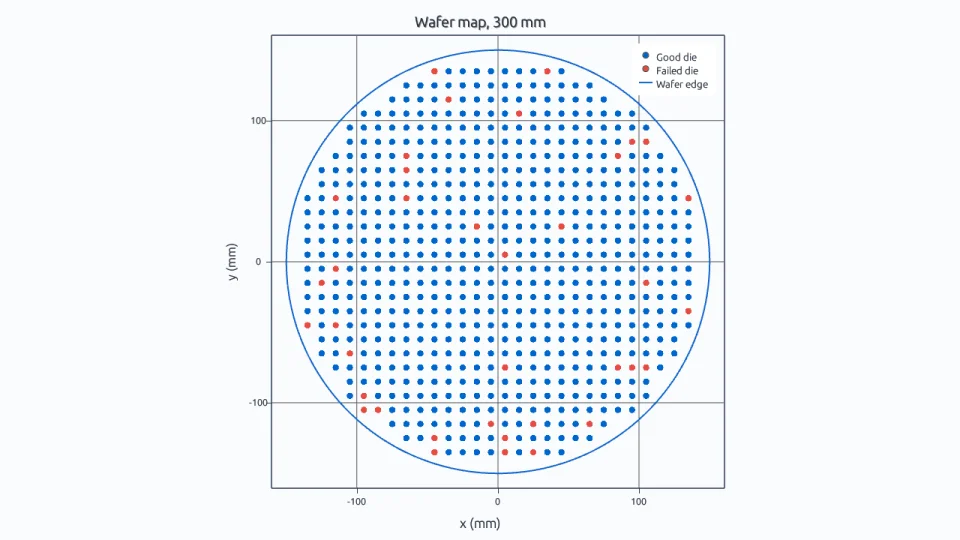

# Wafer map and radial die yield with a Poisson defect model

[](https://runmat.com/sandbox?example=electronics-semiconductors-wafer-map)

This example lays out 640 dies of 10 × 10 mm on a 300 mm wafer, draws each die's pass or fail from
a defect density that rises toward the wafer edge, and computes yield by radial zone. Overall
yield is 94.2 %: 98.3 % inside half the radius against 87.1 % in the outer ring.

<picture>
  <source media="(prefers-color-scheme: dark)" srcset=".artifacts/thumbnail.webp">
  
</picture>

## The problem

Wafer sort tests every die and records pass or fail at its position. The wafer map shows where the
failures cluster, which points to the process step behind them: edge-heavy loss often comes from
film thickness, etch or handling at the wafer rim. Yield engineers split the wafer into radial
zones to put a number on that pattern.

With randomly scattered defects, the chance that a die has none follows the Poisson model

$$Y = e^{-D}$$

where D is the expected number of killer defects per die. Here D rises steeply with the normalized
radius r: D = 0.02 + 0.25 r⁶, so the center has an expected yield of e^-0.02 = 98.0 % and a die at
the very edge e^-0.27 = 76.3 %.

## How the example works

1. **Place the dies** on a 10 mm grid and keep the ones that fit inside the 150 mm radius:

   ```matlab
   [cx, cy] = meshgrid(-145:pitch:145, -145:pitch:145);
   on = sqrt(cx.^2 + cy.^2) + pitch*0.7 < radius;
   ```

2. **Set each die's defect density** from its radius, and draw pass or fail:

   ```matlab
   density = 0.02 + 0.25*rr.^6;
   good = rand(numel(x), 1) < exp(-density);
   ```

3. **Compute the yields**: overall, inside r < 0.5, and in the ring r > 0.85.

4. **Draw the map**: good dies, failed dies and the wafer edge, on equal axes.

## Results

```
640 dies, yield 94.2%
center yield 98.3%, outer ring 87.1%
```

The map shows failed dies scattered thinly across the center and gathering in the outer rows.
The center yield of 98.3 % matches the 98.0 % the model gives at r = 0, within the scatter of a few
hundred dies. The outer ring, the last 22 mm of radius, loses about one die in eight.

## What to try

1. Remove the edge effect by setting `0.25` to `0`. Every die then has the same 98.0 % expected
   yield.
2. Use 20 × 20 mm dies with `pitch = 20`. Fewer dies fit, and a larger die collects more defects:
   scale the density by the die area to model that.
3. Change `rng(6)` to see how much the zone yields move between wafers with the same process.

## Files

- `wafer-map.m`: the script: die layout, the defect model, the zone yields and the map.
- `runmat.toml`: the project file.

## Related

- [Electronics and semiconductors in RunMat](https://runmat.com/industries/electronics-semiconductors)
- [Wafer bow from film stress](../wafer-bow) and [Cpk by test station](../station-cpk)
- Function reference: [`meshgrid`](https://runmat.com/docs/reference/builtins/meshgrid), [`rand`](https://runmat.com/docs/reference/builtins/rand), [`scatter`](https://runmat.com/docs/reference/builtins/scatter)
- [Download RunMat](https://runmat.com/download)
