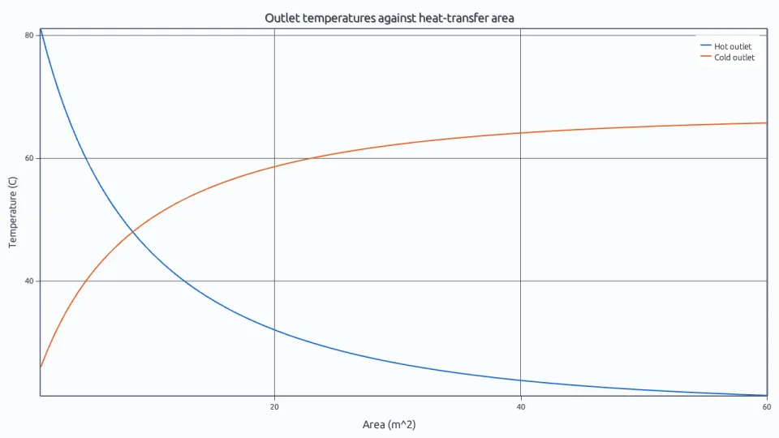

# Sizing a counterflow heat exchanger with the effectiveness-NTU method

[](https://runmat.com/sandbox?example=heat-exchanger)

This example sizes a water-to-water counterflow heat exchanger: hot water enters at 90 °C and
2 kg/s, cold water at 20 °C and 3 kg/s, with an overall heat-transfer coefficient of 1200 W/m²K.
The effectiveness-NTU method gives both outlet temperatures for areas from 1 to 60 m². Heating the
cold stream to 55 °C takes 14.5 m²; at 60 m² the exchanger transfers 574 kW and the hot side
leaves at 21.4 °C.

<picture>
  <source media="(prefers-color-scheme: dark)" srcset=".artifacts/thumbnail.webp">
  
</picture>

## The problem

Sizing a heat exchanger means choosing the area that meets an outlet temperature. When the outlet
temperatures are unknown, the log-mean temperature difference method needs iteration; the
effectiveness-NTU method gives them directly. With heat capacity rates C = ṁ c_p, the number of
transfer units and the capacity ratio are

$$NTU = \frac{UA}{C_{min}}, \qquad C_r = \frac{C_{min}}{C_{max}}$$

and for counterflow the effectiveness, the fraction of the largest possible heat transfer, is

$$\varepsilon = \frac{1 - e^{-NTU(1 - C_r)}}{1 - C_r\,e^{-NTU(1 - C_r)}}, \qquad q = \varepsilon\,C_{min}\,(T_{h,in} - T_{c,in})$$

Here the hot stream is C_min = 8360 W/K, the cold stream 12,540 W/K, and C_r = 0.667.

## How the example works

1. **Set the streams** and compute the capacity rates:

   ```matlab
   cp = 4180;  Ch = 2*cp;  Cc = 3*cp;  U = 1200;  Thi = 90;  Tci = 20;
   Cmin = min(Ch, Cc);  Cr = Cmin / max(Ch, Cc);
   ```

2. **Sweep the area** in 0.5 m² steps and compute effectiveness, duty and both outlets:

   ```matlab
   NTU = U * area / Cmin;
   eff = (1 - exp(-NTU*(1 - Cr))) ./ (1 - Cr*exp(-NTU*(1 - Cr)));
   q = eff * Cmin * (Thi - Tci);
   Tho = Thi - q/Ch;  Tco = Tci + q/Cc;
   ```

3. **Solve for the area** that brings the cold outlet to 55 °C with `fzero` on the interpolated
   curve:

   ```matlab
   need = fzero(@(a) interp1(area, Tco, a) - 55, 20);
   ```

4. **Plot** both outlet temperatures against area.

## Results

```
cold side reaches 55 C with 14.5 m^2 of area
at 60 m^2: 574 kW, hot side out at 21.4 C
```

Heating the cold stream to 55 °C needs 438.9 kW (12,540 W/K × 35 K), an effectiveness of 0.75.
Beyond that the curves flatten: the hot stream, with the smaller capacity rate, can cool at most to
20 °C, so the duty cannot exceed 8360 × 70 = 585 kW and the cold outlet cannot exceed 66.7 °C.
Quadrupling the area from 14.5 to 60 m² adds only about 135 kW.

## What to try

1. Raise the cold flow to 6 kg/s with `Cc = 6*cp`. C_r falls to 0.333, and the cold outlet ceiling
   drops to 20 + 585 / 25.08 = 43.3 °C, so 55 °C is no longer reachable at any area.
2. Halve `U` to 600, as fouling would. The area needed for 55 °C doubles, because NTU depends on
   the product UA.
3. Replace the counterflow effectiveness with the parallel-flow form
   `(1 - exp(-NTU*(1 + Cr))) / (1 + Cr)` and compare the curves.

## Files

- `heat-exchanger.m`: the script: effectiveness-NTU over area, the area for 55 °C and the plot.
- `runmat.toml`: the project file.

## Related

- [Energy engineering in RunMat](https://runmat.com/industries/energy)
- [Load-duration curve](../load-duration) and [heated tube Nusselt number](../../fea/heated-tube-nusselt)
- Function reference: [`fzero`](https://runmat.com/docs/reference/builtins/fzero), [`interp1`](https://runmat.com/docs/reference/builtins/interp1), [`exp`](https://runmat.com/docs/reference/builtins/exp)
- [Download RunMat](https://runmat.com/download)
