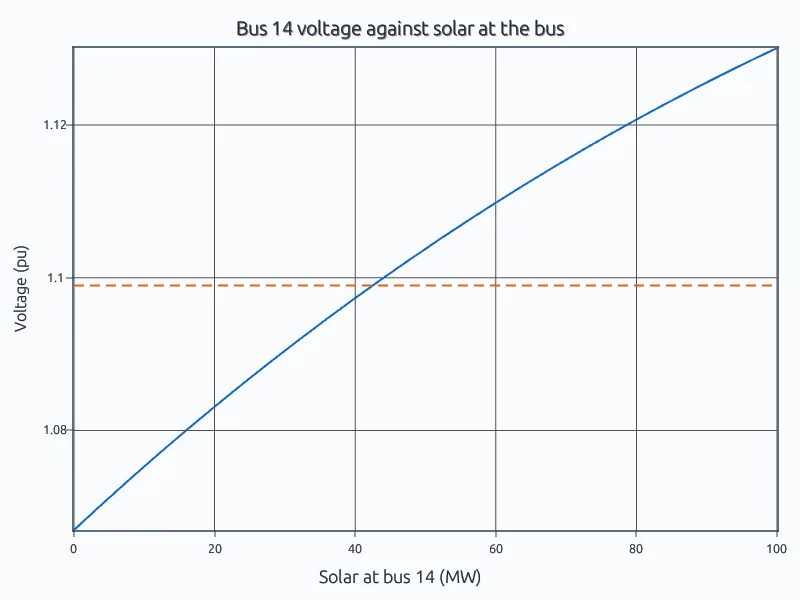

# Solar hosting capacity of a bus from repeated power flows

[](https://runmat.com/sandbox?example=energy-hosting-capacity)

This example finds how much solar generation bus 14 of the IEEE 14-bus system can take at light
load before its voltage rises 3 % above its no-solar level, a common planning limit. At 40 % load
with no solar, bus 14 sits at 1.067 pu, so the limit is 1.099 pu. A Newton-Raphson power flow run
at every 4 MW step from 0 to 100 MW shows that the bus takes 40 MW of solar before passing the limit.

<picture>
  <source media="(prefers-color-scheme: dark)" srcset=".artifacts/thumbnail.webp">
  
</picture>

## The problem

Generation connected far out on a network pushes current back toward the source, and the voltage
at the connection point rises. The worst case is at light load, when little local demand absorbs
the injected power. Utilities screen new solar and wind connections by their hosting capacity: the
largest generation a bus can take before a limit is passed. Voltage rise is usually the first
limit at the far end of a radial feeder. Here the limit is a 3 % rise over the bus voltage with no
solar, at 40 % of the case's base load.

## How the example works

1. **Load the IEEE 14-bus case** and scale every load to 40 %:

   ```matlab
   light = bus;
   light(:, 4:5) = bus(:, 4:5) * 0.4;
   ```

2. **Sweep the solar** at bus 14 from 0 to 100 MW in 4 MW steps, at unity power factor, and solve
   the power flow at each step with the Newton-Raphson function at the end of the file:

   ```matlab
   b = light;
   b(14, 6) = pvs(k);
   V = powerflow(b, br);
   v14(k) = V(14);
   ```

3. **Find the hosting capacity**: the last step before the voltage crosses 1.03 times its no-solar
   value:

   ```matlab
   cap = 1.03 * v14(1);
   limit = pvs(find(v14 > cap, 1) - 1);
   ```

4. **Plot** bus 14's voltage against solar output with the limit as a dashed line.

## Results

```
bus 14 sits at 1.067 pu at 40% load with no solar; the limit is 1.099 pu
it takes 40 MW of solar before passing the limit
```

The voltage rises almost linearly at first and bends over as more power flows back through the
lines to bus 9 and bus 13. It crosses the limit between 40 and 44 MW, so 40 MW is the hosting
capacity on the 4 MW grid. Bus 14's own load at 40 % is only 5.96 MW, so most of that solar output
flows back into the network.

## What to try

1. Refine the sweep to `pvs = 36:0.5:48` to place the crossing more precisely.
2. Run at full load by removing the 0.4 scaling, and compare the hosting capacity.
3. Make the solar absorb reactive power by setting `b(14, 5) = light(14, 5) + 0.3*pvs(k)`, a fixed
   power factor setting, and look at how far the limit moves.

## Files

- `hosting-capacity.m`: the script: the light-load case, the solar sweep, the limit and the plot, with the `powerflow` function.
- `runmat.toml`: the project file.

## Related

- [Energy engineering in RunMat](https://runmat.com/industries/energy)
- [Power flow on the IEEE 14-bus case](../power-flow): the same solver checked against the published solution
- [Load-duration curve](../load-duration)
- Function reference: [`find`](https://runmat.com/docs/reference/builtins/find), [`mldivide`](https://runmat.com/docs/reference/builtins/mldivide), [`plot`](https://runmat.com/docs/reference/builtins/plot)
- [Download RunMat](https://runmat.com/download)
