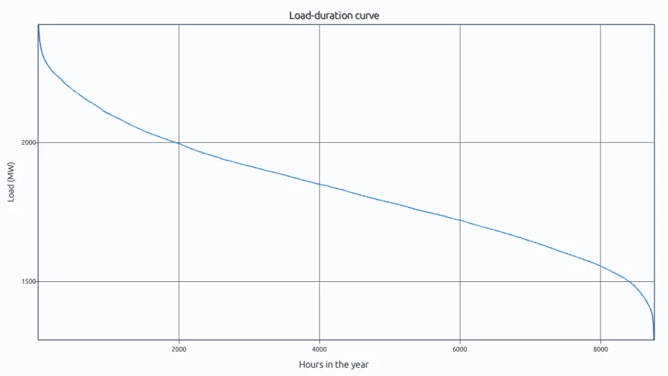

# Load-duration curve and load factor from a year of hourly utility load

[](https://runmat.com/sandbox?example=energy-load-duration)

This example builds a year of hourly load for a utility with a 2400 MW nominal peak, with
seasonal, daily and weekend patterns, and sorts it into a load-duration curve. The year peaks at
2421 MW with a load factor of 76 %, and the system runs above 90 % of its peak for 536 hours.

<picture>
  <source media="(prefers-color-scheme: dark)" srcset=".artifacts/thumbnail.webp">
  
</picture>

## The problem

Generation and capacity planners need to know not only the peak load but how many hours the system
spends near it. Sorting the 8760 hourly loads of a year from highest to lowest gives the
load-duration curve: the load at hour x is the level exceeded for x hours of the year. Its steep
left end shows how few hours the top of the peak lasts, which is the case for peaking plants,
storage and demand response. The area under it is the year's energy. The load factor summarizes
its shape:

$$\text{load factor} = \frac{\text{mean load}}{\text{peak load}}$$

## How the example works

1. **Build the hourly load** from a seasonal cycle with summer and winter peaks, a daily cycle, an
   8 % weekend reduction and 3 % random variation:

   ```matlab
   seasonal = 0.75 + 0.20*cos(2*pi*(h - 4900)/8760).^2;
   daily = 0.85 + 0.15*sin(pi*(hour - 7)/14).^2;
   load = 2400 * seasonal .* daily .* (1 - 0.08*weekend) .* (1 + 0.03*randn(8760, 1));
   ```

2. **Sort it** from highest to lowest: `sorted = sort(load, 'descend');`

3. **Compute the load factor** and count the hours above 90 % of peak:

   ```matlab
   100*mean(load)/sorted(1)
   sum(load > 0.9*sorted(1))
   ```

4. **Plot** the sorted load against hours in the year.

## Results

```
peak 2421 MW, load factor 76%
536 hours a year above 90% of peak
```

The curve falls steeply over its first few hundred hours, runs nearly straight through the middle
of the year, and drops again at the lightest hours. The top 10 % of the peak, 242 MW of capacity,
is needed for 536 hours, about 6 % of the year. Capacity that serves only that slice runs at a low
capacity factor, which is the planning case for storage or demand response.

## What to try

1. Count the hours above 95 % of peak with `sum(load > 0.95*sorted(1))` and compare with the 536
   hours above 90 %.
2. Remove the weekend reduction by setting `0.08` to `0`, and compare the load factor.
3. Replace `load` with a year of your own hourly data, 8760 values in MW, read with `readmatrix`.

## Files

- `load-duration.m`: the script: the synthetic hourly load, the load-duration curve and its statistics.
- `runmat.toml`: the project file.

## Related

- [Energy engineering in RunMat](https://runmat.com/industries/energy)
- [Wind energy from a power curve](../wind-energy) and [hosting capacity of a bus](../hosting-capacity)
- Function reference: [`sort`](https://runmat.com/docs/reference/builtins/sort), [`sum`](https://runmat.com/docs/reference/builtins/sum), [`randn`](https://runmat.com/docs/reference/builtins/randn)
- [Download RunMat](https://runmat.com/download)
