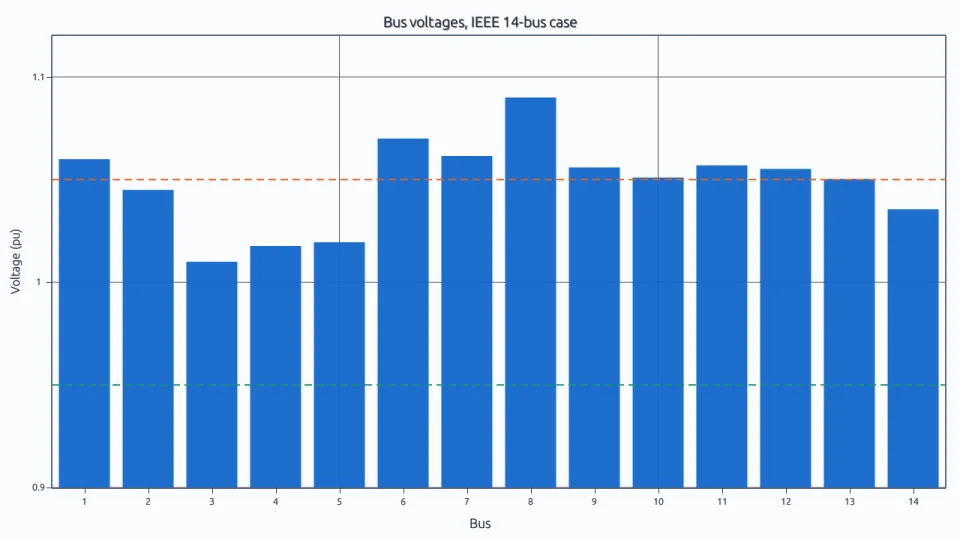

# Newton-Raphson power flow on the IEEE 14-bus test case

[](https://runmat.com/sandbox?example=energy-power-flow)

This example solves the AC power flow of the IEEE 14-bus test system with a Newton-Raphson solver
of about 30 lines, and checks it against the published solution. The slack bus supplies
232.4 MW and -16.5 Mvar, and bus 14 settles at 1.036 pu and -16.03°, against the published
1.036 pu and -16.04°.

<picture>
  <source media="(prefers-color-scheme: dark)" srcset=".artifacts/thumbnail.webp">
  
</picture>

## The problem

Power flow is the base calculation of transmission and distribution planning: given the loads, the
generator outputs and voltage set points, and the network, find every bus voltage and angle and the
flow on every line. The complex power injected at each bus must equal the power the network draws
from it:

$$S_i = V_i \left( \sum_k Y_{ik} V_k \right)^{*}$$

where Y is the bus admittance matrix. Load (PQ) buses fix P and Q; generator (PV) buses fix P and
|V|; the slack bus fixes |V| and the angle and takes up the losses. Newton-Raphson solves the
mismatch equations by linearizing them with the Jacobian at each iteration, and converges in a
handful of steps from a flat start. The IEEE 14-bus case is the standard check for a new solver.

## How the example works

1. **Enter the case.** One row per bus (type, voltage set point, load, generation, shunt) and one
   per branch (resistance, reactance, line charging, transformer ratio), in per unit on 100 MVA.

2. **Build the admittance matrix** branch by branch, with off-nominal transformer ratios:

   ```matlab
   y = 1 / (br(k, 3) + 1i*br(k, 4));  b = 1i*br(k, 5)/2;
   Y(f, f) = Y(f, f) + (y + b)/a^2;  Y(t, t) = Y(t, t) + y + b;
   Y(f, t) = Y(f, t) - y/a;          Y(t, f) = Y(t, f) - y/a;
   ```

3. **Compute the mismatch** in P at PV and PQ buses and in Q at PQ buses:

   ```matlab
   S = E .* conj(Y*E);
   mis = vertcat(P(ns) - real(S(ns)), Q(pq) - imag(S(pq)));
   ```

4. **Form the Jacobian** in complex matrix form and update the angles and PQ voltages until the
   largest mismatch is below 10⁻⁸ pu:

   ```matlab
   dSdth = 1i*diag(E)*conj(diag(Y*E) - Y*diag(E));
   dSdV = diag(E)*conj(Y*diag(E./V)) + diag(conj(Y*E).*(E./V));
   dx = J \ mis;
   ```

5. **Report and plot** the slack injection, bus 14, and every bus voltage against 0.95 and 1.05 pu.

## Results

```
slack bus supplies 232.4 MW and -16.5 Mvar
bus 14 at 1.036 pu, -16.03 degrees (published 1.036 pu, -16.04)
```

Bus 14's voltage matches the published solution to three decimals and its angle to 0.01°. The bar
chart shows every voltage inside 1.01–1.09 pu: the generator buses hold their set points, from
1.010 pu at bus 3 to 1.090 pu at bus 8, and the buses around generators 6 and 8 sit at or above the 1.05 pu
line. The slack bus absorbs reactive power, which is typical of a lightly loaded high-voltage
network with line charging.

## What to try

1. Scale every load by 1.2 with `bus(:, 4:5) = 1.2 * bus(:, 4:5)` and look at which bus voltage
   drops most.
2. Remove the 0.19 pu shunt capacitor at bus 9 and compare the voltages around it.
3. Print the iteration count from the loop in `powerflow` to see how quickly Newton-Raphson
   converges from a flat start.

## Files

- `power-flow.m`: the script: the IEEE 14-bus data, the `powerflow` Newton-Raphson function, the check and the plot.
- `runmat.toml`: the project file.

## Related

- [Energy engineering in RunMat](https://runmat.com/industries/energy)
- [Hosting capacity of a bus](../hosting-capacity): this solver used to find how much solar bus 14 takes
- Function reference: [`conj`](https://runmat.com/docs/reference/builtins/conj), [`diag`](https://runmat.com/docs/reference/builtins/diag), [`mldivide`](https://runmat.com/docs/reference/builtins/mldivide)
- [Download RunMat](https://runmat.com/download)
