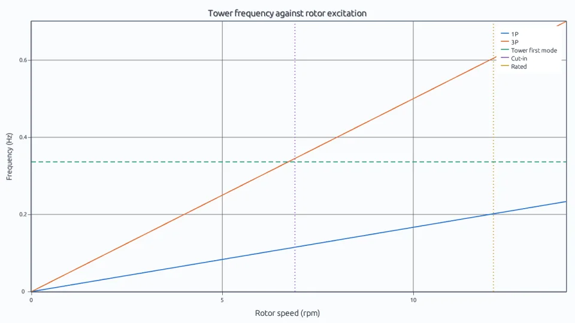

# Wind turbine tower frequency against 1P and 3P: a Campbell diagram for the NREL 5-MW tower

[](https://runmat.com/sandbox?example=energy-tower-campbell)

This example computes the first fore-aft natural frequency of the NREL 5-MW reference turbine's
87.6 m tower with a 30-element beam model, and places it between the rotor (1P) and blade-passing
(3P) excitation over the operating speed range. The model gives 0.336 Hz against the report's
0.324 Hz for the full turbine model. Across the 6.9–12.1 rpm range, 1P reaches at most 0.202 Hz
and 3P starts at 0.345 Hz, so the tower mode sits in the gap between them.

<picture>
  <source media="(prefers-color-scheme: dark)" srcset=".artifacts/thumbnail.webp">
  
</picture>

## The problem

A wind turbine rotor excites its tower once per revolution (1P), from mass and aerodynamic
imbalance, and once per blade passage (3P for three blades), as each blade passes the tower. If the
tower's first natural frequency meets either excitation inside the operating speed range, the
tower resonates. Most large turbines use a soft-stiff tower: its first frequency sits above the
highest 1P and below the lowest 3P.

The tower is modeled as a cantilever Euler-Bernoulli beam fixed at the base, with the rotor and
nacelle as a 350 t point mass at the top. Its tapered mass and stiffness come from Jonkman et al.
(2009), NREL/TP-500-38060, Table 6-1. Each element has the standard cubic-beam stiffness and
consistent mass matrices, and the first frequency is the smallest eigenvalue of

$$K \phi = \omega^2 M \phi$$

## How the example works

1. **Enter the tower properties** at 11 stations from base to top and interpolate them to the
   midpoints of 30 elements:

   ```matlab
   m = interp1(frac, mden, mid);  k = interp1(frac, EI, mid);
   ```

2. **Assemble the beam matrices**, two degrees of freedom (deflection and slope) per node:

   ```matlab
   ke = k(e)/L^3 * [12 6*L -12 6*L; 6*L 4*L^2 -6*L 2*L^2; -12 -6*L 12 -6*L; 6*L 2*L^2 -6*L 4*L^2];
   K(d, d) = K(d, d) + ke;  M(d, d) = M(d, d) + me;
   ```

3. **Add the top mass** of 110 t rotor plus 240 t nacelle, fix the base, and solve:

   ```matlab
   M(end-1, end-1) = M(end-1, end-1) + top;
   f1 = sqrt(min(eig(K(free, free), M(free, free)))) / (2*pi);
   ```

4. **Draw the Campbell diagram**: the 1P and 3P lines over 0–14 rpm, the tower frequency, and the
   cut-in (6.9 rpm) and rated (12.1 rpm) speeds.

## Results

```
first tower mode 0.336 Hz (report: 0.324 Hz, full turbine model)
1P reaches 0.202 Hz at 12.1 rpm; 3P starts at 0.345 Hz at 6.9 rpm
```

The beam model lands 3.7 % above the report's value, which comes from the full turbine model; this
example reduces the rotor and nacelle to a point mass on the tower top. The tower frequency is
1.66 times the highest 1P, a wide margin, but the lowest 3P is only 2.7 % above it: at cut-in the
3P line passes just above the tower mode. The diagram shows the 3P line crossing the tower
frequency at 6.7 rpm, just below cut-in.

## What to try

1. Raise the top mass by 50 t, `top = 110000 + 290000`, and see the frequency drop toward 1P.
2. Stiffen the tower by scaling `EI` by 1.2. Every eigenvalue scales by 1.2, so the frequency rises
   by √1.2 to 0.368 Hz, and 3P now crosses it at 7.4 rpm, inside the operating range.
3. Refine the mesh to `ne = 60` and check that the frequency is converged.

## Files

- `tower-campbell.m`: the script: tower properties, the beam model, the first frequency and the Campbell diagram.
- `runmat.toml`: the project file.

## Related

- [Energy engineering in RunMat](https://runmat.com/industries/energy)
- [NREL 5-MW tower mode shape](../turbine): the same beam model, drawn on the turbine
- [Bracket modes against engine orders](../../automotive-transportation/bracket-orders): the same kind of diagram for an engine
- Function reference: [`eig`](https://runmat.com/docs/reference/builtins/eig), [`interp1`](https://runmat.com/docs/reference/builtins/interp1), [`plot`](https://runmat.com/docs/reference/builtins/plot)
- [Download RunMat](https://runmat.com/download)
