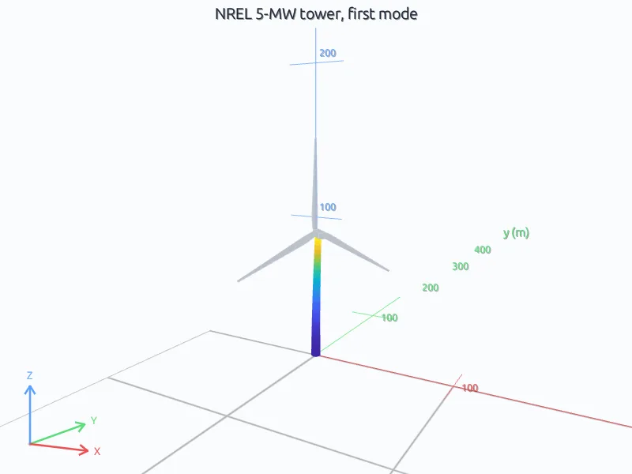

# First fore-aft mode shape of the NREL 5-MW wind turbine tower, drawn in 3D

[](https://runmat.com/sandbox?example=energy-turbine)

This example builds a 30-element beam model of the NREL 5-MW reference turbine's 87.6 m tower,
solves for its first fore-aft mode, and draws the whole turbine to scale with the tower colored by
the mode's motion. The mode is at 0.336 Hz. The base is fixed and the top moves most; half the tip
motion is reached at 60 m of the 87.6 m height.

<picture>
  <source media="(prefers-color-scheme: dark)" srcset=".artifacts/thumbnail.webp">
  
</picture>

## The problem

A mode shape shows where a structure moves when it vibrates at a natural frequency: where sensors
pick up the most signal, where loads concentrate, and how a top mass changes the response. For a
wind turbine tower, the first fore-aft mode is the one the rotor's thrust excites. With 350 t of
rotor and nacelle at its top, the tower behaves much like a tapered cantilever with a tip mass.

The model uses the tower's distributed mass and bending stiffness from Jonkman et al. (2009),
NREL/TP-500-38060, Table 6-1: 5591 kg/m and 614 GN·m² at the base, tapering to 2536 kg/m and
116 GN·m² at the top. The generalized eigenproblem K φ = ω² M φ gives the frequencies and the
mode shapes φ.

## How the example works

1. **Build the beam model**: interpolate the tower properties onto 30 elements, assemble cubic beam
   stiffness and consistent mass matrices, and add the top mass:

   ```matlab
   K(d, d) = K(d, d) + ke;  M(d, d) = M(d, d) + me;
   M(end-1, end-1) = M(end-1, end-1) + top;
   ```

2. **Solve for the modes** with the base fixed, take the lowest, and keep its deflection degrees
   of freedom, normalized to 1 at the top:

   ```matlab
   [Phi, Lam] = eig(K(free, free), M(free, free));
   [w2, first] = min(diag(Lam));
   u = vertcat(0, Phi((1:2:2*ne)', first));
   ```

3. **Draw the tower** as 30 tapered tube bands, 6 m to 3.87 m in diameter, each displaced by the
   mode (6 m drawn at the tip) and colored by its motion with `parula`.

4. **Draw the nacelle, hub and three 61.5 m blades** with `patch`, carried with the tower top, and
   turn the turbine 45° so the rotor faces the viewer.

## Results

```
first fore-aft mode 0.336 Hz; the tower top moves, the base is fixed
half the tip motion is reached at 60 m of 87.6 m
```

The drawing shows the tower shading from dark at the fixed base to bright at the top, where the
nacelle and rotor ride on the mode. As in a cantilever loaded at its tip, deflection builds slowly
near the fixed base: half the tip deflection is reached only at 60 m, 68 % of the height. The 0.336 Hz frequency sits
between the rotor's 1P and 3P excitation, as the [Campbell diagram](../tower-campbell) shows.

## What to try

1. Change `amp` to `12` to exaggerate the drawn deflection further.
2. Take the second mode by sorting `diag(Lam)` and picking the second-smallest, then look at where
   its node falls along the tower.
3. Remove the top mass with `top = 0` and compare the frequency and where half the tip motion is
   reached.

## Files

- `turbine.m`: the script: the beam model, the first mode, and the 3D drawing of the turbine.
- `runmat.toml`: the project file.

## Related

- [Energy engineering in RunMat](https://runmat.com/industries/energy)
- [Tower frequency against 1P and 3P](../tower-campbell) and [wind energy from a Weibull fit](../wind-energy)
- [Tuning fork modal study](../../fea/tuning-fork-modal): mode shapes from an FEA study
- Function reference: [`eig`](https://runmat.com/docs/reference/builtins/eig), [`patch`](https://runmat.com/docs/reference/builtins/patch), [`parula`](https://runmat.com/docs/reference/builtins/parula)
- [Download RunMat](https://runmat.com/download)
