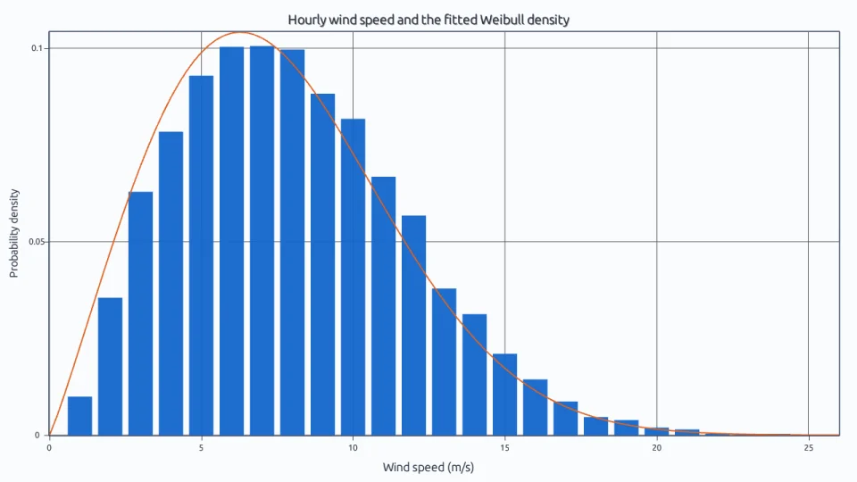

# Annual energy production of a wind turbine from a Weibull wind-speed fit

[](https://runmat.com/sandbox?example=energy-wind-energy)

This example fits a Weibull distribution to a year of hourly hub-height wind speeds by maximum
likelihood, then integrates a 5 MW turbine's power curve against it for the annual energy
production (AEP). The fit gives a shape of 2.11 and a scale of 8.53 m/s for a mean speed of
7.55 m/s, and the turbine yields 16.3 GWh a year, a capacity factor of 37 %.

<picture>
  <source media="(prefers-color-scheme: dark)" srcset=".artifacts/thumbnail.webp">
  
</picture>

## The problem

A wind farm's revenue depends on its energy yield, so every project starts with an AEP estimate.
Hourly wind speeds at a site follow the Weibull distribution closely, with density

$$p(v) = \frac{k}{c}\left(\frac{v}{c}\right)^{k-1} e^{-(v/c)^k}$$

where k is the shape and c the scale. The AEP is the power curve integrated over that distribution
for the 8760 hours of a year:

$$\text{AEP} = 8760 \int P(v)\,p(v)\,dv$$

The maximum-likelihood shape k solves

$$\frac{1}{k} + \overline{\ln u} - \frac{\sum u_i^k \ln u_i}{\sum u_i^k} = 0, \qquad c = \left(\overline{u^k}\right)^{1/k}$$

## How the example works

1. **Make a year of hourly wind**, drawn from a Weibull distribution with shape 2.1 and scale
   8.5 m/s by inverting its cumulative distribution:

   ```matlab
   u = 8.5 * (-log(rand(8760, 1))).^(1/2.1);
   ```

2. **Fit the Weibull** by solving the likelihood equation for k with `fzero`:

   ```matlab
   g = @(k) 1/k + mean(log(u)) - sum(u.^k .* log(u)) / sum(u.^k);
   k = fzero(g, 2);
   c = mean(u.^k)^(1/k);
   ```

3. **Model the power curve**: zero below 3 m/s cut-in, rising with v³ to 5 MW at 11.4 m/s rated,
   flat to 25 m/s cut-out:

   ```matlab
   P = 5 * min(1, max(0, (v.^3 - 27) / (11.4^3 - 27))) .* (v <= 25);
   ```

4. **Integrate** power times density over 0–30 m/s for the AEP, and plot the histogram of hourly
   speeds with the fitted density.

## Results

```
Weibull shape 2.11, scale 8.53 m/s, mean speed 7.55 m/s
16.3 GWh a year, a capacity factor of 37%
```

The fit recovers the shape and scale the speeds were drawn from, 2.1 and 8.5 m/s, to within the
sampling scatter of one year, and the fitted density follows the histogram across the whole range.
The capacity factor is the AEP over a full year at rated power, 5 MW × 8760 h = 43.8 GWh.

## What to try

1. Drop the scale to `6.5` in the line that makes `u`, a lower-wind site, and compare the AEP.
2. Raise the rated speed from `11.4` to `13` in the power curve and look at how much energy the
   turbine gives up below rated.
3. Replace `u` with measured hub-height speeds, 8760 hourly values in m/s, read with `readmatrix`.

## Files

- `wind-energy.m`: the script: the hourly speeds, the maximum-likelihood Weibull fit, the power curve, the AEP and the plot.
- `runmat.toml`: the project file.

## Related

- [Energy engineering in RunMat](https://runmat.com/industries/energy)
- [Tower frequency against 1P and 3P](../tower-campbell) and [load-duration curve](../load-duration)
- Function reference: [`fzero`](https://runmat.com/docs/reference/builtins/fzero), [`histcounts`](https://runmat.com/docs/reference/builtins/histcounts), [`trapz`](https://runmat.com/docs/reference/builtins/trapz)
- [Download RunMat](https://runmat.com/download)
