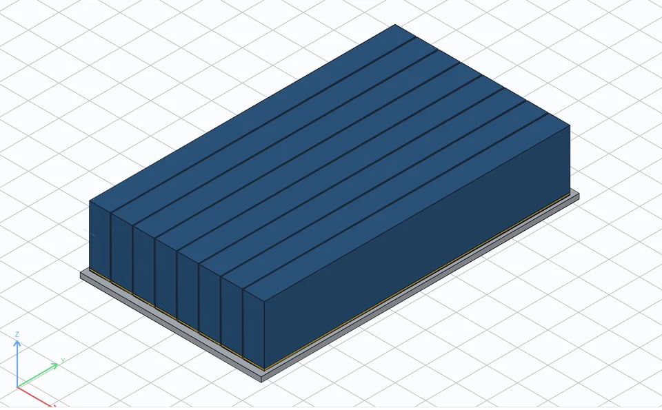

# EV battery module on a liquid cold plate: a conjugate heat transfer FEA study

[](https://runmat.com/sandbox?example=battery-cold-plate&run=0)

This study solves the laminar coolant flow in a cold plate's serpentine channel and the heat through
eight prismatic battery cells, their gap-filler pads and the aluminum plate, all in one model. The
cells make 20 W each (160 W), and 2 L/min of 50/50 water-glycol enters at 25 °C. It reports the
hottest point of an end cell and a middle cell against a 45 °C limit, the coolant outlet temperature
and the pressure at the inlet. A hand check puts the hottest cell top near 35 °C, 10 K under the
limit.

<picture>
  <source media="(prefers-color-scheme: dark)" srcset=".artifacts/thumbnail.webp">
  
</picture>

## The problem

A liquid cold plate under a battery module carries the cells' heat to the coolant loop. The cell
temperature at the end of that path sets cell life, so the designer sizes the channel, the plate
and the gap filler to keep the hottest cell under a limit, here 45 °C at 160 W, with a coolant rise
and a pressure drop that the pack's pump can supply.

The study is laminar, so the channel must keep the Reynolds number under 2000. With a 14 × 4 mm
channel (A = 56 mm², hydraulic diameter Dh = 6.22 mm), 2 L/min flows at 0.595 m/s and

$$Re = \frac{\rho U D_h}{\mu} = \frac{1070 \times 0.595 \times 6.22\times10^{-3}}{3.5\times10^{-3}} = 1130$$

The hand checks in the study's header give a coolant rise of 160 W / (ρQc_p) = 1.36 K and a
pressure drop of about 5 kPa (3.9 kPa of laminar friction over the 2,215 mm path plus about
1.1 kPa in the six bends). Each cell's 20 W then crosses four resistances in series: the 3 mm gap
filler (1.2 K), the land and plate (0.05 K), the channel's laminar film at Nu = 4.4 (4.5 K) and the
cell's own height (2.8 K). Added to the 25 °C inlet and the coolant rise, the hottest cell top sits
near 35 °C.

Conjugate heat transfer replaces the film coefficient and the series sum with the solved flow and
the solved conduction, so it also shows how evenly the four passes cool the eight cells.

## How the study works

1. **The part.** `m01_cold_plate.part` builds the eight 34 × 500 × 95 mm cells at a 36 mm pitch, a
   3 mm gap-filler pad under each, and a 296 × 520 × 8 mm brazed plate with a four-pass serpentine
   under the cells' center lines. The coolant is its own body, and each channel wall is one surface
   with a fluid side and a plate side. The part is exported to `geometry/m01-cold-plate.step`.

2. **Mesh.** Linear tetrahedra at 12 mm, refined to 2 mm on the channel walls, 3 mm in the gap
   filler and 4 mm in the plate.

3. **Materials and loads.** Cells at k = 20 W/m·K with 12,383.9 W/m³ of heat generation, which is
   20 W in each 34 × 500 × 95 mm cell. Gap filler at 3 W/m·K, 3003 aluminum at 160 W/m·K, and the
   coolant as an incompressible Newtonian fluid, declared in `materials.module`:

   ```
   material water_glycol_50 = {
       mass_density = 1070 kg/m^3
       fluid = {
           law = incompressible_newtonian
           dynamic_viscosity = 0.0035 Pa*s
       }
   ```

4. **Flow and coupling.** 0.595 m/s at 25 °C into the inlet, 0 Pa at the outlet, no slip on the
   channel walls, and a perfect thermal contact between the plate's and the coolant's sides of
   each wall:

   ```
   interface wall_transfer {
       conjugate_heat_transfer.perfect {
           primary = geometry.module.region.plate_wall
           secondary = geometry.module.region.channel_wall
       }
   }
   ```

5. **Study.** A steady conjugate heat transfer analysis, reporting the peak temperatures and the
   inlet pressure:

   ```
   analysis operating_point { conjugate_heat_transfer steady {} }
   output peak_end_cell_temperature = max(output.temperature, over = geometry.module.region.cell_1)
   output peak_mid_cell_temperature = max(output.temperature, over = geometry.module.region.cell_4)
   output inlet_pressure = max(output.pressure, over = geometry.module.region.inlet)
   ```

## Results

| Quantity | Hand check | Limit |
| --- | --- | --- |
| Reynolds number in the channel | 1130 | 2000 (laminar) |
| Coolant temperature rise | 1.36 K | |
| Pressure drop | about 5 kPa | |
| Hottest cell top | about 35 °C | 45 °C |

The study returns the temperature field through every cell, pad and plate, the coolant's velocity
and pressure fields, and the five scalar outputs above. The inlet pressure is the pressure drop,
since the outlet is held at 0 Pa. Comparing `peak_end_cell_temperature` with
`peak_mid_cell_temperature` shows whether the cell at the end of the module runs hotter than one in
the middle.

## What to try

1. Lower the flow to 1 L/min by setting the inlet velocity to 0.2975 m/s. By the hand check the
   coolant rise doubles to 2.72 K and Re falls to 565.
2. Raise each cell's `heat_generation` to 18,575.8 W/m³ (30 W per cell, 240 W) and compare the peak
   cell temperatures with the 45 °C limit.
3. Change `gap_filler` in the part to 2 mm, export it to `geometry/m01-cold-plate.step`, and see how
   much of the 1.2 K pad drop the thinner pad saves.

## Files

- `battery-cold-plate.fea`: the conjugate heat transfer study, with its hand checks in the header.
- `materials.module`: the materials the study imports: `li_ion_cell`, `gap_filler`, `aluminum_3003` and `water_glycol_50`.
- `m01_cold_plate.part`: the cells, gap filler, plate and coolant in RunMat MCAD, with the channel, plate, land and pad sizes as inputs.
- `geometry/m01-cold-plate.step`: the part exported to STEP, with the body and face names the study selects.
- `DESIGN-NOTES.md`: how the channel, the passes and the gap filler were sized, with the hand checks.
- `runmat.toml`: the project file.

## Related

- [Conjugate heat transfer in RunMat](https://runmat.com/simulation/conjugate-heat-transfer)
- [Conjugate heat transfer physics reference](https://runmat.com/docs/simulation/physics/conjugate-heat-transfer) and [steady heat transfer guide](https://runmat.com/docs/simulation/guides/steady-heat-transfer)
- [Battery module cells](../battery-module-cells) and [chip cold plate power step](../chip-cold-plate-power-step)
- [Download RunMat](https://runmat.com/download)
