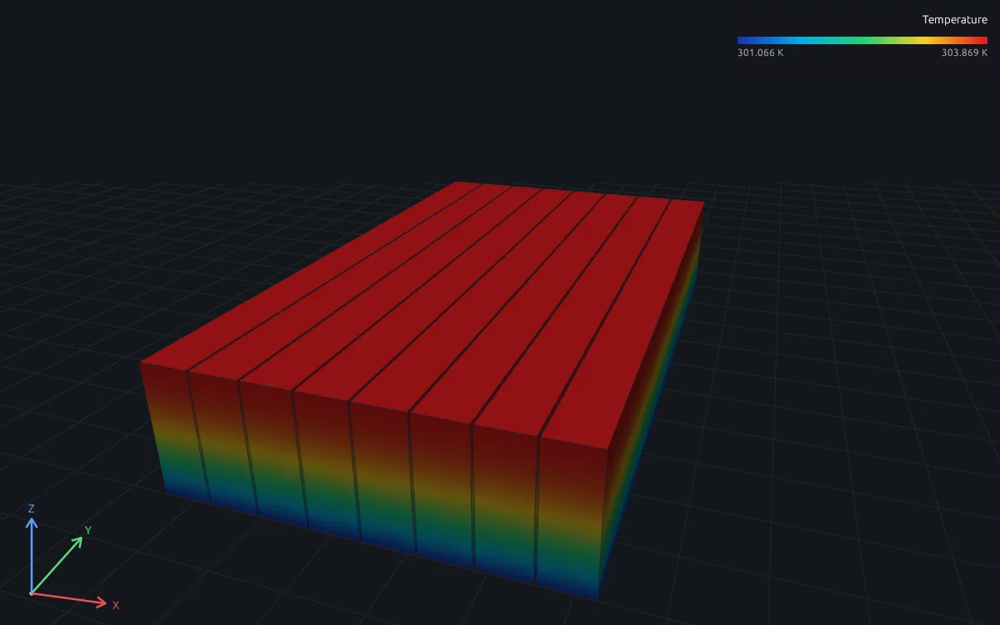

# EV battery module cell temperature on a cold plate: a steady heat-conduction FEA study

[](https://runmat.com/sandbox?example=battery-module-cells&run=0)

This study finds the steady temperature of the eight prismatic cells in one module of an EV battery
pack, with each cell generating 20 W and the module's cold plate cooling the cell bottoms. The
cooling path below the cells is written as one effective film coefficient to 25 °C coolant. The
cells run from 301.07 K (27.9 °C) at their bottoms to 303.87 K (30.7 °C) at their tops, matching
the hand check's 303.86 K.



## The problem

Lithium-ion cells age faster and lose capacity when they run hot, and cells at different
temperatures age at different rates. A battery module's thermal design sets how hot its cells get
under a steady load and how even they stay. Here each 34 × 500 × 95 mm cell generates 20 W, 160 W
for the module, and loses its heat downward through the module's thermal interface.

Three resistances lie between the cell bottoms and the coolant: a 3 mm gap filler (3 W/m·K), a 2 mm
aluminum cold-plate lid, and the coolant film, h = 1,500 W/m²·K on 0.06168 m² of channel wall.
Over the 0.136 m² of cell bottoms they add up to 2.482 × 10⁻³ m²·K/W, an effective film coefficient
of 403 W/m²·K.

Each cell is then a slab with uniform heat generation Q, a convective bottom and an insulated top.
Its top temperature is

$$T_{top} = T_{coolant} + \frac{Q H}{h_{eff}} + \frac{Q H^2}{2k}$$

with H = 0.095 m the cell height and k the cell's conductivity. The second term is the rise across
the cooling path, 2.919 K, and the third the rise through the cell, 2.794 K.

## How the study works

1. **Geometry.** `geometry/m01-cells.step` holds the eight cells with their CAD names. Each cell's
   bottom face is named "M01 cell bottom". The 2 mm barriers between cells are left out: every cell
   carries the same load, so no heat crosses them.

   ```
   region cell_1 : solid { select name "M01 cell 1"; expect exactly_one }
   region cell_bottoms : face { select name "M01 cell bottom"; expect one_or_more }
   ```

2. **Mesh.** Linear tetrahedra at a 12 mm target size.

3. **Material.** An effective isotropic cell at the in-plane conductivity of a stacked prismatic
   cell: k = 20 W/m·K, ρ = 2,500 kg/m³, c = 1,000 J/kg·K.

4. **Loads.** 20 W over each cell's 1.615 × 10⁻³ m³ is 12,383.9 W/m³. The cold plate is a convection
   condition on the cell bottoms:

   ```
   load cell_1_heat { heat_generation on geometry.module.region.cell_1 = 12383.9 W/m^3 }
   load cold_plate {
       thermal.convection {
           target = geometry.module.region.cell_bottoms
           ambient_temperature = 298.15 K
           coefficient = 403 W/m^2/K
       }
   }
   ```

5. **Study.** A steady thermal analysis, reporting the temperature and heat-flux fields and the peak
   temperatures of an end cell and a middle cell.

## Results

| Quantity | Value |
| --- | --- |
| Coldest point, cell bottoms | 301.07 K (27.9 °C) |
| Hottest point, cell tops | 303.87 K (30.7 °C) |
| Hand check, cell top | 303.86 K |
| Heat out through the cold plate | 160.0 W, equal to the heat generated |
| Peak heat flux | 1,172 W/m² |

The figure shows every cell at the same temperature profile, coolest at the bottom and hottest
across the top. The cells are identical and the barriers are insulated, so the end and middle cells
match. About half of the 5.7 K rise from coolant to cell top is in the cooling path and half in the
cell itself.

## What to try

1. Replace the gap filler with a 6 W/m·K grade. The effective coefficient rises to 504 W/m²·K, and
   the slab formula gives a cell-top temperature of 303.28 K. Change `coefficient` to 504 W/m^2/K
   and compare.
2. Double each cell's `heat_generation` to model a harder duty cycle. Steady conduction is linear,
   so every temperature rise above 298.15 K doubles.
3. Solve the cold plate's coolant flow as well with the [battery module on its liquid cold
   plate](../battery-cold-plate) study.

## Files

- `battery-module-cells.fea`: the study: geometry, mesh, cell material, heat loads, the cold-plate condition and the hand check.
- `materials.module`: the material the study imports, `li_ion_cell`.
- `geometry/m01-cells.step`: the module's eight cells, with each cell and the cell bottoms named.
- `runmat.toml`: the project file.

## Related

- [Thermal simulation in RunMat](https://runmat.com/simulation/thermal)
- [Steady heat transfer guide](https://runmat.com/docs/simulation/guides/steady-heat-transfer)
- [Battery module on its liquid cold plate](../battery-cold-plate) and [heat spreader on a cooled block](../tim-stack)
- [Download RunMat](https://runmat.com/download)
