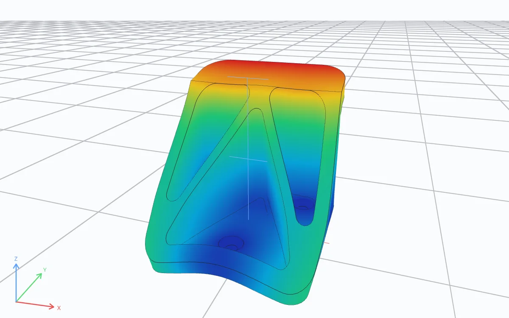

# Wall-hook bracket stress and deflection: a linear static FEA study

[](https://runmat.com/sandbox?example=bracket-hook-load&run=0)

This study checks a steel wall-hook bracket, 40 × 50 × 35 mm, bolted to a wall at three
countersunk holes with 2 kN hanging from its hook. It imports the bracket from a STEP file, meshes
it with tetrahedra and solves linear elasticity for the displacement and von Mises stress. The hook
tip moves 0.0184 mm under the load.

<picture>
  <source media="(prefers-color-scheme: dark)" srcset=".artifacts/thumbnail.webp">
  
</picture>

## The problem

A wall bracket has to carry its load without yielding and without sagging enough to matter. A
linear static study answers both for a given load: it solves the equilibrium of an elastic body,

$$K u = f$$

where K is the stiffness matrix built from the mesh and the material, f the applied forces and u the
nodal displacements. Strain and stress follow from u. The result scales linearly with the load as
long as the steel stays elastic.

The inputs are the geometry, the steel's Young's modulus and Poisson's ratio, the supports and the
load. Here the bolts are modeled by holding the mounting-hole faces fixed, and the hanging load is a
2 kN force pressing down the wall (-Y) on the hook seat, the upward-facing flat between the wall and
the lip.

## How the study works

1. **Geometry.** The bracket comes from `geometry/bracket.step`. Regions are picked by the names
   stored in the CAD file:

   ```
   region hook_seat : face { select name "Hook seat"; expect exactly_one }
   region mounting_holes : face { select name "Mounting holes"; expect one_or_more }
   ```

2. **Mesh.** Linear tetrahedra with a 6 mm target size, refined wherever the mesh would stray more
   than 0.15 mm from the true surface.

3. **Material.** Steel: E = 200 GPa, ν = 0.3, ρ = 7,850 kg/m³.

4. **Model.** The mounting holes are fixed and the load acts on the hook seat:

   ```
   constraint mounting {
       structural.fixed { target = geometry.bracket.region.mounting_holes }
   }
   load hanging_load {
       force on geometry.bracket.region.hook_seat = [0, -2, 0] kN
   }
   ```

5. **Study.** A structural static analysis. Besides the fields, it reports the mean and peak stress
   on the corner fillets, the support reaction and the peak displacement:

   ```
   output fillet_peak_stress = max(analysis.static.field.element.von_mises_stress, over = geometry.bracket.region.corner_fillets)
   ```

## Results

| Quantity | Value |
| --- | --- |
| Peak displacement, at the hook tip | 0.0184 mm |
| Mesh | 114,862 tetrahedra, 22,278 nodes |
| Bracket mass | 138.5 g |

The figure shows displacement magnitude: zero at the bolted base and largest along the top edge of
the hook, where the bracket bends away from the wall. The work done by the load equals twice the
stored strain energy to within 4 × 10⁻¹³, the check that the solve is in equilibrium.

The highest element stress in the body, 140.9 MPa, sits in the base plate by the held mounting
holes. Fixing a face exactly makes a stress singularity at the clamped countersink edges, so that peak grows as the mesh is refined and does not
measure strength. The study reports the corner-fillet stresses for that reason: the fillets lie away
from the supports and their stress converges under refinement.

## What to try

1. Double the load to `[0, -4, 0] kN`. The study is linear, so the hook-tip displacement doubles to
   0.0368 mm and every stress doubles.
2. Change `youngs_modulus` to 69 GPa and keep ν = 0.3. Displacement scales with 1/E, so the hook
   tip moves 0.0533 mm; the stresses stay the same, because the supports and loads fix them.
3. Switch the mesh to `order = quadratic` and compare `fillet_peak_stress` with the linear run.
   Linear tetrahedra are stiff in bending, so the quadratic run is the better estimate.
4. Run the [load sweep](../bracket-hook-sweep) to see the same bracket at a range of loads.

## Files

- `bracket-hook-load.fea`: the study: geometry, mesh, material, model and the static analysis.
- `materials.module`: the material the study imports, `steel`.
- `geometry/bracket.step`: the bracket's geometry, with the body, hook seat, mounting holes and corner fillets named.
- `runmat.toml`: the project file.

## Related

- [Structural simulation in RunMat](https://runmat.com/simulation/structural)
- [Linear static guide](https://runmat.com/docs/simulation/guides/linear-static) and [mesh refinement guide](https://runmat.com/docs/simulation/guides/mesh-refinement)
- [Wall-hook bracket load sweep](../bracket-hook-sweep) and [bracket random vibration](../bracket-random-vibration)
- [Download RunMat](https://runmat.com/download)
