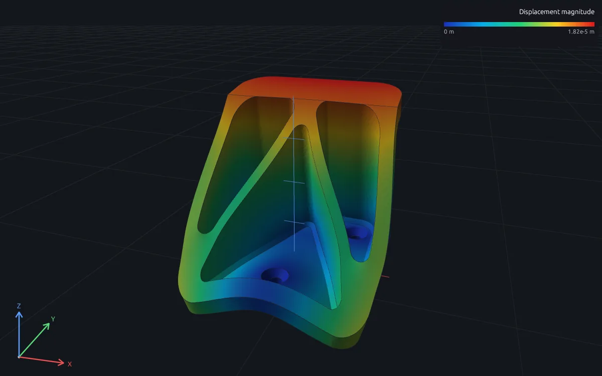

# Wall-hook bracket deflection over a load sweep: static FEA with a pass/fail check

[](https://runmat.com/sandbox?example=bracket-hook-sweep&run=0)

This study checks the deflection of an S355 steel wall-hook bracket, 40 × 50 × 35 mm, against a
0.1 mm limit, then repeats the check at seven loads from 1 kN to 4 kN. The bracket is bolted to a
wall at three countersunk holes and the load hangs from its hook. At the 2 kN service load the
largest displacement anywhere on the bracket is 0.0189 mm. It is the study RunMat's guided setup
wrote in the session shown on the structural simulation page.



## The problem

A bracket that holds a hook, a pipe or a fixture usually has a deflection limit as well as a stress
limit: past a set movement the load sags, a fitting leaks or a door binds. Here the requirement is
that the hook seat moves less than 0.1 mm at every load in the service range.

A linear static study solves K u = f for the displacements u under the applied forces f. Because the
response is linear in the load, a sweep over the load is a set of independent cases with the same
stiffness. Each case reports its own deflection and its own pass or fail.

The inputs are the geometry, S355 steel (E = 210 GPa, ν = 0.30, yield strength 355 MPa), the held
mounting holes and the hanging load, which presses down the wall (-Y) on the hook seat. Linear
elasticity does not model plastic redistribution above yield, and the screws and the wall contact
are left out.

## How the study works

1. **Geometry and mesh.** The bracket comes from `geometry/bracket.step`, with its body, mounting
   holes (three bores and their countersinks) and hook seat named in the CAD file. The mesh is
   linear tetrahedra at a 6 mm target size, within 0.05 mm of the true surface and at least three
   cells across any gap.

2. **The load as a model input.** The model takes the load as an input, so each case can set it.
   The force is the total over the seat:

   ```
   input service_load : force = 2 kN
   load hanging {
       force on geometry.bracket.region.hook_seat = [0 N, -input.service_load, 0 N]
   }
   ```

3. **The deflection check.** The study reports the peak displacement on the hook seat and assesses
   it against 0.1 mm:

   ```
   assessment hook_deflection {
       value = output.peak_hook_deflection
       maximum = 0.1 mm
       evidence = authored_samples
   }
   ```

4. **The sweep.** Seven static cases, 1 kN to 4 kN in 0.5 kN steps. The sweep collects each case's
   deflection and the largest over all cases:

   ```
   output governing_deflection = max(case.output.peak_hook_deflection.value, over = cases)
   ```

## Results

The captured run is the study on its own, at 2 kN, on 521,163 tetrahedra. The largest displacement
on the bracket is 0.0189 mm, along the top edge of the hook, and the hook seat moves no more than
that. The figure shows displacement magnitude, from zero at the bolted base to its peak at the top.

The response is linear, so the 2 kN result sets the whole sweep. Scaling the 0.0189 mm peak by the
load bounds the hook-seat deflection in each case:

| Load | Largest displacement on the bracket |
| --- | --- |
| 1.0 kN | 0.0094 mm |
| 2.0 kN | 0.0189 mm |
| 3.0 kN | 0.0283 mm |
| 4.0 kN | 0.0378 mm |

Every case passes the 0.1 mm limit, with the 4 kN case at under 40 % of it.

## What to try

1. Run the `load_sweep` and read `deflection_by_case` and `governing_deflection`.
2. Extend the axis to 8 kN or 10 kN. By the same scaling the bracket's largest displacement reaches
   0.1 mm at about 10.6 kN, so the deflection check holds to there at least. Check the stress before
   trusting a case that high, since the study is elastic.
3. Add an output for the peak von Mises stress on a region away from the held holes, and an
   assessment against 355 MPa divided by your safety factor.

## Files

- `bracket-hook-sweep.fea`: the study, its deflection assessment and the seven-case load sweep.
- `materials.module`: the material the study imports, `s355`.
- `geometry/bracket.step`: the bracket's geometry, with the body, hook seat and mounting holes named.
- `runmat.toml`: the project file.
- `runmat.lock`: the resolved project dependencies.

## Related

- [Structural simulation in RunMat](https://runmat.com/simulation/structural)
- [Linear static guide](https://runmat.com/docs/simulation/guides/linear-static)
- [Wall-hook bracket under load](../bracket-hook-load) and [bracket random vibration](../bracket-random-vibration)
- [Download RunMat](https://runmat.com/download)
