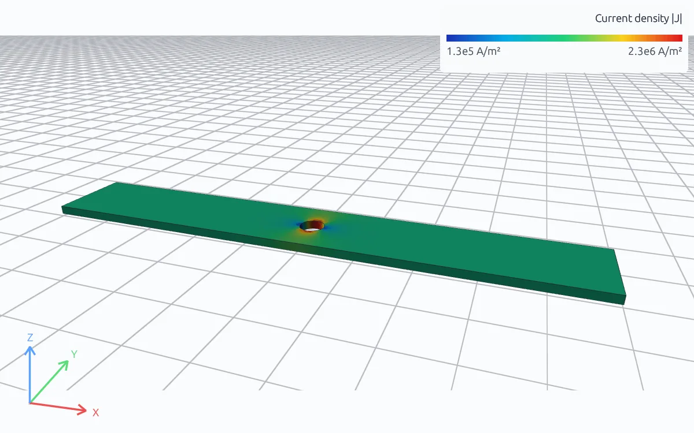

# Copper busbar resistance and current crowding at a bolt hole: a DC conduction FEA study

[](https://runmat.com/sandbox?example=busbar-resistance&run=0)

This study solves DC current flow through a copper busbar strip, 200 × 30 × 3 mm, with a 9 mm bolt
hole at its middle. 100 A enters one end and leaves through the other, held at 0 V. The strip drops
3.919 mV, a resistance of 39.19 µΩ, and the current density beside the hole peaks at 2.32 A/mm²,
twice the strip's mean.

<picture>
  <source media="(prefers-color-scheme: dark)" srcset=".artifacts/thumbnail.webp">
  
</picture>

## The problem

Busbars carry high currents between batteries, inverters, breakers and loads. Their resistance sets
the voltage drop and the I²R heating, and every bolt hole, slot or bend changes it. Current also has
to flow around a hole, so it crowds at the hole's sides. That local density sets the hot spot.

For a plain strip of length L, width W and thickness t, the resistance is

$$R = \frac{\rho L}{W t} = \frac{0.2}{58 \times 10^6 \times 0.03 \times 0.003} = 38.31\ \mu\Omega$$

A small round hole of radius a in a sheet adds about 2πa²/W² squares of sheet resistance (ρ/t =
5.75 µΩ), 0.81 µΩ here, for a total of about 39.1 µΩ. In a wide sheet the current density at the
sides of a round hole reaches twice the far-field value. The strip's mean density is 1.11 A/mm², so
the hole's sides should see about 2.2 A/mm², a little more with the strip's finite width.

## How the study works

1. **Geometry.** `geometry/busbar-bolt-hole.step` names the body `Busbar` and the faces
   `Terminal A`, `Terminal B` and `Bolt hole`. The hole is an M8 medium clearance hole (ISO 273).

   ```
   region terminal_a : face { select name "Terminal A"; expect exactly_one }
   region bolt_hole : face { select name "Bolt hole"; expect exactly_one }
   ```

2. **Mesh.** Quadratic tetrahedra at a 2 mm target size.

3. **Material.** Copper at the IEC 60028 standard conductivity, σ = 58 MS/m at 20 °C.

4. **Model.** Steady current conduction, with 100 A into Terminal A and Terminal B at 0 V:

   ```
   electromagnetic { equation = steady_conduction }
   constraint return_terminal {
       electrical.potential { target = geometry.busbar.region.terminal_b; value = 0 V }
   }
   load supply {
       electric_current on geometry.busbar.region.terminal_a = 100 A
   }
   ```

5. **Study.** A static electromagnetic analysis. It reports the potential and current density
   fields, the mean potential on Terminal A and the peak current density on the hole's face:

   ```
   output terminal_voltage = mean(analysis.conduction.field.node.electric_potential, over = geometry.busbar.region.terminal_a)
   ```

## Results

| Quantity | Hand check | Solved |
| --- | --- | --- |
| Voltage across the strip at 100 A | 3.91 mV | 3.919 mV |
| Resistance | 39.1 µΩ | 39.19 µΩ |
| Peak current density, beside the hole | about 2.2 A/mm² | 2.32 A/mm² |
| Joule loss density at that point | | 93.2 kW/m³ |

The resistance agrees with the hand check within 0.3 %. The figure shows current density on the
strip: uniform along most of its length, crowding to red at the two sides of the hole and falling
to blue just upstream and downstream of it, where the current has to turn.

## What to try

1. Raise the current to 200 A. Conduction is linear, so the voltage doubles to 7.84 mV and the
   Joule loss quadruples.
2. Change `conductivity` to an aluminum busbar grade's value, such as 35 MS/m. Resistance scales
   with 1/σ, so the voltage rises to 6.49 mV.
3. Heat the copper with the [six-bolt EV busbar](../six-bolt-busbar) study, which couples the Joule
   loss to temperature.

## Files

- `busbar-resistance.fea`: the study, with its hand check in the header.
- `geometry/busbar-bolt-hole.step`: the strip as STEP, with the body, both terminals and the bolt hole named.
- `runmat.toml`: the project file.

## Related

- [Electrothermal simulation in RunMat](https://runmat.com/simulation/electrothermal)
- [What is finite element analysis](https://runmat.com/docs/simulation/guides/what-is-finite-element-analysis) and [mesh refinement guide](https://runmat.com/docs/simulation/guides/mesh-refinement)
- [EV busbar temperature at 400 A](../six-bolt-busbar), [busbar fault pulse](../busbar-fault-pulse) and [AC resistance of a round conductor](../round-conductor-ac)
- [Download RunMat](https://runmat.com/download)
