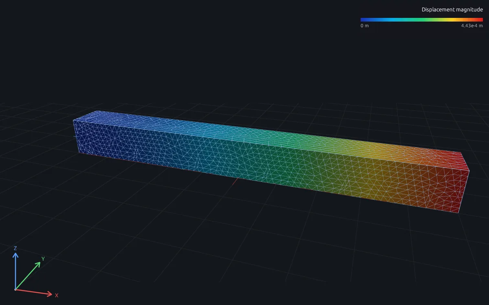

# Cantilever beam frequency response near resonance: a modal harmonic FEA study

[](https://runmat.com/sandbox?example=cantilever-harmonic&run=0)

This study finds the steady vibration of a steel cantilever beam, 1000 × 100 × 100 mm, driven at
its free end by a 100 N force swept from 20 Hz to 200 Hz. It solves the first eight modes, then
builds the forced response from them at nine frequencies with Rayleigh damping. At 80 Hz, just
below the first bending mode, the free end vibrates with an amplitude of 0.443 mm, 22 times the
0.020 mm the same force would cause statically.



## The problem

A structure driven by a steady oscillating force, such as an unbalanced rotor or a shaker table,
settles into vibration at the driving frequency. Its amplitude depends on how close that frequency
is to a natural frequency and on how much damping the structure has. A frequency response study
gives the amplitude at each driving frequency, so you can see how much margin a design has from
resonance.

The modal method solves the free-vibration modes first, then writes the forced response as a sum of
those modes. Each mode responds like a damped single-degree-of-freedom oscillator. With Rayleigh
damping, the damping matrix is C = αM + βK, and the damping ratio of a mode at angular frequency ω is

$$\zeta = \frac{\alpha}{2\omega} + \frac{\beta \omega}{2}$$

For this beam, Euler–Bernoulli theory puts the first bending mode at 81.5 Hz. With α = 10 s⁻¹ and
β = 20 µs, ζ is 1.49 % there, so the resonant amplitude is about 1/(2ζ) = 34 times the static
deflection.

## How the study works

1. **Geometry and mesh.** The beam comes from `geometry/cantilever.step`, with its body, fixed end
   and loaded end named in the CAD file. Quadratic tetrahedra at a 50 mm target size.

2. **Material.** Steel, E = 200 GPa, ν = 0.3, ρ = 7,850 kg/m³, with Rayleigh damping:

   ```
   rayleigh_damping {
       mass_coefficient = 10 Hz
       stiffness_coefficient = 20 us
   }
   ```

3. **Excitation.** A force over frequency, 100 N with zero phase from 20 Hz to 200 Hz, acting on the
   loaded end in -Z.

4. **Modes, then response.** The study solves eight modes and keeps the basis. The harmonic step
   reuses that basis at each requested frequency:

   ```
   analysis modes {
       structural modal { modes = 8 }
       retain basis
   }
   analysis response after analysis.modes {
       structural modal_harmonic {
           basis = analysis.modes.state.basis
           frequencies = [20, 40, 60, 75, 80, 85, 100, 150, 200] Hz
       }
   }
   ```

   The frequencies cluster around 80 Hz, where the first bending mode sits.

## Results

The figure shows the displacement amplitude at 80 Hz, from zero at the fixed end to 0.443 mm at the
free end. The beam takes the shape of its first bending mode, since that mode dominates the response
near its frequency.

| Quantity | Value |
| --- | --- |
| Free-end amplitude at 80 Hz | 0.443 mm |
| Static tip deflection under 100 N, PL³/3EI | 0.020 mm |
| Dynamic amplification at 80 Hz | 22 × |

A single-mode hand estimate at 80 Hz, using the 81.5 Hz Euler–Bernoulli frequency and the damping
above, gives 0.422 mm. The FE amplitude is a little higher because shear and rotary inertia, which
the beam formula leaves out, lower the true frequency and put 80 Hz closer to resonance. The run
reports a modal truncation balance error of 0.092 at 200 Hz, the top of the sweep, where the eight
retained modes cover the response least well.

## What to try

1. Add samples at 81, 82 and 83 Hz to `frequencies` to find the resonant peak more closely.
2. Halve both damping coefficients. ζ at 81.5 Hz drops to 0.74 %, so the resonant peak roughly
   doubles while the response far from resonance hardly changes.
3. Raise `modes = 8` to 16 and compare the response at 150 Hz and 200 Hz with the 8-mode run.

## Files

- `cantilever-harmonic.fea`: the study: geometry, mesh, damped material, frequency-domain force, modes and harmonic response.
- `materials.module`: the material the study imports, `steel`.
- `geometry/cantilever.step`: the beam's geometry, with its body, fixed end and loaded end named.
- `runmat.toml`: the project file.

## Related

- [Structural simulation in RunMat](https://runmat.com/simulation/structural)
- [Modal analysis guide](https://runmat.com/docs/simulation/guides/modal-analysis)
- [Cantilever beam impact](../cantilever-impact), [heated panel frequency response](../heated-panel-harmonic) and [tuning fork modes](../tuning-fork-modal)
- [Download RunMat](https://runmat.com/download)
