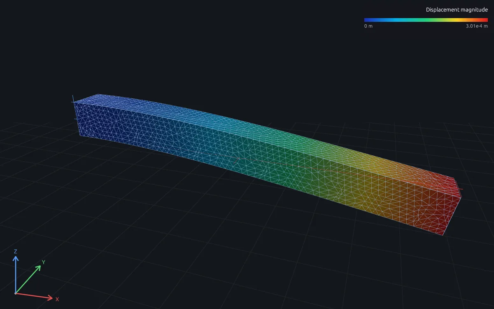

# Cantilever beam struck by a half-sine impact pulse: a transient dynamic FEA study

[](https://runmat.com/sandbox?example=cantilever-impact&run=0)

This study follows a steel cantilever beam, 1000 × 100 × 100 mm, after a 1 kN half-sine force pulse
lasting 6 ms strikes its free end. The pulse comes from a MATLAB-language function, and the study
integrates the motion over 30 ms in 0.25 ms steps. At t = 18.5 ms the free end is displaced
0.301 mm, half again the 0.200 mm the same force would cause statically.



## The problem

A short load can deflect a structure more than the same load applied slowly, because the structure
picks up momentum and overshoots. How much more depends on the pulse's duration compared with the
structure's natural period. A transient study integrates the equation of motion,

$$M \ddot{u} + K u = f(t)$$

step by step in time, so it captures the overshoot and the free vibration that follows.

For this beam, Euler–Bernoulli theory puts the first bending mode at 81.5 Hz, a period of 12.3 ms.
The 6 ms pulse lasts about half a period, and the 30 ms window covers about two and a half periods.
The beam has no damping, so it keeps vibrating after the pulse ends.

## How the study works

1. **The pulse function.** `impactPulse.m` returns a half-sine of the given peak and duration, and
   zero after it:

   ```matlab
   insidePulse = time <= duration;
   phase = min(time ./ duration, 1);
   force = peak .* sin(pi .* phase) .* insidePulse;
   ```

2. **The signal.** The study imports the function and samples it at 20 kHz over the 30 ms window:

   ```
   import { impactPulse } from "./impactPulse.m"

   signal pulse : force over time {
       generated by impactPulse {
           arguments {
               peak = 1 kN
               duration = 6 ms
           }
           sample from 0 s to 30 ms at 20 kHz
   ```

3. **Geometry, mesh and material.** The beam comes from `geometry/cantilever.step`, meshed with
   quadratic tetrahedra at a 50 mm target size. Steel: E = 200 GPa, ν = 0.3, ρ = 7,850 kg/m³. The
   fixed end is held, and the pulse acts on the loaded end in -Z.

4. **Transient analysis.** Newmark average-acceleration integration, which neither adds nor removes
   energy, at a fixed step:

   ```
   structural transient {
       start_time = 0 s
       end_time = 30 ms
       time_step = 0.25 ms
   }
   ```

## Results

The run takes 120 steps with none rejected. The figure shows displacement magnitude at t = 18.5 ms,
from zero at the fixed end to 0.301 mm at the free end, with the beam bent in its first mode.

| Quantity | Value |
| --- | --- |
| Free-end displacement at 18.5 ms | 0.301 mm |
| Static tip deflection under 1 kN, PL³/3EI | 0.200 mm |
| Peak von Mises stress at 18.5 ms, at the fixed end | 8.90 MPa |
| Free-end velocity at 18.5 ms | 7.46 mm/s |
| Energy put in by the pulse | 0.232 J |

The energy in the beam at the end of the run equals the work done by the pulse, and the run reports
a relative energy-balance error of 4 × 10⁻¹¹. With no damping that is the expected result.

A single-mode hand estimate, an undamped oscillator at 81.5 Hz under the same half-sine, peaks at
1.55 × the static deflection, 0.311 mm. The FE result at 18.5 ms is within 4 % of it.

## What to try

1. Change `duration` to 12 ms, about one natural period, and compare the peak displacement with the
   6 ms run.
2. Add Rayleigh damping to the material (as in [the frequency response study](../cantilever-harmonic))
   and watch the free vibration decay after the pulse.
3. Halve `time_step` to 0.125 ms and compare the displacement at 18.5 ms. A small change means the
   step is fine enough; this is the time-step convergence check.
4. Edit `impactPulse.m` to a different pulse shape, such as a triangle or a square step.

## Files

- `cantilever-impact.fea`: the study: geometry, mesh, material, the generated pulse and the transient analysis.
- `materials.module`: the material the study imports, `steel`.
- `impactPulse.m`: the half-sine pulse as a function of time, peak and duration.
- `geometry/cantilever.step`: the beam's geometry, with its body, fixed end and loaded end named.
- `runmat.toml`: the project file.
- `runmat.lock`: the resolved project dependencies.

## Related

- [Structural simulation in RunMat](https://runmat.com/simulation/structural)
- [Modal analysis guide](https://runmat.com/docs/simulation/guides/modal-analysis) and [`sin`](https://runmat.com/docs/reference/builtins/sin)
- [Cantilever beam frequency response](../cantilever-harmonic) and [bracket shock response](../bracket-shock-spectrum)
- [Shock response spectrum](../../aerospace/shock-response-spectrum)
- [Download RunMat](https://runmat.com/download)
