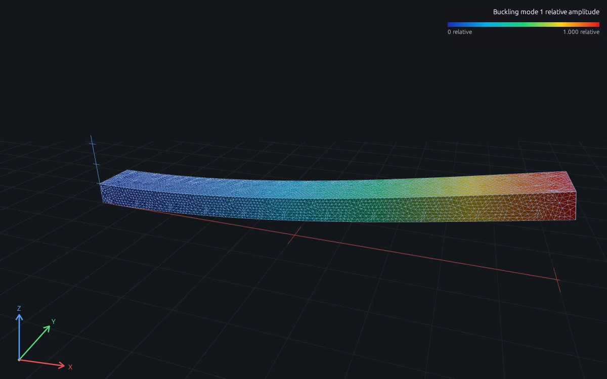

# Critical buckling load of a fixed-free steel column: a linear buckling FEA study

[](https://runmat.com/sandbox?example=column-buckling&run=0)

This study finds the axial load at which a steel column, 1000 mm tall with a 100 × 50 mm section,
buckles when fixed at its base and free at its top. A preload step applies 250 kN to the top face
and builds the geometric stiffness, and a buckling step finds the load factor on that preload. The
column buckles at 2.062 × 250 kN = 515.5 kN, bending about the weak axis of its section.



## The problem

A slender member in compression can fail by buckling, a sudden sideways bending, at a stress well
below its yield strength. Columns, struts, truss members and pushrods are checked for it. For an
ideal elastic column fixed at one end and free at the other, Euler's formula gives the critical load:

$$P_{cr} = \frac{\pi^2 E I}{(2L)^2}$$

where I is the smaller second moment of area of the section and 2L the effective length of a
fixed-free column.

A linear buckling study solves the same problem on the real geometry. It first solves the column
under a reference load, then finds the factor λ at which the stiffness lost to compression, the
geometric stiffness, cancels the elastic stiffness:

$$(K + \lambda K_G)\, \phi = 0$$

The critical load is λ times the reference load, and φ is the buckled shape.

## How the study works

1. **Geometry and mesh.** The column comes from `geometry/column-100x50.step`, with its body, base
   and top named in the CAD file. Quadratic tetrahedra at a 25 mm target size.

2. **Material.** Steel: E = 200 GPa, ν = 0.3, ρ = 7,850 kg/m³.

3. **Model.** The base is fixed and 250 kN pushes on the top face along the column's axis:

   ```
   load axial {
       force on geometry.column.region.top = [-250, 0, 0] kN
   }
   ```

4. **Preload, then buckling.** The preload's geometric stiffness feeds the buckling step, which asks
   for the first mode:

   ```
   analysis preload { structural preload {} }
   analysis buckling after analysis.preload {
       structural buckling {
           prestress = analysis.preload.state.geometric_stiffness
           modes = 1
       }
   }
   ```

## Results

| Quantity | Value |
| --- | --- |
| Load factor, mode 1 | 2.062 |
| Critical load | 515.5 kN |
| Euler critical load, weak axis (I = 1.042 × 10⁶ mm⁴) | 514.0 kN |
| Axial stress at the critical load | 103 MPa |

The study agrees with Euler's formula within 0.3 %. The figure shows the buckled shape, colored by
relative amplitude from 0 at the fixed base to 1 at the free top. A buckling mode has no physical
amplitude of its own: it shows the shape, and the load factor gives the load.

The axial stress at buckling is 103 MPa, well below the yield strength of structural steel, so this
column fails by elastic buckling before it yields. A real column buckles below the ideal load because
of initial crookedness and load eccentricity, so design codes apply reduction factors to it.

## What to try

1. Ask for `modes = 3`. By beam theory the next modes are bending about the strong axis at a factor
   of 8.22, then the weak axis's second fixed-free mode at 18.5.
2. Change `youngs_modulus` to 69 GPa. The load factor scales with E, to 0.711 by Euler's formula, so
   250 kN would buckle the column.
3. Halve the mesh size to `target_size = 12.5 mm` and compare the load factor with the 25 mm run.

## Files

- `column-buckling.fea`: the study: geometry, mesh, material, model, preload and buckling analysis.
- `geometry/column-100x50.step`: the column's geometry, with its body, base and top named.
- `runmat.toml`: the project file.

## Related

- [Structural simulation in RunMat](https://runmat.com/simulation/structural)
- [Linear static guide](https://runmat.com/docs/simulation/guides/linear-static) and [mesh refinement guide](https://runmat.com/docs/simulation/guides/mesh-refinement)
- [Rail thermal buckling](../rail-thermal-buckling) and [cantilever beam plastic bending](../cantilever-plastic)
- [Download RunMat](https://runmat.com/download)
