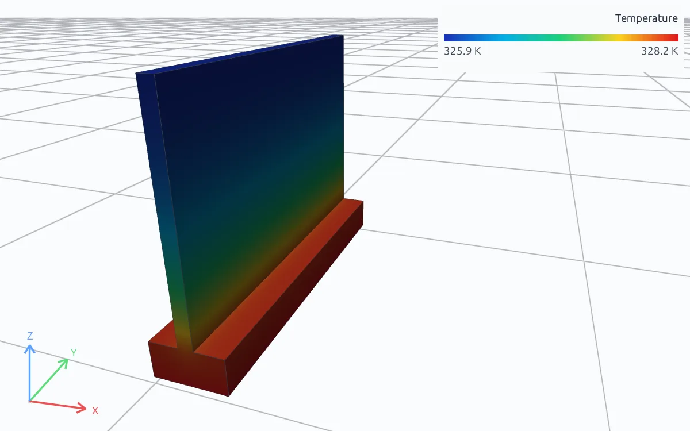

# Heat sink fin array temperature from one periodic cell: a steady thermal FEA study

[](https://runmat.com/sandbox?example=fin-array-cell&run=0)

This study finds the base temperature of a straight-fin aluminum heat sink by solving one 10 mm
pitch cell of it: a 5 mm base and one 2 mm fin, 30 mm tall and 50 mm deep. The base takes
5 kW/m² (2.5 W per cell) and the fin and exposed base lose heat to 25 °C air at 25 W/m²·K. A
periodic constraint ties the cell's two side faces, so the cell stands for the whole array. The
base underside peaks at 55.01 °C, in line with the 54.9 °C fin-array estimate.

<picture>
  <source media="(prefers-color-scheme: dark)" srcset=".artifacts/thumbnail.webp">
  
</picture>

## The problem

A heat sink with many identical fins repeats one cell across its width. Away from the ends, every
cell sees the same heat and the same air, so the temperature on one side face of a cell equals the
temperature on the matching point of the other. Solving one cell with that periodic condition gives
the array's temperature at a fraction of the cost of the full part.

The classical estimate treats the fin as one-dimensional with a corrected height Hc = H + t/2 to
account for its convecting tip:

$$m = \sqrt{\frac{2h}{k t}}, \qquad \eta = \frac{\tanh(m H_c)}{m H_c}$$

Here m = 12.24 m⁻¹, Hc = 31 mm and the fin efficiency η = 0.955. The cell's conductance to air is
h(A_base + ηA_fin) = 25 × (400 + 0.955 × 3,100) mm² = 0.0840 W/K, so the base runs 2.5 / 0.0840 =
29.8 K above the air. Another 0.15 K across the 5 mm base plate puts the underside at 54.9 °C.

## How the study works

1. **Geometry.** `geometry/fin-array-cell.step` names the body, the base underside, the two cell
   sides and the cooled surfaces (both fin faces, the fin tip and the exposed base).

2. **Mesh and material.** Quadratic tetrahedra at a 2 mm target size. Aluminum 6061-T6,
   k = 167 W/m·K (ASM Handbook, Vol. 2).

3. **Loads.** 5 kW/m² into the base underside and convection to 25 °C air on the cooled surfaces.

4. **The periodic sides.** The left side's temperatures equal the right side's, one pitch over:

   ```
   constraint neighbor_cells {
       thermal.periodic {
           primary = geometry.cell.region.side_left
           secondary = geometry.cell.region.side_right
           translation = [10 mm, 0 mm, 0 mm]
       }
   }
   ```

5. **Study.** A steady thermal analysis, reporting the temperature field and the mean temperature of
   the base underside:

   ```
   output base_temperature = mean(analysis.heat.field.node.temperature, over = geometry.cell.region.base_underside)
   ```

## Results

| Quantity | Value |
| --- | --- |
| Hottest point, base underside | 55.01 °C (328.16 K) |
| Coolest point, fin tip | 52.74 °C (325.89 K) |
| Fin-array estimate, base underside | 54.9 °C |
| Heat to air | 2.50 W, equal to the heat in |

The figure shows the base in red and the fin cooling toward its tip. The whole cell spans only
2.3 K, which is what a fin efficiency of 0.955 means: the fin is nearly at base temperature over its
height, so almost all of its area works.

## What to try

1. Raise `coefficient` to 50 W/m²·K for forced air. The estimate gives η = 0.914 and a base at about
   40.6 °C; compare it with the run.
2. Change the heat flux to 10 kW/m². Conduction with a fixed film coefficient is linear, so every
   rise above 25 °C doubles.
3. Change the fin thickness or pitch in the STEP file and compare the base temperature; a thicker
   fin raises η but leaves less exposed base.

## Files

- `fin-array-cell.fea`: the study, with its fin-array estimate in the header.
- `materials.module`: the material the study imports, `aluminum_6061_t6`.
- `geometry/fin-array-cell.step`: the cell as STEP, with the body, base underside, cell sides and cooled surfaces named.
- `runmat.toml`: the project file.

## Related

- [Thermal simulation in RunMat](https://runmat.com/simulation/thermal)
- [Steady heat transfer guide](https://runmat.com/docs/simulation/guides/steady-heat-transfer)
- [Pin fin convection](../pin-fin-convection) and [heat spreader on a cooled block](../tim-stack)
- [Download RunMat](https://runmat.com/download)
