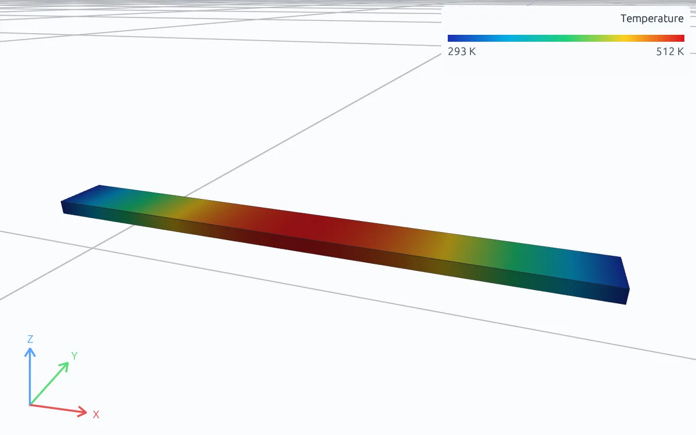

# Copper fuse element temperature under a 120 A overload: a coupled electrothermal FEA study

[](https://runmat.com/sandbox?example=fuse-link-overload&run=0)

This study finds the steady temperature of a copper fuse element, 10 mm long with a 1 × 0.25 mm
section, carrying a 120 A overload. The ends are soldered to terminals held at 20 °C, and the
copper's resistivity rises with temperature, so the study solves current and heat together. The
middle of the element reaches 238.66 °C, matching the closed-form 238.7 °C, and the element
dissipates 15.52 W.

<picture>
  <source media="(prefers-color-scheme: dark)" srcset=".artifacts/thumbnail.webp">
  
</picture>

## The problem

A fuse element is a deliberately thin conductor. Under an overload its Joule heating outruns the
heat it can conduct to its terminals, and it melts at its hottest point. Copper's resistivity rises
about 0.393 % per kelvin, so the hotter middle generates more heat than the ends. That feedback
concentrates the rise in the middle, and a constant-resistivity estimate underpredicts it badly.

With resistivity ρ = ρ₂₀(1 + αθ), both ends at the reference temperature and an insulated surface
(the element is packed in still filler), the steady profile has a closed form:

$$\theta(x) = \frac{1}{\alpha}\left(\frac{\cos m(x - L/2)}{\cos(mL/2)} - 1\right), \qquad m^2 = \frac{\alpha J^2 \rho_{20}}{k}$$

At J = 120 A / 0.25 mm² = 480 A/mm², m = 200.6 m⁻¹ and mL/2 = 1.003, so the middle reaches
218.7 K above the ends, 238.7 °C. At constant resistivity the rise would be ρJ²L²/(8k) = 128.0 K.
As mL/2 approaches π/2 the peak grows without bound, so the element has no steady state above about
188 A and heats until it melts.

## How the study works

1. **Geometry.** `geometry/fuse-element.step` names the body `Fuse element` and the faces
   `Terminal A` and `Terminal B`. Quadratic tetrahedra at a 0.125 mm target size.

2. **Material.** Copper with electrical and thermal properties together: σ = 58 MS/m at 20 °C and a
   temperature coefficient of 0.00393 K⁻¹ (IEC 60028), and k = 388 W/m·K (C11000, ASM Handbook,
   Vol. 2):

   ```
   electrical {
       reference_temperature = 20 degC
       conductivity = 58000000 A/V/m
       resistive_heating_coefficient = 0.00393 K^-1
   ```

3. **Model.** 120 A into Terminal A with Terminal B at 0 V, and both terminals held at 20 °C:

   ```
   load overload {
       electric_current on geometry.fuse.region.terminal_a = 120 A
   }
   constraint terminal_a_temperature {
       thermal.temperature { target = geometry.fuse.region.terminal_a; value = 293.15 K }
   }
   ```

4. **Study.** A steady electrothermal analysis, which iterates the current and temperature fields
   to a consistent operating point:

   ```
   analysis operating_point { electrothermal steady {} }
   ```

## Results

| Quantity | Closed form | Solved |
| --- | --- | --- |
| Peak temperature, at mid-length | 238.7 °C | 238.66 °C (511.81 K) |
| Voltage across the element | 129.3 mV | 129.35 mV |
| Power dissipated | 15.52 W | 15.52 W |
| Current density | 480 A/mm² | 478–482 A/mm² |

The figure shows the temperature: blue at the held ends and red across the middle. The Joule loss
density is 3.98 GW/m³ at the ends and 7.39 GW/m³ at mid-length, 1.86 times higher, because the hot
copper there has higher resistivity.

## What to try

1. Lower the current to 100 A. The closed form gives a rise of 125.0 K, a peak of 145.0 °C.
2. Raise the current to 150 A. The closed form gives a rise of 561.6 K, a peak of 581.6 °C, more
   than four times the 120 A rise for 25 % more current.
3. Set `resistive_heating_coefficient = 0 K^-1` and compare the peak with the 128.0 K
   constant-resistivity estimate.

## Files

- `fuse-link-overload.fea`: the study, with the closed-form check in its header.
- `geometry/fuse-element.step`: the element as STEP, with the body and both terminals named.
- `runmat.toml`: the project file.

## Related

- [Electrothermal simulation in RunMat](https://runmat.com/simulation/electrothermal)
- [Steady heat transfer guide](https://runmat.com/docs/simulation/guides/steady-heat-transfer)
- [Busbar fault pulse](../busbar-fault-pulse), [EV busbar temperature at 400 A](../six-bolt-busbar) and [heater rod with fixed end temperatures](../heated-rod-fixed-ends)
- [Download RunMat](https://runmat.com/download)
