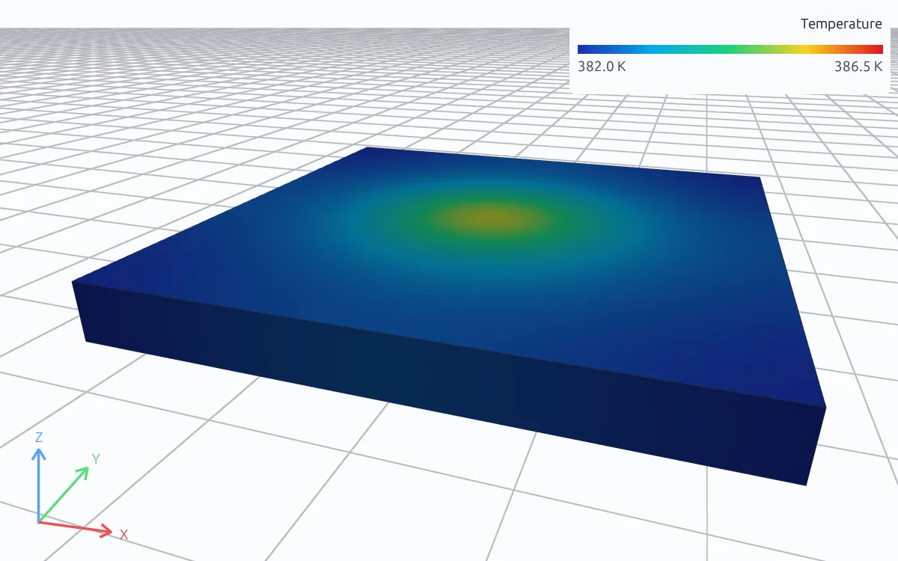

# Heat spreader warm-up after a component switches on: a transient thermal FEA study

[](https://runmat.com/sandbox?example=heat-spreader-warm-up&run=0)

This study follows the temperature of an aluminum heat spreader, 100 × 100 × 10 mm, after a 20 W
component on a 20 × 20 mm pad switches on. The other faces lose heat to 25 °C air at 10 W/m²·K, and
the run covers 6,000 s, about six time constants. At 6,000 s the plate spans 108.80 °C at its
corners to 113.32 °C over the pad, against a lumped-model mean of 109.5 °C.

<picture>
  <source media="(prefers-color-scheme: dark)" srcset=".artifacts/thumbnail.webp">
  
</picture>

## The problem

A component that switches on does not reach its steady temperature at once: its heat sink or
spreader has to warm up first. How long that takes sets whether a short duty cycle is safe, and how
quickly a fault shows up as a temperature rise.

The plate's Biot number, h(t/2)/k = 10 × 0.005 / 167 = 3 × 10⁻⁴, is small, so the plate warms
almost uniformly. As one lump, its mean temperature follows

$$T(t) = T_\infty + \frac{P}{hA}\left(1 - e^{-t/\tau}\right), \qquad \tau = \frac{\rho c V}{hA}$$

with τ = 2700 × 896 × 1.0 × 10⁻⁴ / (10 × 0.0236) = 1,025 s and a steady rise P/(hA) = 20 / 0.236 =
84.7 K:

| t (s) | 600 | 1200 | 1800 | 3600 | 6000 |
| --- | --- | --- | --- | --- | --- |
| Mean, lumped model (°C) | 62.6 | 83.5 | 95.1 | 107.2 | 109.5 |

The FE study adds what the lumped model leaves out: the spread of temperature from the pad across
the plate.

## How the study works

1. **Geometry.** `geometry/heat-spreader.step` names the body `Spreader`, the face `Heater pad` and
   the `Cooled surfaces`. Quadratic tetrahedra at a 5 mm target size.

2. **Material.** Aluminum 6061-T6: ρ = 2,700 kg/m³, c = 896 J/kg·K, k = 167 W/m·K (ASM Handbook,
   Vol. 2).

3. **Model.** The plate starts at 25 °C. 20 W over the 400 mm² pad is 50 kW/m², on from t = 0, and
   the other faces convect to 25 °C air:

   ```
   load component {
       thermal.heat_flux {
           target = geometry.spreader.region.heater_pad
           value = 50000 W/m^2
       }
   }
   ```

4. **Transient analysis.** 6,000 s in 30 s steps, 200 steps in all, starting from the initial
   condition:

   ```
   thermal transient {
       start_time = 0 s
       end_time = 6000 s
       time_step = 30 s
   }
   initial_conditions = [model.initial.room_temperature]
   ```

5. **Outputs.** The temperature history, and the peak and mean temperature of the plate at each step.

## Results

| Quantity at 6,000 s | Value |
| --- | --- |
| Hottest point, over the pad | 113.32 °C (386.47 K) |
| Coolest point, at a top corner | 108.80 °C (381.95 K) |
| Lumped-model mean | 109.5 °C |
| Heat lost to air | 19.94 W of the 20 W input |

The figure shows the plate at 6,000 s: a warm spot centered over the pad, fading toward the edges.
The whole plate spans 4.5 K, small next to the 84 K rise, which is what the low Biot number
predicts. The remaining 0.06 W still goes into storage, so the plate is within a fraction of a
kelvin of steady state.

## What to try

1. Plot `mean_temperature` against time and compare it with the lumped-model table.
2. Halve `coefficient` to 5 W/m²·K. Both τ and the steady rise double, to 2,050 s and 169.4 K, so the
   plate is still warming at 6,000 s; extend `end_time` to follow it.
3. Double the plate's thickness to 20 mm in the STEP file. The cooled area grows from 0.0236 m² to
   0.0276 m², so the lumped model gives τ = 1,753 s and a steady rise of 72.5 K.

## Files

- `heat-spreader-warm-up.fea`: the study, with the lumped-model check in its header.
- `geometry/heat-spreader.step`: the plate as STEP, with the body, heater pad and cooled surfaces named.
- `runmat.toml`: the project file.

## Related

- [Thermal simulation in RunMat](https://runmat.com/simulation/thermal)
- [Steady heat transfer guide](https://runmat.com/docs/simulation/guides/steady-heat-transfer)
- [Chip cold plate power step](../chip-cold-plate-power-step) and [heat spreader on a cooled block](../tim-stack)
- [Download RunMat](https://runmat.com/download)
