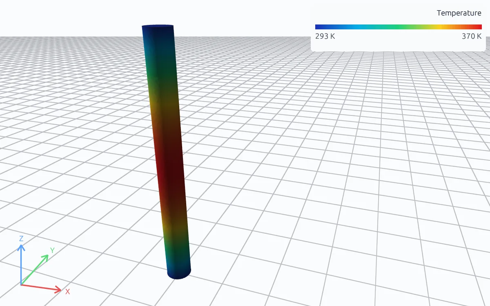

# Temperature of a heater rod with both ends held: steady conduction with heat generation

[](https://runmat.com/sandbox?example=heated-rod-fixed-ends&run=0)

This study finds the steady temperature of a stainless steel heater rod, 10 mm in diameter and
100 mm long, generating 1 MW/m³ (7.85 W) uniformly. Both ends are clamped in terminal blocks held
at 20 °C, and the surface is insulated. The temperature rises in a parabola to 97.16 °C at
mid-length, matching the closed-form answer to within 0.01 K.

<picture>
  <source media="(prefers-color-scheme: dark)" srcset=".artifacts/thumbnail.webp">
  
</picture>

## The problem

Resistive heaters, current-carrying conductors and fuel rods generate heat throughout their volume
and lose it through their ends or surfaces. When the surface is insulated and both ends are held at
the same temperature, all heat flows along the rod. The steady temperature then satisfies

$$k \frac{d^2 T}{dx^2} + \dot q = 0$$

whose solution is a parabola with its peak at mid-length:

$$T_{max} = T_{end} + \frac{\dot q L^2}{8k} = 20 + \frac{10^6 \times 0.1^2}{8 \times 16.2} = 97.16\ ^\circ\text{C}$$

Each end carries half the heat, q̇AL/2 = 3.93 W, at a flux of q̇L/2 = 50 kW/m². This is a standard
check that a thermal solver handles volumetric heating and fixed-temperature boundaries correctly.

## How the study works

1. **Geometry.** `geometry/heater-rod.step` names the body `Heater rod` and the faces `End A`,
   `End B` and `Rod surface`. Quadratic tetrahedra at a 2.5 mm target size.

2. **Material.** AISI 304 stainless steel, k = 16.2 W/m·K (ASM Handbook, Vol. 1).

3. **Model.** Both ends held at 20 °C and uniform heat generation in the body. The rod surface
   gets no condition, so it is insulated:

   ```
   constraint end_a_held {
       thermal.temperature { target = geometry.rod.region.end_a; value = 293.15 K }
   }
   load heating {
       heat_generation on geometry.rod.region.body = 1000000 W/m^3
   }
   ```

4. **Study.** A steady thermal analysis, reporting the temperature field, the peak temperature and
   the heat flow out through End A:

   ```
   output peak_temperature = max(analysis.heat.field.node.temperature, over = geometry.rod.region.body)
   output end_a_heat_flow = flux(analysis.heat.field.element.heat_flux, through = geometry.rod.region.end_a)
   ```

## Results

| Quantity | Closed form | Solved |
| --- | --- | --- |
| Peak temperature, at mid-length | 97.16 °C | 97.16 °C (370.31 K) |
| Heat flux at the ends | 50.0 kW/m² | 49.9 kW/m² |
| Net heat leaving through both ends | 7.85 W | 7.85 W |

The figure shows the temperature along the rod: blue at the two held ends and red at mid-length.
The run's energy balance closes to 2 × 10⁻¹³ W.

## What to try

1. Change `conductivity` to 21.5 W/m·K. The rise scales with 1/k, so the peak drops to 78.14 °C.
2. Double `heat_generation` to 2 MW/m³. The rise above 20 °C doubles, to a peak of 174.3 °C.
3. Hold End B at 100 °C instead of 20 °C and see how the peak moves toward the hotter end.

## Files

- `heated-rod-fixed-ends.fea`: the study, with its hand check in the header.
- `materials.module`: the material the study imports, `stainless_304`.
- `geometry/heater-rod.step`: the rod as STEP, with the body, both ends and the rod surface named.
- `runmat.toml`: the project file.

## Related

- [Thermal simulation in RunMat](https://runmat.com/simulation/thermal)
- [Steady heat transfer guide](https://runmat.com/docs/simulation/guides/steady-heat-transfer)
- [Pin fin convection](../pin-fin-convection) and [restrained bar heated past yield](../clamped-bar-yield)
- [Download RunMat](https://runmat.com/download)
