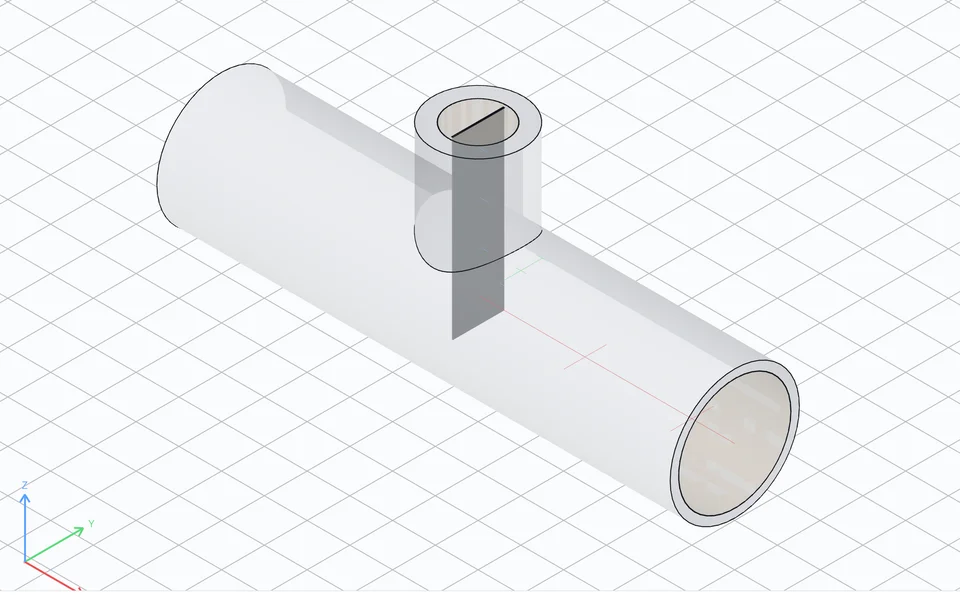

# Paddle flow switch deflection in oil: a fluid-structure FEA study

[](https://runmat.com/sandbox?example=paddle-flow-switch&run=0)

This study solves laminar oil flow through a 2-inch pipe tee and the bending of the spring-steel
paddle that hangs across it, coupled in one steady fluid-structure analysis. At 1 m/s of ISO VG 46
oil at 40 °C, the switch must see at least 1 mm of tip travel to trip. It reports the paddle's
largest deflection. A cantilever hand check gives 1.99 mm at the tip and 47 MPa at the root.

<picture>
  <source media="(prefers-color-scheme: dark)" srcset=".artifacts/thumbnail.webp">
  
</picture>

## The problem

A paddle flow switch confirms that a line is flowing: the flow pushes a thin blade downstream, and
the blade's tip travel operates a switch. The paddle must be soft enough to move the trip distance
at the rated speed and strong enough that its root stays far inside the steel's strength over many
trips.

The rated flow is laminar. In the 52.5 mm bore, with oil at 46 cSt,

$$Re = \frac{U D}{\nu} = \frac{1 \times 0.0525}{46\times10^{-6}} = 1140$$

The hand check in the study's header treats the paddle as a cantilever loaded at the centroid of its
wetted area. About 864 mm² of paddle sits in the run, 64 mm below the clamp, and blocks 40 % of the
bore. With a drag coefficient of 2,

$$F = C_d \tfrac{1}{2} \rho U^2 A = 2 \times 0.5 \times 861 \times 1^2 \times 864\times10^{-6} = 0.74\ \text{N}$$

With I = 24 × 0.5³ / 12 = 0.25 mm⁴ and EI = 46,250 N·mm², the paddle bends 1.40 mm at the load
and 1.99 mm at its tip, 18 mm further down. The root stress is Fac/I = 47 MPa against about
1,300 MPa for spring-hard EN 1.4310. The coupled study replaces the drag coefficient with the solved
pressure and shear on the paddle.

## How the study works

1. **The part.** `flow_switch.part` builds a schedule 40 steel tee (52.5 mm bore, 240 mm long) with
   a 27 mm switch boss, the oil filling both bores, and a 0.5 × 24 × 82 mm paddle clamped at the top
   of the boss. Each is its own body; the paddle's faces carry an oil side and a steel side. The
   part is exported to `geometry/flow_switch.step`.

2. **Mesh.** Linear tetrahedra at 4 mm, refined to 0.5 mm in the paddle.

3. **Materials.** ISO VG 46 oil (861 kg/m³, 0.0396 Pa·s), EN 1.4310 spring steel (E = 185 GPa,
   ν = 0.3) for the paddle and carbon steel for the tee.

4. **Model.** 1 m/s into the inlet, 0 Pa at the outlet, no slip on the pipe wall, the paddle root and
   the tee ends fixed, and a no-slip fluid-structure interface on the paddle:

   ```
   interface wetted {
       fluid_structure.no_slip {
           primary = geometry.switch.region.paddle_wetted
           secondary = geometry.switch.region.paddle_surface
       }
   }
   ```

5. **Study.** A steady fluid-structure analysis, reporting the largest displacement in the paddle:

   ```
   analysis equilibrium { fluid_structure_interaction steady {} }
   output tip_deflection = max(magnitude(output.displacement), over = geometry.switch.region.paddle)
   ```

## Results

| Quantity | Hand check | Requirement |
| --- | --- | --- |
| Reynolds number | 1140 | under 2000 (laminar) |
| Drag on the paddle | 0.74 N | |
| Tip deflection | 1.99 mm | at least 1 mm to trip |
| Root bending stress | 47 MPa | well under about 1,300 MPa |

The study returns the paddle's displacement field, the oil's velocity and pressure fields, and
`tip_deflection`. Compare `tip_deflection` with the 1 mm trip travel; the velocity field shows the
wake behind the paddle and the flow squeezing past it through the 60 % of the bore it leaves open.

## What to try

1. Change `paddle` (the thickness) in `flow_switch.part` to 0.8 mm and export the part again.
   Deflection goes as 1/t³, so the hand check falls to 0.49 mm, short of the trip.
2. Halve the inlet velocity to 0.5 m/s. Drag goes as U², so the hand check gives 0.50 mm of tip
   travel and Re 570.
3. Lengthen the paddle with `paddle_length` and watch the tip deflection against the trip travel.

## Files

- `paddle-flow-switch.fea`: the fluid-structure study, with its hand check in the header.
- `materials.module`: the materials the study imports: `iso_vg_46`, `spring_steel` and `carbon_steel`.
- `flow_switch.part`: the tee, the oil and the paddle in RunMat MCAD, with the bores and the paddle's thickness, width and length as inputs.
- `geometry/flow_switch.step`: the part exported to STEP, with the body and face names the study selects.
- `DESIGN-NOTES.md`: how the line size, the paddle and its material were chosen, with the hand checks.
- `runmat.toml`: the project file.

## Related

- [Fluid-structure simulation in RunMat](https://runmat.com/simulation/fluid-structure)
- [Fluid-structure interaction physics reference](https://runmat.com/docs/simulation/physics/fluid-structure-interaction) and [fluid constraints](https://runmat.com/docs/simulation/constraints/fluid)
- [Pulse in a compliant tube](../compliant-tube-pulse) and [hydraulic line pressure drop](../hydraulic-line-poiseuille)
- [Download RunMat](https://runmat.com/download)
