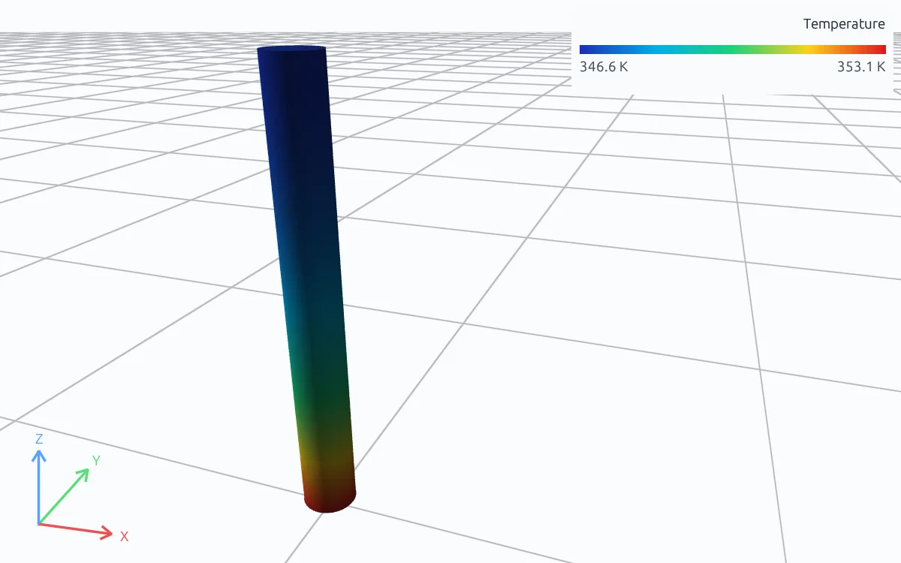

# Pin fin heat transfer with a convecting tip: an FEA check against the classical fin solution

[](https://runmat.com/sandbox?example=pin-fin-convection&run=0)

This study solves steady heat flow through an aluminum pin fin, 6 mm in diameter and 50 mm long,
with its base held at 80 °C and its side and tip losing heat to 25 °C air at 25 W/m²·K. It returns
the temperature along the fin, the heat flowing in through the base and the tip temperature. The
fin carries 1.228 W and its tip sits at 73.45 °C, both matching the classical fin solution.

<picture>
  <source media="(prefers-color-scheme: dark)" srcset=".artifacts/thumbnail.webp">
  
</picture>

## The problem

Pin fins add surface area to heat sinks, cold plates and engine parts. How much heat one carries
depends on how far its temperature falls along its length. The classical solution treats the fin as
one-dimensional, valid here because the radial Biot number hr/k = 4.5 × 10⁻⁴ is tiny. With
perimeter P = πd and area A = πd²/4,

$$m = \sqrt{\frac{hP}{kA}} = 9.990\ \text{m}^{-1}, \qquad mL = 0.4995$$

With a convecting tip, the heat into the base is

$$q = \sqrt{hPkA}\,\theta_b\,\frac{\sinh mL + (h/mk)\cosh mL}{\cosh mL + (h/mk)\sinh mL} = 1.228\ \text{W}$$

where θb = 80 − 25 = 55 K. The tip's excess temperature is θb / (cosh mL + (h/mk) sinh mL) =
48.45 K, so the tip reads 73.45 °C. The FE model solves the full 3D conduction problem, so it checks
both the 1D assumption and the solver.

## How the study works

1. **Geometry.** `geometry/pin-fin.step` names the body `Pin fin` and its base, side and tip faces.

2. **Mesh and material.** Quadratic tetrahedra at a 1.5 mm target size. Aluminum 6061-T6,
   k = 167 W/m·K (ASM Handbook, Vol. 2).

3. **Model.** The base is held at 80 °C, and the side and tip convect to 25 °C air:

   ```
   constraint hot_base {
       thermal.temperature { target = geometry.fin.region.base; value = 353.15 K }
   }
   load side_air {
       thermal.convection {
           target = geometry.fin.region.side
           ambient_temperature = 25 degC
           coefficient = 25 W/m^2/K
       }
   }
   ```

4. **Study.** A steady thermal analysis. It reports the heat through the base and the mean tip
   temperature:

   ```
   output base_heat_flow = flux(analysis.heat.field.element.heat_flux, through = geometry.fin.region.base)
   output tip_temperature = mean(analysis.heat.field.node.temperature, over = geometry.fin.region.tip)
   ```

## Results

| Quantity | Classical solution | Solved |
| --- | --- | --- |
| Heat lost to air | 1.228 W | 1.228 W |
| Tip temperature | 73.45 °C | 73.45 °C (346.60 K) |

The figure shows the fin red at its 80 °C base, cooling along its length to blue at the tip. The
fin loses 6.5 K over 50 mm, so it is a short, efficient fin: most of its surface sits close to base
temperature.

## What to try

1. Double `coefficient` on both the side and the tip to 50 W/m²·K. The classical solution gives
   2.281 W and a tip at 68.09 °C.
2. Change `conductivity` to 385 W/m·K for a copper fin. The classical solution gives 1.286 W and a
   tip at 76.99 °C: about 5 % more heat for more than three times the conductivity.
3. Make the fin longer in the STEP file and watch the tip approach air temperature; past mL of
   about 2, extra length adds little heat.

## Files

- `pin-fin-convection.fea`: the study, with the classical fin solution in its header.
- `materials.module`: the material the study imports, `aluminum_6061_t6`.
- `geometry/pin-fin.step`: the fin as STEP, with the body, base, side and tip named.
- `runmat.toml`: the project file.

## Related

- [Thermal simulation in RunMat](https://runmat.com/simulation/thermal)
- [Steady heat transfer guide](https://runmat.com/docs/simulation/guides/steady-heat-transfer)
- [Fin array cell with periodic sides](../fin-array-cell) and [heater rod with fixed end temperatures](../heated-rod-fixed-ends)
- [Download RunMat](https://runmat.com/download)
