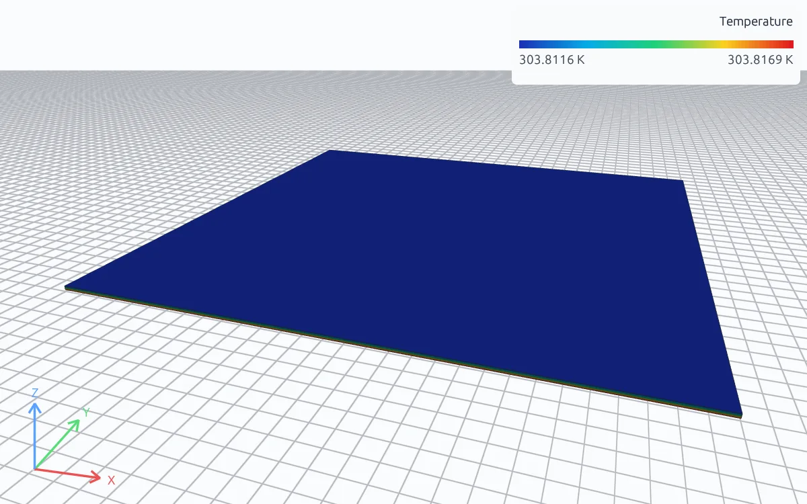

# Spacecraft radiator panel temperature: a steady radiation heat-transfer FEA study

[](https://runmat.com/sandbox?example=radiator-panel&run=0)

This study finds the steady temperature of an aluminum spacecraft radiator panel, 300 × 300 × 2 mm,
that rejects 40 W of electronics heat to deep space. Its painted front face radiates to a 3 K sink
with an emissivity of 0.92. The panel settles at 303.81 K (30.7 °C), where the radiated power
equals the input, matching the radiation balance to within 0.01 K.

<picture>
  <source media="(prefers-color-scheme: dark)" srcset=".artifacts/thumbnail.webp">
  
</picture>

## The problem

A spacecraft in vacuum can reject heat only by radiation. Radiator panels with high-emissivity paint
face deep space and carry the heat of the electronics mounted behind them. Sizing one means finding
the area and coating that hold the electronics in their operating range for a given heat load.

Radiation is nonlinear in temperature. The radiating face loses q = εσ(T⁴ − T_space⁴), so the panel
settles where

$$T = \left(\frac{q''}{\varepsilon \sigma} + T_{space}^4\right)^{1/4} = \left(\frac{444.4}{0.92 \times 5.670 \times 10^{-8}} + 3^4\right)^{1/4} = 303.8\ \text{K}$$

with q″ = 40 W / 0.09 m² = 444.4 W/m². The temperature drop through 2 mm of aluminum at that flux
is 0.005 K, so the panel is effectively one temperature. This example sets up a radiation boundary
on a real geometry and checks it against that balance.

## How the study works

1. **Geometry.** `geometry/radiator-panel.step` names the body `Radiator panel` and the faces
   `Mounting face`, `Radiating face` and `Panel edges`. Quadratic tetrahedra at a 10 mm target size.

2. **Material.** Aluminum 6061-T6, k = 167 W/m·K (ASM Handbook, Vol. 2).

3. **Heat in.** 40 W spread over the 0.09 m² back face:

   ```
   load electronics {
       thermal.heat_flux {
           target = geometry.radiator.region.mounting_face
           value = 444.444 W/m^2
       }
   }
   ```

4. **Heat out.** The front face radiates to space. White zinc-oxide silicate paint has an emissivity
   of 0.92 (Gilmore, *Spacecraft Thermal Control Handbook*, Vol. 1). The back face and edges get no
   condition, since the spacecraft's multilayer blankets insulate them:

   ```
   load to_space {
       thermal.radiation {
           target = geometry.radiator.region.radiating_face
           ambient_temperature = 3 K
           emissivity = 0.92
       }
   }
   ```

5. **Study.** A steady thermal analysis, which iterates on the nonlinear radiation term. It reports
   the temperature field and the mean temperature of the radiating face.

## Results

| Quantity | Radiation balance | Solved |
| --- | --- | --- |
| Panel temperature | 303.8 K (30.7 °C) | 303.81 K |
| Spread across the panel | 0.005 K through the thickness | 0.0053 K |
| Heat radiated | 40.0 W | 40.0 W |

The figure shows a uniform panel: the color scale spans only 303.8116 K to 303.8169 K. A real
radiator has its electronics in a few spots, and then conduction across the panel sets how much of
its area runs hot enough to radiate well.

## What to try

1. Lower `emissivity` to 0.85, as for a degraded coating. The balance gives 309.89 K.
2. Double the heat flux to 888.888 W/m² (80 W). The balance gives 361.30 K: double the power raises
   the absolute temperature by only 19 %, since radiation goes as T⁴.
3. Apply the 40 W to a small pad instead of the whole back face and see how far the hot spot spreads
   through 2 mm of aluminum.

## Files

- `radiator-panel.fea`: the study, with the radiation balance in its header.
- `materials.module`: the material the study imports, `aluminum_6061_t6`.
- `geometry/radiator-panel.step`: the panel as STEP, with the body, mounting face, radiating face and edges named.
- `runmat.toml`: the project file.

## Related

- [Thermal simulation in RunMat](https://runmat.com/simulation/thermal)
- [Steady heat transfer guide](https://runmat.com/docs/simulation/guides/steady-heat-transfer)
- [Heat spreader warm-up](../heat-spreader-warm-up) and [avionics temperature through a flight](../../aerospace/avionics-thermal)
- [Download RunMat](https://runmat.com/download)
