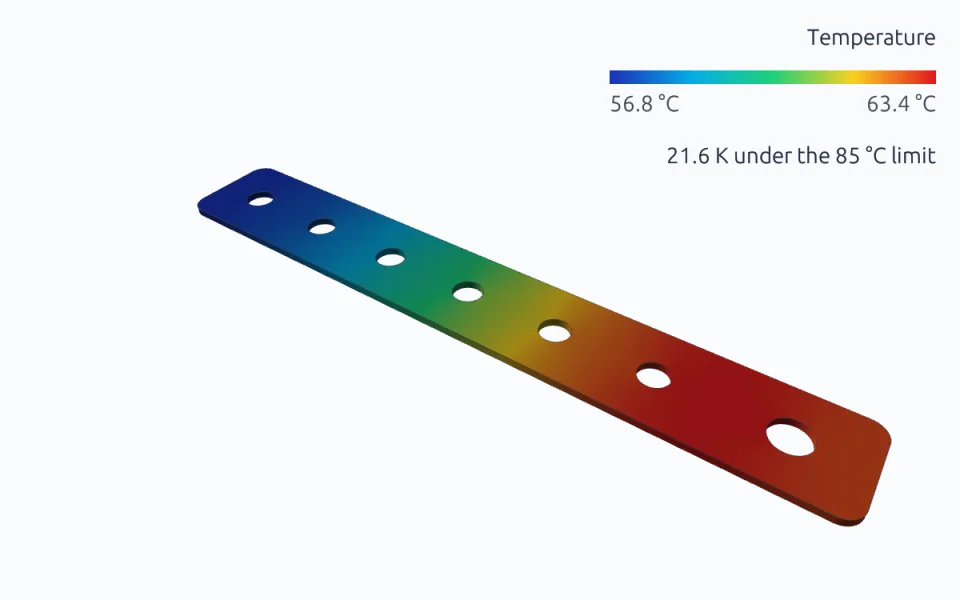

# EV battery busbar temperature at 400 A: an electrothermal FEA study of a six-bolt copper strap

[](https://runmat.com/sandbox?example=six-bolt-busbar&run=0)

This study checks a 200 × 30 × 2 mm copper busbar that collects six battery cells on M8 bolts and
hands 400 A to an M10 output bolt. It solves current flow and temperature together, with copper's
resistivity rising with temperature, in still air at 25 °C. The strap peaks at 63.4 °C between the
last cell bolt and the output bolt, 21.6 K under its 85 °C limit. The busbar is a parametric RunMat
MCAD part, exported to STEP for the study.

<picture>
  <source media="(prefers-color-scheme: dark)" srcset=".artifacts/thumbnail.webp">
  
</picture>

## The problem

A battery module's busbar must carry its rated current continuously without overheating the cell
terminals, the insulation or the plastic around it. Its section is a trade between heat and copper:
too thin and it runs hot, too thick and it adds mass and cost. Here the requirement is 400 A
continuous in still air at 25 °C (10 W/m²·K), with the strap under 85 °C.

The current grows by 66.7 A at each cell bolt, so the strap heats unevenly. With ρ = 1.72 × 10⁻⁸ Ω·m
at 20 °C and a 60 mm² section, the 27 mm spans after bolts 1 to 5 lose I²ρL/A = 0.03, 0.14, 0.31,
0.55 and 0.86 W, and the last 32 mm at 400 A loses 1.47 W: 3.36 W in all. Still air over the
strap's 12,400 mm² carries 0.124 W/K, a 27 K rise. Resistivity rising 0.39 % per kelvin lifts that
to about 31 K, so the hand estimate puts the strap at about 56 °C as one temperature.

The study takes the bolted joints as perfect contacts and the cell terminals and cable as
adiabatic, so all heat leaves by convection from the strap. Real joints add contact resistance and
real terminals sink heat; this study bounds the strap's own heating.

## How the study works

1. **The part.** `busbar.part` declares the strap's sizes and bolt layout as inputs, places six
   8.5 mm holes at a 27 mm pitch from 15 mm, and a 10.5 mm output hole 18 mm from the far end:

   ```
   input thickness : length = 2 mm
   input pitch : length = 27 mm
   input output_inset : length = 18 mm
   ```

   It is exported to `geometry/busbar.step` with its faces named `Cell bolt 1` to `Cell bolt 6`,
   `Output bolt` and `Exterior`.

2. **Mesh and material.** Linear tetrahedra at a 2 mm target size. Cu-ETP (C11000): σ = 58 MS/m at
   20 °C, temperature coefficient 0.0039 K⁻¹, k = 390 W/m·K.

3. **Loads.** 66.667 A into each cell-bolt bore, 0 V on the output bolt's bore, and still air on the
   exterior:

   ```
   load cell_6 { electric_current on geometry.busbar.region.cell_bolt_6 = 66.667 A }
   constraint ground {
       electrical.potential { target = geometry.busbar.region.output_bolt; value = 0 V }
   }
   ```

4. **Study and check.** A steady electrothermal analysis, with the peak temperature assessed
   against the limit:

   ```
   analysis operating_point { electrothermal steady {} }
   assessment stays_below_85_celsius {
       value = output.peak_temperature
       maximum = 85 degC
       evidence = authored_samples
   }
   ```

## Results

| Quantity | Value |
| --- | --- |
| Peak temperature, between cell bolt 6 and the output bolt | 63.4 °C (336.57 K) |
| Coolest point, at the first cell bolt | 56.8 °C (329.98 K) |
| Margin to the 85 °C limit | 21.6 K, assessment passes |
| Power dissipated | 4.26 W |
| Voltage at the first cell bolt | 14.7 mV |
| Peak current density, beside the cell bolt 6 hole | 15.1 A/mm² |

The figure shows the strap blue at the first cell and red toward the output end, where all 400 A
flows. The mean runs about 4 K over the hand estimate because the heat is made mostly at the output
end and spreads back along the strap. [DESIGN-NOTES.md](DESIGN-NOTES.md) records a 1.5 mm mesh
giving the same 56.8 °C and 63.4 °C.

## What to try

1. Change `thickness` in `busbar.part` to 1.5 mm, export the part to `geometry/busbar.step`, and run
   the study to see how much of the margin a thinner strap uses.
2. Raise each cell's current to 83.333 A (500 A total) and check the assessment.
3. Change the `still_air` coefficient to model forced air or a potted strap.

## Files

- `busbar.part`: the busbar in RunMat MCAD, with its length, width, thickness, bolt sizes and pitch as inputs.
- `geometry/busbar.step`: the part exported to STEP, with the body and face names the study selects.
- `six-bolt-busbar.fea`: the electrothermal study, with its hand check in the header and the 85 °C assessment.
- `materials.module`: the material the study imports, `copper_c11000`.
- `DESIGN-NOTES.md`: how the strap section and the material were chosen, with the hand checks and solved results.
- `runmat.toml`: the project file.

## Related

- [Electrothermal simulation in RunMat](https://runmat.com/simulation/electrothermal)
- [RunMat MCAD](https://runmat.com/cad) and the [model a part guide](https://runmat.com/docs/mcad/guides/model-a-part)
- [Copper busbar resistance with a bolt hole](../busbar-resistance) and [fuse element overload](../fuse-link-overload)
- [Download RunMat](https://runmat.com/download)
