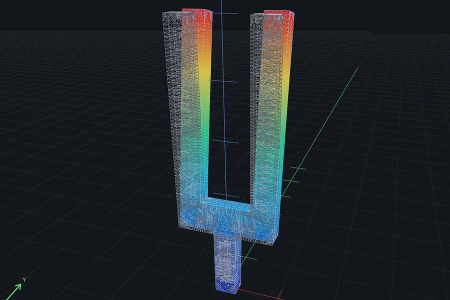

# Natural frequencies of a steel tuning fork: a modal FEA study

[](https://runmat.com/sandbox?example=tuning-fork-modal&run=0)

This study finds the first two natural frequencies and mode shapes of a steel tuning fork held at
the end of its stem. It imports the fork from a STEP file, meshes it with quadratic tetrahedra and
solves the modal eigenproblem. Mode 1 is at 364.67 Hz and mode 2 at 475.17 Hz.



## The problem

Every elastic structure has natural frequencies at which it vibrates freely once disturbed. A
tuning fork is designed so that one of them is its note. For most parts the goal is the opposite:
keep natural frequencies away from the frequencies the part will see in service, such as a motor's
running speed or a vibration test's input band.

A modal study answers two questions: at which frequencies the structure resonates, and how it moves
at each one. It needs only the geometry, the material's stiffness and density, and how the part is
held. No load is applied.

## How the study works

A `.fea` file describes the study in blocks. This one has five:

1. **Geometry.** The fork comes from `geometry/tuning-fork.step`. Regions are picked by the names
   stored in the CAD file, and each selection states how many entities it expects to find:

   ```
   region body : solid { select name "Tuning fork"; expect exactly_one }
   region fixed_end : face { select name "Fixed end"; expect exactly_one }
   ```

2. **Mesh.** Quadratic tetrahedra with a 30 mm target size, refined wherever the mesh would stray
   more than 0.1 mm from the true surface.

3. **Material.** Steel: E = 200 GPa, ν = 0.3, ρ = 7,850 kg/m³.

4. **Model.** The steel is assigned to the fork's body, and the stem's end face is fixed in every
   direction.

5. **Study.** A structural modal analysis for the first two modes. It outputs each mode's
   displacement field, the mode shape.

   ```
   analysis modes { structural modal { modes = 2 } retain basis }
   output shapes = analysis.modes.field.node.displacement
   ```

## Results

| Mode | Natural frequency |
| --- | --- |
| 1 | 364.67 Hz |
| 2 | 475.17 Hz |

Each mode shape is shown colored by relative amplitude, from 0 at the fixed stem to 1 at the
point that moves most. A mode shape has no physical amplitude of its own: it says how the
structure moves, not how far. The tips of the tines move most, and the stem barely moves.

## What to try

1. Ask for more modes with `modes = 6` and compare how each one moves the tines and the stem.
2. Change the material to aluminum (`mass_density = 2700 kg/m^3`, `youngs_modulus = 69 GPa`,
   `poisson_ratio = 0.33`). Frequency scales with the square root of E/ρ, which is almost the same
   for aluminum and steel, so the frequencies barely move.
3. Halve the mesh size to `target_size = 15 mm` and see how much the frequencies change. A small
   change means the mesh is fine enough; this is the usual mesh-convergence check.

## Files

- `tuning-fork-modal.fea`: the study: geometry, mesh, material, model and the modal analysis.
- `geometry/tuning-fork.step`: the fork's geometry, with its body and its fixed end face named.
- `tuning-fork-setup.svg`: a sketch of the setup.
- `runmat.toml`: the project file.

## Related

- [Structural simulation in RunMat](https://runmat.com/simulation/structural)
- [Modal analysis guide](https://runmat.com/docs/simulation/guides/modal-analysis) and [mesh refinement guide](https://runmat.com/docs/simulation/guides/mesh-refinement)
- [Cantilever beam frequency response](../cantilever-harmonic) and [heated bar natural frequencies](../heated-bar-modes)
- [Random vibration response of one mode](../../aerospace/random-vibration): what a natural frequency does under a random vibration test
- [Download RunMat](https://runmat.com/download)
