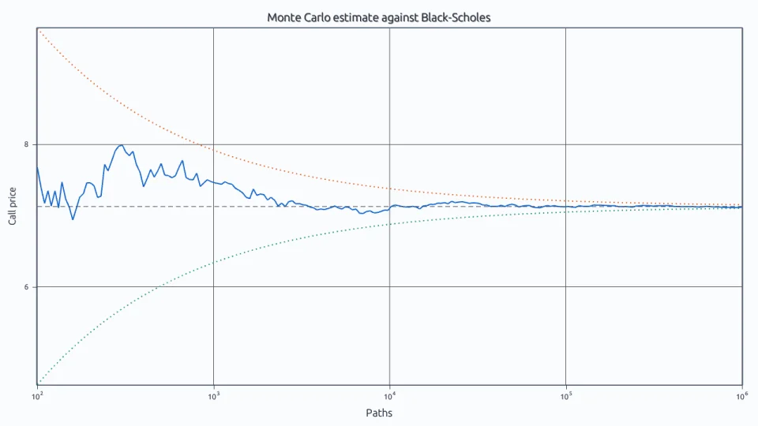

# Monte Carlo option pricing checked against Black-Scholes

[](https://runmat.com/sandbox?example=finance-bs-vs-monte-carlo)

This example prices a one-year European call (spot 100, strike 105, 3 % rate, 20 % volatility) by
simulating one million terminal prices, then checks the estimate against the closed-form
Black-Scholes price from `blsprice`. The Monte Carlo price is 7.120 with a standard error of 0.013;
Black-Scholes gives 7.128. The difference, 0.008, is within one standard error.

<picture>
  <source media="(prefers-color-scheme: dark)" srcset=".artifacts/thumbnail.webp">
  
</picture>

## The problem

Monte Carlo is the general-purpose pricer for derivatives: path-dependent payoffs, baskets and
products with no closed form. Before a simulation pricer is trusted on those, it is checked on a
contract with a known answer. The European call under geometric Brownian motion is that contract.

Under the risk-neutral measure the terminal price is

$$S_T = S_0 \exp\!\left[\left(r - \tfrac{1}{2}\sigma^2\right)T + \sigma\sqrt{T}\,Z\right],
\qquad Z \sim N(0, 1)$$

and the call price is the discounted mean payoff, e^(−rT)·E[max(S_T − K, 0)]. The sample mean of N
discounted payoffs estimates it with a standard error of s/√N, where s is the payoff standard
deviation. The estimate should land within about two standard errors of the exact price 95 % of
the time.

## How the example works

1. **Simulate one million terminal prices** with a fixed seed:

   ```matlab
   rng(42);
   Z = randn(N, 1);
   ST = S0 * exp((r - 0.5*sigma^2)*T + sigma*sqrt(T)*Z);
   ```

2. **Discount the payoffs** and form the running mean at every path count:

   ```matlab
   payoff = exp(-r*T) * max(ST - K, 0);
   running = cumsum(payoff) ./ (1:N)';
   ```

3. **Price in closed form** and compute the standard error:

   ```matlab
   call = blsprice(S0, K, r, T, sigma);
   se = std(payoff) / sqrt(N);
   ```

4. **Plot the running estimate** at 200 log-spaced path counts from 100 to 10⁶, with dotted lines
   at the Black-Scholes price ± 2 standard errors and a dashed line at the price itself.

## Results

```
Monte Carlo: 7.120 (standard error 0.013)
Black-Scholes: 7.128
```

The Monte Carlo estimate is 0.008 below the exact price, 0.6 standard errors. In the figure the
running estimate wanders well above the exact price in the first thousand paths, stays inside
the dotted two-standard-error band throughout, and lies on the dashed Black-Scholes line from
about 10⁴ paths on. The band narrows as 1/√N: every factor of 100 in paths cuts it by 10.

## What to try

1. Cut the paths to `N = 1e4`. The standard error grows by a factor of 10, to about 0.13.
2. Add antithetic variates: price with both `Z` and `-Z` and average the two payoffs, then compare
   the standard error at the same N.
3. Raise `sigma` to 0.3. Black-Scholes gives 11.112, and the standard error grows with the payoff
   spread.

## Files

- `bs-vs-monte-carlo.m`: the script: path simulation, running estimate, blsprice check and the
  convergence plot.
- `runmat.toml`: the project file.

## Related

- [Finance in RunMat](https://runmat.com/math/finance)
- [Call price surface](../call-price-surface) and [option Greeks](../greeks)
- Function reference: [`blsprice`](https://runmat.com/docs/reference/builtins/blsprice), [`randn`](https://runmat.com/docs/reference/builtins/randn), [`cumsum`](https://runmat.com/docs/reference/builtins/cumsum)
- [Download RunMat](https://runmat.com/download)
