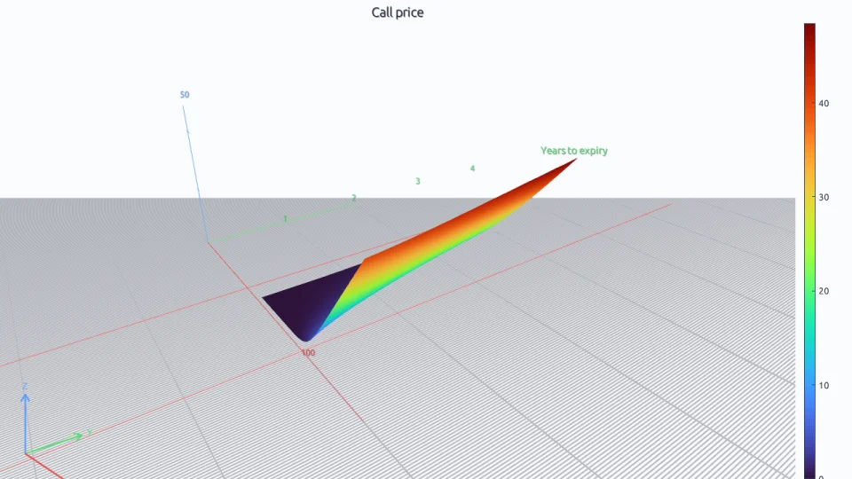

# Black-Scholes call price surface over spot and time to expiry

[](https://runmat.com/sandbox?example=finance-call-price-surface)

This example evaluates the Black-Scholes price of a European call with strike 100, a 3 % rate and
25 % volatility on a grid of 41 spot prices (60 to 140) and 40 expiries (0.05 to 2 years), with one
`blsprice` call on the whole grid, and draws the result as a surface. An at-the-money call with one
year to expiry is worth 11.35; at spot 140 with two years left the price is 48.47.

<picture>
  <source media="(prefers-color-scheme: dark)" srcset=".artifacts/thumbnail.webp">
  
</picture>

## The problem

A trader or risk manager looks at an option's price as a function of two things that change every
day: the price of the underlying and the time left to expiry. A price surface shows both at once
and makes the option's behavior easy to read: where it is nearly worthless, where it behaves like
the stock itself, and where time value is largest.

The Black-Scholes price of a European call is

$$C = S\,N(d_1) - K e^{-rT} N(d_2), \qquad
d_{1,2} = \frac{\ln(S/K) + (r \pm \tfrac{1}{2}\sigma^2)T}{\sigma\sqrt{T}}$$

where N is the standard normal CDF. Far out of the money C tends to 0. Deep in the money it tends to
the forward intrinsic value S − Ke^(−rT). Between the two, the price carries time value, which is
largest at the money and grows with √T.

## How the example works

1. **Build the grid** of spot and expiry:

   ```matlab
   K = 100;  r = 0.03;  sigma = 0.25;
   [S, T] = meshgrid(60:2:140, 0.05:0.05:2);
   ```

2. **Price every grid point in one call**; `blsprice` works element by element on arrays:

   ```matlab
   C = blsprice(S, K, r, T, sigma);
   ```

3. **Draw the surface** with smooth shading, the turbo colormap and a color bar:

   ```matlab
   surf(S, T, C);
   shading interp;
   colormap('turbo');
   colorbar;
   view(-35, 28);
   ```

4. **Print two reference prices**: at the money with one year left, and deep in the money with two.

## Results

```
At the money, one year: 11.35
Spot 140, two years: 48.47
```

At spot 140 and two years, the forward intrinsic value is 140 − 100e^(−0.06) = 45.82, and the price
sits 2.65 above it. In the surface the low-spot edge stays near zero, the high-spot edge rises
almost linearly with spot, and the color bar runs from 0 to the grid maximum, 48.47, at the
deep in-the-money, long-expiry corner. Along the short-expiry edge the surface approaches the payoff
max(S − 100, 0), with its kink at the strike.

## What to try

1. Raise `sigma` to 0.35. The one-year at-the-money price rises to 15.21.
2. Plot `C - max(S - K, 0)` to show the time value alone; it peaks near the strike.
3. Swap in `[~, P] = blsprice(...)` to draw the put surface instead.

## Files

- `call-price-surface.m`: the script: spot-expiry grid, blsprice on the grid, the surface and two
  reference prices.
- `runmat.toml`: the project file.

## Related

- [Finance in RunMat](https://runmat.com/math/finance)
- [Option Greeks](../greeks) and [Black-Scholes against Monte Carlo](../bs-vs-monte-carlo)
- Function reference: [`blsprice`](https://runmat.com/docs/reference/builtins/blsprice), [`meshgrid`](https://runmat.com/docs/reference/builtins/meshgrid), [`surf`](https://runmat.com/docs/reference/builtins/surf)
- [Download RunMat](https://runmat.com/download)
