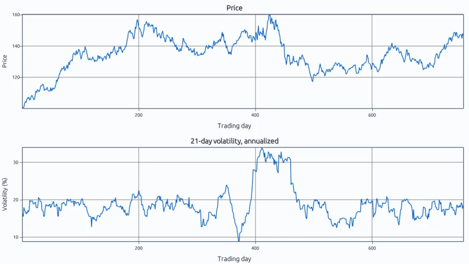

# Maximum drawdown, rolling volatility and Sharpe ratio of a price series

[](https://runmat.com/sandbox?example=finance-drawdown-and-volatility)

This example simulates three years (756 trading days) of daily returns with a 61-day stress period,
builds the price path, and measures it the way a risk report would: maximum drawdown, 21-day
rolling volatility, full-period annualized volatility and the Sharpe ratio. The worst
peak-to-trough fall is 26.8 %. Annualized volatility over the whole series is 19.3 %, and the
Sharpe ratio is 0.76.

<picture>
  <source media="(prefers-color-scheme: dark)" srcset=".artifacts/thumbnail.webp">
  
</picture>

## The problem

Return alone says little about a strategy or a fund. Investors and risk managers ask how far it
fell, how volatile it was, and how much return it earned per unit of risk. Three standard measures
answer those questions.

- **Maximum drawdown** is the largest fall from a running peak to a later trough:
  DD_t = P_t / max(P_1..P_t) − 1, and the maximum drawdown is −min DD_t.
- **Rolling volatility** is the standard deviation of daily returns over a trailing window,
  annualized by √252. A 21-day window covers about one trading month.
- **The Sharpe ratio** is mean return over its standard deviation, annualized:
  mean(r)/std(r)·√252. This example measures it against a zero risk-free rate.

The simulated returns have a daily mean of 0.08 % and volatility of 1.1 %. Days 400 to 460 get
an extra −0.2 % drift and 2 % of added noise, a stand-in for a market sell-off.

## How the example works

1. **Simulate returns and prices** with a fixed seed:

   ```matlab
   rng(7);
   ret = 0.0008 + 0.011 * randn(n, 1);
   ret(400:460) = ret(400:460) - 0.002 + 0.02 * randn(61, 1);
   price = 100 * cumprod(1 + ret);
   ```

2. **Compute the rolling volatility** and the drawdown series:

   ```matlab
   vol21 = movstd(ret, 21) * sqrt(252);
   dd = price ./ cummax(price) - 1;
   ```

3. **Plot** the price path above the 21-day annualized volatility in percent.

4. **Print** the maximum drawdown, the full-period volatility and the Sharpe ratio.

## Results

```
Maximum drawdown: 26.8%
Annualized volatility 19.3%, Sharpe ratio 0.76
```

The price climbs for the first 400 days, peaks inside the stress window and then falls sharply,
which is where the 26.8 % drawdown occurs. In the lower panel the 21-day volatility runs in a
band around the base level of 1.1 % × √252 = 17.5 % for most of the series and roughly doubles
during the stress period. The full-period figure of 19.3 % averages over both regimes; the rolling
window shows when the regime changed and for how long.

## What to try

1. Change the window to 63 days (about a quarter) and compare how sharply the stress period shows.
2. Plot `100*dd` to see the full drawdown curve and how long the recovery takes.
3. Remove the stress period by deleting the second `ret` line, and compare the drawdown and
   Sharpe ratio.

## Files

- `drawdown-and-volatility.m`: the script: simulated returns, drawdown, rolling volatility,
  Sharpe ratio and the two-panel plot.
- `runmat.toml`: the project file.

## Related

- [Finance in RunMat](https://runmat.com/math/finance)
- [Value at risk](../value-at-risk) and [efficient frontier](../efficient-frontier)
- Function reference: [`movstd`](https://runmat.com/docs/reference/builtins/movstd), [`cummax`](https://runmat.com/docs/reference/builtins/cummax), [`cumprod`](https://runmat.com/docs/reference/builtins/cumprod)
- [Download RunMat](https://runmat.com/download)
