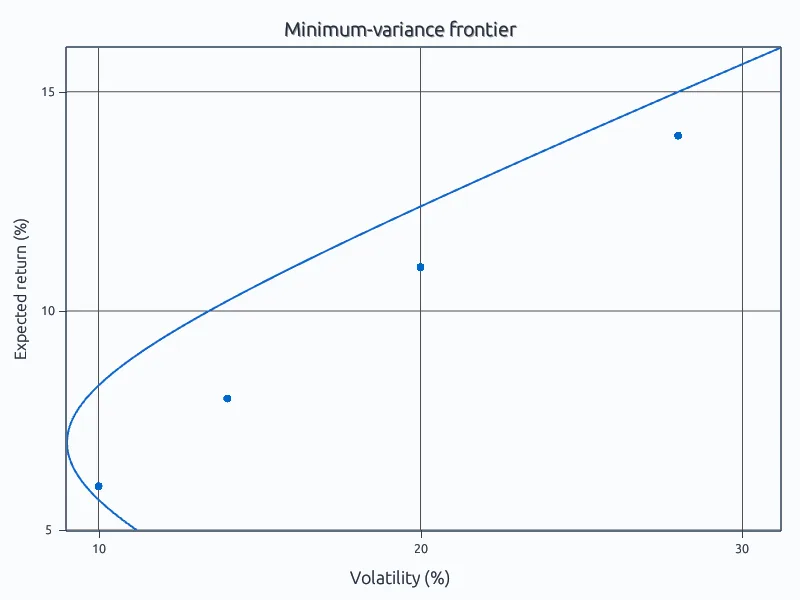

# Markowitz efficient frontier for four assets from the covariance matrix

[](https://runmat.com/sandbox?example=finance-efficient-frontier)

This example traces the minimum-variance frontier for four assets from their expected returns,
volatilities and correlations, using the closed-form solution of mean-variance optimization with
short sales allowed. The global minimum-variance portfolio returns 6.99 % at 9.02 % volatility,
lower than the 10 % volatility of the least risky asset on its own. It holds 69.0 % of that asset.

<picture>
  <source media="(prefers-color-scheme: dark)" srcset=".artifacts/thumbnail.webp">
  
</picture>

## The problem

Portfolio construction starts from the trade-off between expected return and risk. For a set of
assets with expected returns μ and covariance matrix Σ, Markowitz's question is: for each target
return m, which fully invested weights w give the smallest variance?

$$\min_w\ w^\top \Sigma w \quad \text{subject to} \quad \mathbf{1}^\top w = 1,\ \ \mu^\top w = m$$

With only those two equality constraints the answer has a closed form. Define
a = 1ᵀΣ⁻¹1, b = 1ᵀΣ⁻¹μ, c = μᵀΣ⁻¹μ and d = ac − b². The smallest achievable standard deviation
at return m is

$$\sigma(m) = \sqrt{\frac{a m^2 - 2 b m + c}{d}}$$

a hyperbola in the volatility-return plane. Its tip is the global minimum-variance portfolio, with
return b/a, volatility 1/√a and weights Σ⁻¹1 / a. The upper branch, above the tip, is the
efficient frontier.

The four assets here have expected returns of 6, 8, 11 and 14 %, volatilities of 10, 14, 20 and
28 %, and pairwise correlations from 0.1 to 0.5.

## How the example works

1. **Build the covariance matrix** from volatilities and the correlation matrix:

   ```matlab
   Sigma = (vol * vol') .* C;
   ```

2. **Compute the four scalars** with linear solves instead of an explicit inverse:

   ```matlab
   a = one' * (Sigma \ one);
   b = one' * (Sigma \ mu);
   c = mu' * (Sigma \ mu);
   d = a*c - b^2;
   ```

3. **Evaluate the frontier** for target returns from 5 % to 16 % in 0.1 % steps:

   ```matlab
   sd = sqrt((a*target.^2 - 2*b*target + c) / d);
   ```

4. **Plot the frontier** with the four assets as points, and print the minimum-variance portfolio.

## Results

```
Minimum-variance portfolio: return 6.99%, volatility 9.02%
Its weights: 0.690 0.227 0.042 0.042
```

The minimum-variance portfolio beats the least volatile asset on both counts: 0.99 points more
return for 0.98 points less volatility. Imperfect correlation is what makes that possible. In the
figure all four assets lie inside the frontier, to the right of it, so every one of them is
dominated by some combination of the four. Working the same formulas by hand, the frontier
portfolios start to sell the first asset short above an expected return of about 11.1 %, at
about 16.3 % volatility.

## What to try

1. Set all off-diagonal correlations to 0.8 and look at how far the frontier tip moves toward the
   assets.
2. Add a fifth asset by extending `mu`, `vol` and `C` and see whether the frontier moves left.
3. Print the weights for a 12 % target, `Sigma \ (lambda*one + gamma*mu)` with
   λ = (c − b·m)/d and γ = (a·m − b)/d. By the formulas they are −0.146, 0.344, 0.368 and 0.434,
   a short position in the first asset, at 18.9 % volatility.

## Files

- `efficient-frontier.m`: the script: covariance matrix, closed-form frontier, minimum-variance
  weights and the plot.
- `runmat.toml`: the project file.

## Related

- [Finance in RunMat](https://runmat.com/math/finance)
- [Value at risk](../value-at-risk) and [drawdown and volatility](../drawdown-and-volatility)
- Function reference: [`mldivide`](https://runmat.com/docs/reference/builtins/mldivide), [`scatter`](https://runmat.com/docs/reference/builtins/scatter), [`plot`](https://runmat.com/docs/reference/builtins/plot)
- [Download RunMat](https://runmat.com/download)
