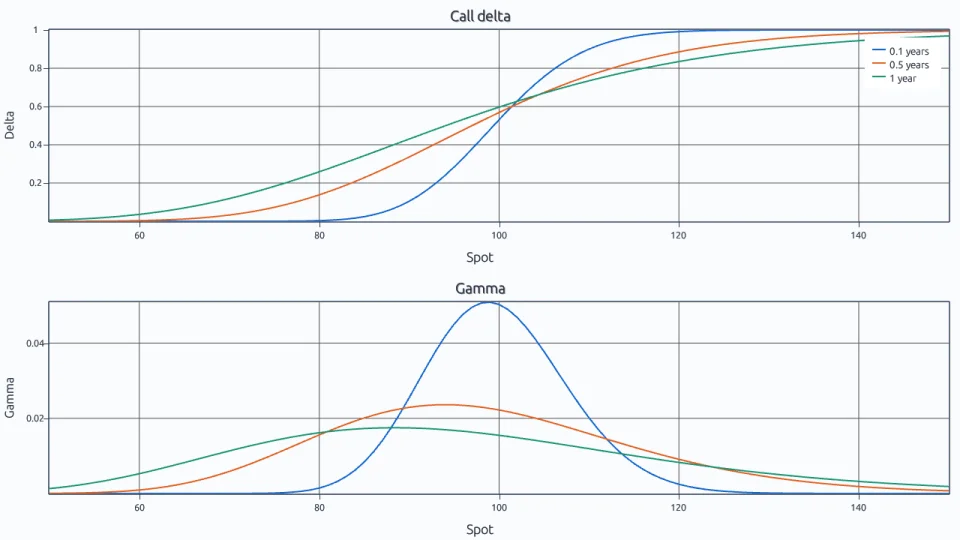

# Black-Scholes delta and gamma of a call option across spot and expiry

[](https://runmat.com/sandbox?example=finance-greeks)

This example computes the delta and gamma of a European call (strike 100, 3 % rate, 25 %
volatility) from the Black-Scholes formulas for spot prices from 50 to 150 and three expiries, then
checks delta against a finite difference of `blsprice`. At the money with one year left, delta is
0.5968 by both routes. At the money, gamma for the shortest
expiry, 0.1 years, is 0.0503, the tallest of the three gamma curves.

<picture>
  <source media="(prefers-color-scheme: dark)" srcset=".artifacts/thumbnail.webp">
  
</picture>

## The problem

An options desk hedges with the Greeks, the sensitivities of the option price to its inputs.
Delta, ∂C/∂S, is the number of shares that offsets a small move in the underlying. Gamma, ∂²C/∂S²,
is how fast delta changes, which sets how often the hedge has to be rebalanced and how much a
large move costs. For a European call under Black-Scholes:

$$\Delta = N(d_1), \qquad \Gamma = \frac{\varphi(d_1)}{S\,\sigma\sqrt{T}}, \qquad
d_1 = \frac{\ln(S/K) + (r + \tfrac{1}{2}\sigma^2)T}{\sigma\sqrt{T}}$$

where N is the standard normal CDF and φ its density. A finite difference of the pricing formula,
[C(S + h) − C(S − h)] / 2h, gives an independent check on delta.

## How the example works

1. **Evaluate d₁ on a spot-by-expiry grid**. `S` is a 101-element column and `T` a 3-element row,
   so the expression broadcasts to a 101 × 3 matrix:

   ```matlab
   S = (50:1:150)';
   T = [0.1 0.5 1];
   d1 = (log(S / K) + (r + sigma^2/2) * T) ./ (sigma * sqrt(T));
   ```

2. **Form delta and gamma**:

   ```matlab
   delta = normcdf(d1);
   gamma = normpdf(d1) ./ (S * sigma .* sqrt(T));
   ```

3. **Plot** delta above and gamma below, one curve per expiry.

4. **Check delta** at the money with a central difference of `blsprice`, h = 0.01:

   ```matlab
   fd = (blsprice(100 + h, K, r, 1, sigma) - blsprice(100 - h, K, r, 1, sigma)) / (2*h);
   ```

## Results

```
Delta at the money, one year: 0.5968 (from blsprice: 0.5968)
Gamma at the money, 0.1 years: 0.0503
```

The formula and the finite difference agree to four decimal places. At-the-money delta sits above
0.5 because the positive rate and the volatility term push d₁ above zero. In the figure the
0.1-year delta curve is the steepest S-curve, switching from 0 to 1 in a narrow band around the
strike, while the one-year curve is the gentlest. Gamma mirrors that: the 0.1-year curve is a tall,
narrow peak near the strike, and the longer expiries are lower and wider. By the formula, each
curve peaks slightly below the strike, at S = K·e^(−(r + 1.5σ²)T): 98.8 for 0.1 years, 94.0 for
0.5 and 88.4 for one year.

## What to try

1. Add vega, `S .* normpdf(d1) .* sqrt(T)`, as a third panel. For one year at the money the
   formula gives 38.71 per unit of volatility, 0.39 per volatility point.
2. Shrink `h` to 1e-6 and look at whether the finite-difference delta still agrees.
3. Add T = 0.02 years (about a week). Gamma at the money rises to 0.1128 by the formula.

## Files

- `greeks.m`: the script: delta and gamma on the grid, the plots and the blsprice check.
- `runmat.toml`: the project file.

## Related

- [Finance in RunMat](https://runmat.com/math/finance)
- [Call price surface](../call-price-surface) and [volatility smile](../volatility-smile)
- Function reference: [`blsprice`](https://runmat.com/docs/reference/builtins/blsprice), [`normcdf`](https://runmat.com/docs/reference/builtins/normcdf), [`normpdf`](https://runmat.com/docs/reference/builtins/normpdf)
- [Download RunMat](https://runmat.com/download)
