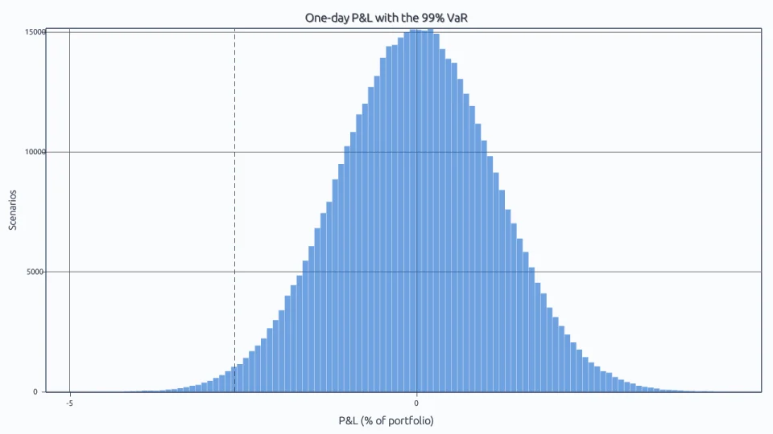

# One-day 99 % value at risk and expected shortfall by Monte Carlo simulation

[](https://runmat.com/sandbox?example=finance-value-at-risk)

This example simulates 500,000 one-day scenarios for a portfolio of three correlated assets and
reads the 99 % value at risk (VaR) and expected shortfall (ES) from the simulated profit and loss.
The 99 % VaR is 2.63 % of portfolio value and the expected shortfall is 3.00 %. The normal closed
form gives 2.63 % and 3.01 %, confirming the simulation.

<picture>
  <source media="(prefers-color-scheme: dark)" srcset=".artifacts/thumbnail.webp">
  
</picture>

## The problem

Banks, funds and treasury desks report how much they could lose on a bad day. VaR at 99 % is the
loss exceeded on only 1 % of days. Expected shortfall is the average loss on those worst 1 % of
days, so it also reflects how bad the tail is beyond the VaR line. Regulators have moved trading
book capital from VaR toward expected shortfall for that reason.

The portfolio holds 50 %, 30 % and 20 % in three assets with daily volatilities of 1.2 %, 2.0 % and
0.8 % and correlations from 0.2 to 0.6. Correlated scenarios come from the Cholesky factor of the
covariance matrix: if Σ = RᵀR and Z has independent standard normal rows, then ZR has covariance Σ.

For normally distributed P&L with standard deviation σ_p the closed forms are

$$\text{VaR}_{99} = z_{0.99}\,\sigma_p, \qquad
\text{ES}_{99} = \sigma_p\,\frac{\varphi(z_{0.99})}{0.01}, \qquad z_{0.99} = 2.326$$

Simulation reaches the same answer here, and carries over unchanged to fat-tailed returns,
options and other positions with no closed form.

## How the example works

1. **Build the covariance matrix** from volatilities and correlations, and factor it:

   ```matlab
   Sigma = (vol * vol') .* C;
   R = chol(Sigma);
   ```

2. **Simulate portfolio P&L** for 500,000 scenarios with a fixed seed:

   ```matlab
   rng(11);
   pnl = (randn(500000, 3) * R) * w;
   ```

3. **Read VaR and ES** from the simulated tail:

   ```matlab
   var99 = -prctile(pnl, 1);
   es99 = -mean(pnl(pnl <= -var99));
   ```

4. **Plot the P&L histogram** in 120 bins with a dashed `xline` at the VaR, and print the closed
   form for comparison.

## Results

```
99% VaR 2.63%, expected shortfall 3.00% of portfolio value
Normal closed form: VaR 2.63%, expected shortfall 3.01%
```

Simulation and closed form agree to 0.01 % of portfolio value. Expected shortfall is 14 % larger
than VaR, the ratio a normal tail gives at 99 %. The portfolio's daily volatility from the
covariance matrix is 1.13 %, against 1.36 % if the three assets moved together: correlations below
1 cut the risk by about a sixth. In the figure the dashed VaR line sits well out in the left tail
of the bell-shaped histogram, with 1 % of the scenarios to its left.

## What to try

1. Scale to a 10-day horizon by multiplying the one-day VaR by √10. By the closed form that gives
   8.30 %.
2. Replace `randn` with Student-t draws (for example `trnd(4, 500000, 3)` scaled to unit variance)
   and compare the VaR and ES with the normal case.
3. Raise all correlations to 0.9 and look at how much the VaR grows.

## Files

- `value-at-risk.m`: the script: covariance and Cholesky factor, scenario simulation, VaR and ES,
  the histogram and the closed-form check.
- `runmat.toml`: the project file.

## Related

- [Finance in RunMat](https://runmat.com/math/finance)
- [Drawdown and volatility](../drawdown-and-volatility) and [efficient frontier](../efficient-frontier)
- Function reference: [`chol`](https://runmat.com/docs/reference/builtins/chol), [`prctile`](https://runmat.com/docs/reference/builtins/prctile), [`histogram`](https://runmat.com/docs/reference/builtins/histogram)
- [Download RunMat](https://runmat.com/download)
