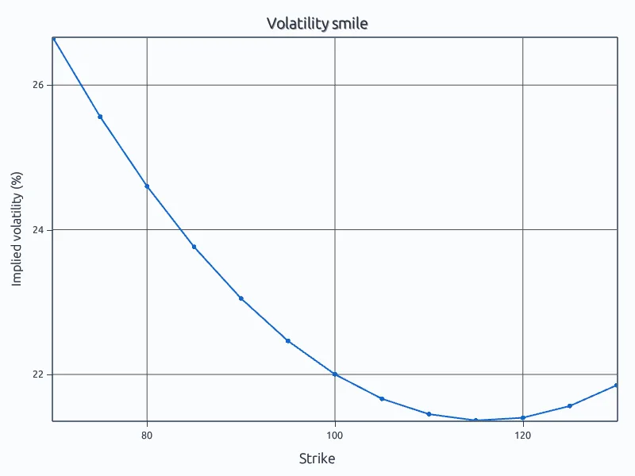

# Implied volatility smile from option prices with blsimpv

[](https://runmat.com/sandbox?example=finance-volatility-smile)

This example prices six-month calls at 13 strikes from 70 to 130 using a known, strike-dependent
volatility, then inverts the Black-Scholes formula with `blsimpv` to recover the implied volatility
from each price. The recovered smile is 22.0 % at the money and 21.8 % at the 130 strike, 30 % out
of the money, and every recovered value is within 2.0 × 10⁻⁷ of the volatility that set the price.

<picture>
  <source media="(prefers-color-scheme: dark)" srcset=".artifacts/thumbnail.webp">
  
</picture>

## The problem

Option markets quote prices, but traders compare options by implied volatility: the σ that makes
the Black-Scholes formula reproduce the market price. If Black-Scholes held exactly, every strike
would imply the same volatility. In practice implied volatility varies with strike. Equity index
options show a skew, with low strikes trading at higher volatility, and many markets show a smile
that turns up on both sides.

Black-Scholes has no closed-form inverse in σ, so implied volatility comes from a root search on
C_BS(σ) = C_market for each strike. The call price rises monotonically with σ, so the root is
unique. This example tests that inversion on a known answer. The volatility used to set the prices
is a quadratic in moneyness m = (K − S₀)/S₀:

$$\sigma(m) = 0.22 + 0.25\,m^2 - 0.08\,m$$

The m² term makes the smile and the −0.08m term tilts it into a skew toward low strikes.

## How the example works

1. **Set the strikes and the volatility** for each one:

   ```matlab
   S0 = 100;  r = 0.02;  T = 0.5;
   K = (70:5:130)';
   m = (K - S0) / S0;
   trueVol = 0.22 + 0.25*m.^2 - 0.08*m;
   ```

2. **Price the calls**, one volatility per strike:

   ```matlab
   price = blsprice(S0, K, r, T, trueVol);
   ```

3. **Invert the prices** back to implied volatility:

   ```matlab
   iv = blsimpv(S0, K, r, T, price);
   ```

4. **Plot the smile** against strike and print the largest recovery error.

## Results

```
At the money: 22.0%, 30% out of the money: 21.8%
Largest error in the recovered volatility: 2.0e-07
```

The largest error is 2 × 10⁻⁷ in volatility, or 2 × 10⁻⁵ volatility points. The figure shows a skewed smile: implied volatility is highest at the lowest strike,
26.65 % at 70 by the formula, falls through 22.0 % at the money, bottoms out near the 115 strike
and turns up again toward 130. From the formula the minimum is at m = 0.16, strike 116, at 21.36 %.

## What to try

1. Set the skew term to zero, `trueVol = 0.22 + 0.25*m.^2`, and the smile becomes symmetric about
   the 100 strike.
2. Add noise to the prices, `price .* (1 + 0.001*randn(size(price)))`, and look at which strikes'
   implied volatilities move most.
3. Shorten the expiry to `T = 0.1` and check whether `blsimpv` still recovers the deep in- and
   out-of-the-money strikes.

## Files

- `volatility-smile.m`: the script: strike-dependent volatility, blsprice, blsimpv inversion and
  the smile plot.
- `runmat.toml`: the project file.

## Related

- [Finance in RunMat](https://runmat.com/math/finance)
- [Option Greeks](../greeks) and [call price surface](../call-price-surface)
- Function reference: [`blsimpv`](https://runmat.com/docs/reference/builtins/blsimpv), [`blsprice`](https://runmat.com/docs/reference/builtins/blsprice), [`plot`](https://runmat.com/docs/reference/builtins/plot)
- [Download RunMat](https://runmat.com/download)
